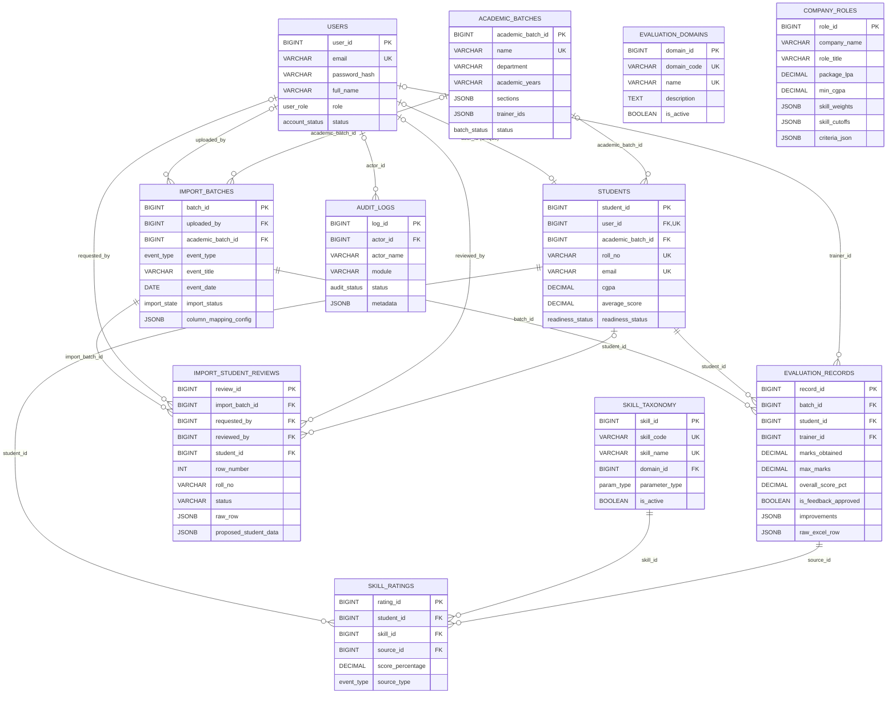

# PlacePro Database Schema Design

This design documents the PostgreSQL schema in [`schema.updated.sql`](./schema.updated.sql).
The diagram focuses on persisted entities, primary keys, foreign keys, and their cardinalities.

## Entity relationship diagram

`||` denotes exactly one, `o|` zero or one, and `o{` zero or many. Optional foreign keys
are nullable; required foreign keys are not nullable.

## Relationship and lifecycle notes

- A student can optionally be linked to one user account and one academic batch. The unique
  constraint on `students.user_id` makes the account-to-student relationship one-to-one.
- An import batch belongs optionally to an uploader and an academic batch. It can contain
  student review rows and evaluation records.
- Evaluation records pair a student with an import batch. The unique constraint on
  `(batch_id, student_id)` permits at most one evaluation per student per import batch.
- Skill ratings belong to a student, a taxonomy skill, and an evaluation record. A rating's
  `source_type` is stored as an event type, but `source_id` is constrained to
  `evaluation_records.record_id`.
- Company roles store their skill requirements and criteria as JSONB. There is no
  foreign-key relationship from those JSON documents to `skill_taxonomy`.
- Delete behavior follows the SQL constraints: deleting users or academic batches preserves
  dependent rows by setting optional references to `NULL`; deleting import batches,
  students, skills, or evaluation records cascades to the dependent rows specified in the
  schema.

## JSONB attributes

The following columns are flexible documents or arrays, not separate relational entities:

- `academic_batches.sections`, `academic_batches.trainer_ids`
- `students.persona_badges`, `students.custom_profile_fields`
- `import_batches.headers`, `raw_preview_rows`, `validation_issues`,
  `column_mapping_config`
- `import_student_reviews.raw_row`, `proposed_student_data`
- `evaluation_records.improvements`, `raw_excel_row`, `custom_attributes`
- `company_roles.skill_weights`, `skill_cutoffs`, `criteria_json`
- `audit_logs.metadata`

JSONB contents are not validated by foreign keys. In particular, `trainer_ids` and
company-role skill identifiers do not enforce references to users or skills.
