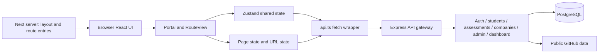
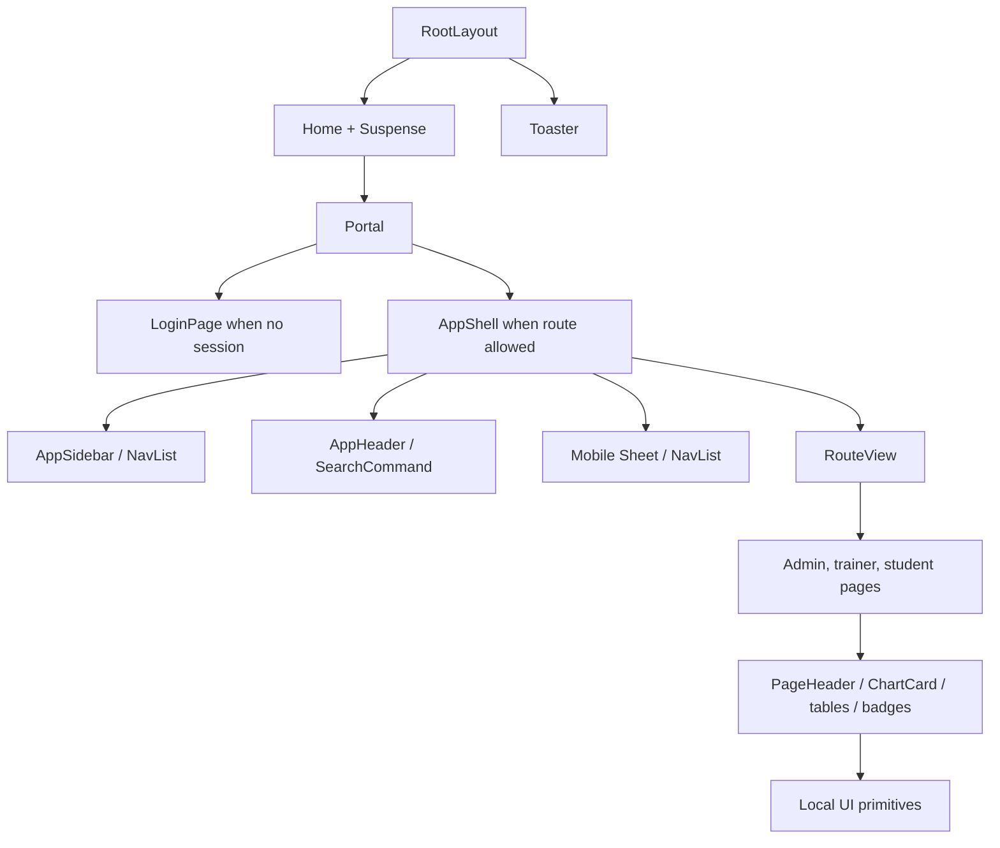
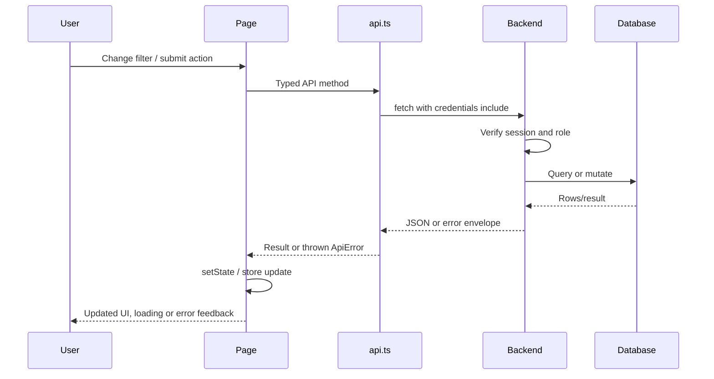
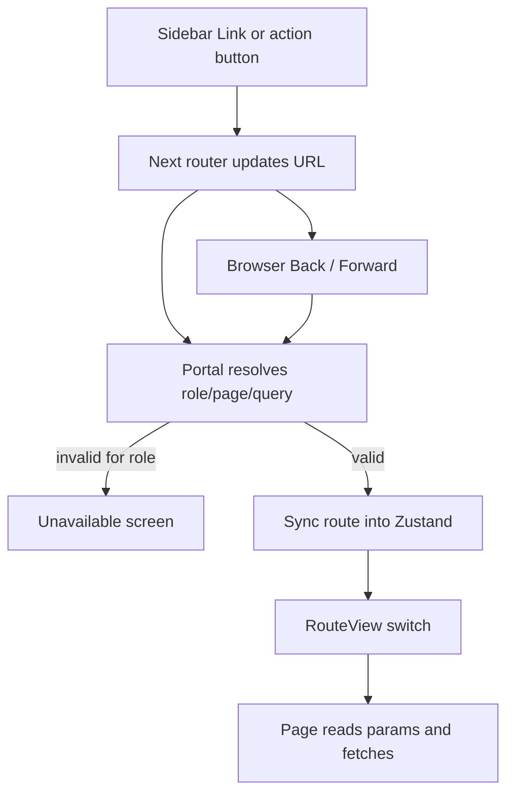
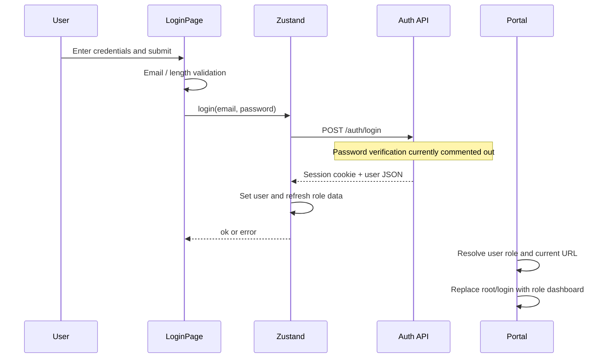
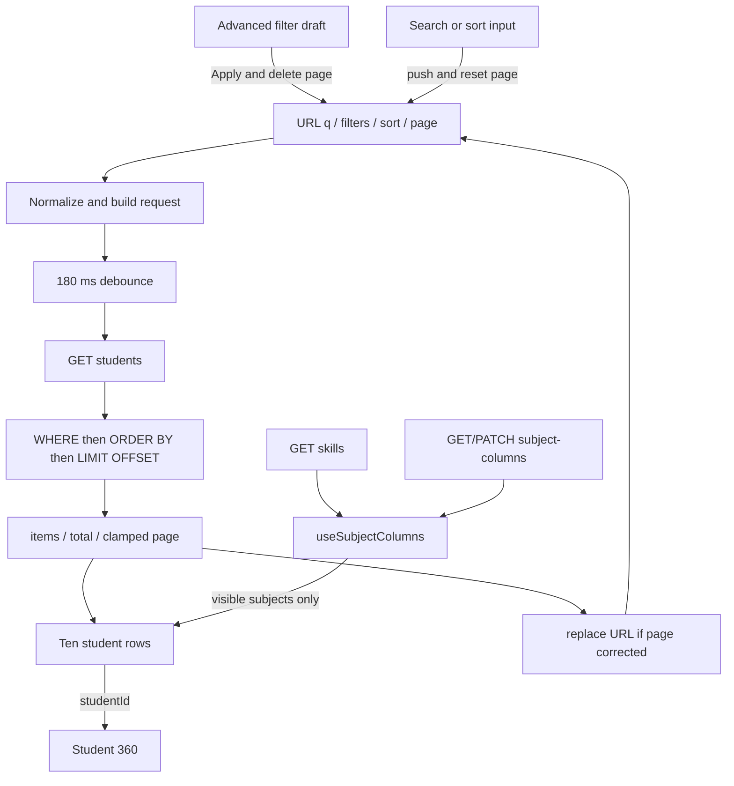
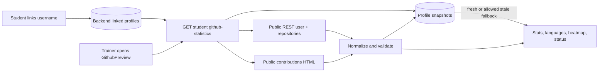

# PlacePro Frontend — Complete Study Guide

Source-based learning guide · 18 November 2026

30 chapters · 18 role pages · 100 interview-bank questions · 20 annotated code walkthroughs · 3 mock viva sessions

## Table of contents

- [Chapter 1: Introduction to PlacePro](#chapter-1)
- [Chapter 2: Complete Frontend Technology Stack](#chapter-2)
- [Chapter 3: Frontend Folder Structure](#chapter-3)
- [Chapter 4: Frontend Architecture](#chapter-4)
- [Chapter 5: React and Framework Concepts Used](#chapter-5)
- [Chapter 6: Routing and Navigation](#chapter-6)
- [Chapter 7: Authentication and Authorization](#chapter-7)
- [Chapter 8: Complete Page-by-Page Explanation](#chapter-8)
- [Chapter 9: Component-by-Component Explanation](#chapter-9)
- [Chapter 10: API Integration](#chapter-10)
- [Chapter 11: State Management](#chapter-11)
- [Chapter 12: Student Table Deep Dive](#chapter-12)
- [Chapter 13: Student 360° Profile](#chapter-13)
- [Chapter 14: GitHub Statistics Integration](#chapter-14)
- [Chapter 15: Admin Domain and Parameter Management](#chapter-15)
- [Chapter 16: Charts and Data Visualization](#chapter-16)
- [Chapter 17: Styling and Responsive Design](#chapter-17)
- [Chapter 18: Forms and Validation](#chapter-18)
- [Chapter 19: Error Handling and Debugging](#chapter-19)
- [Chapter 20: Performance Optimization](#chapter-20)
- [Chapter 21: Security Considerations](#chapter-21)
- [Chapter 22: Build, Environment and Deployment](#chapter-22)
- [Chapter 23: Important Code Walkthroughs](#chapter-23)
- [Chapter 24: Frontend Interview Questions and Answers](#chapter-24)
- [Chapter 25: Difficult Viva and Cross-Questions](#chapter-25)
- [Chapter 26: Complete Frontend Execution Walkthrough](#chapter-26)
- [Chapter 27: Limitations and Future Improvements](#chapter-27)
- [Chapter 28: Revision Notes and Cheat Sheets](#chapter-28)
- [Chapter 29: Mock Viva Sessions](#chapter-29)
- [Chapter 30: Structured Learning Roadmap](#chapter-30)

<a id="chapter-1"></a>

## Chapter 1: Introduction to PlacePro

### What the application does

PlacePro centralizes university placement preparation. Administrators configure users, cohorts, evaluation domains, subjects and company criteria. Trainers import assessment spreadsheets, inspect students, review projects and compare candidates against company requirements. Students see their own academic performance, approved feedback and linked GitHub/project information.

A beginner can think of the frontend as the interactive reception desk: it collects requests, explains results and offers actions. The backend checks permissions, queries records and applies business rules. The database retains those records. A green badge is a presentation of readiness, not the place where readiness becomes authoritative.

#### Verified responsibilities and boundaries

- **Browser:** React components, form drafts, URL filters, tables, charts, popovers, local spreadsheet parsing and downloadable text/CSV files.
- **Next.js frontend server:** root layout, document metadata, route entry files and standalone deployment. It is not the business API gateway.
- **Express backend:** authentication, role checks, student queries, imports, matching, GitHub requests and project scoring.
- **PostgreSQL:** business data accessed through the backend pool. The frontend also contains a Prisma/SQLite scaffold; it is not the active browser-to-business-data path.

Follow [src/components/placepro/portal.tsx](src/components/placepro/portal.tsx), [src/lib/placepro/api.ts](src/lib/placepro/api.ts) and [the backend gateway](../placepro-backend/src/gateway/app.js). Ignore stale comments saying the project will be wired to a backend later: it already calls a backend.

#### Major user journeys

An administrator creates a domain, adds parameters under it, and configures default visible subjects. A trainer selects a batch, stages an assessment spreadsheet, maps columns and confirms it. Student listings show backend scores and readiness. A trainer opens a 360° profile, checks evidence and reviews submitted projects. Students link GitHub from Profile Intelligence, verify ownership and submit repositories. Company matching separates mandatory eligibility from weighted compatibility.

#### A professional 60-second introduction

“PlacePro is a placement intelligence platform for a university placement cell. It brings student performance, assessment imports, trainer feedback and company criteria into one interface. I use Next.js and React with TypeScript for the frontend, Zustand for shared session and domain state, Tailwind and reusable Radix-based components for the UI, and Recharts for visual analysis. Administrators manage configuration, trainers evaluate students and generate shortlists, and students inspect their own progress and submit GitHub projects. The frontend talks to an Express API gateway using a session cookie. Filtering and sorting on the trainer student list happen on the server, while the URL preserves the selected view. Readiness and project scoring are backend responsibilities. The prototype also has known limitations, including authentication code that needs correction and inconsistent mutation feedback; I can explain those honestly rather than claiming production readiness.”

#### Reading conventions

Paths in this guide are relative to the frontend root. Backend links start with ../placepro-backend. “Implemented” means found in source, not proven in a live deployment. “Recommendation” means proposed future work. Dependency versions below are manifest declarations, with resolved versions separately identified. Code excerpts are copied from the inspected checkout; line numbers can move after later edits. Review date: 18 November 2026.

This is a source-based study, not a penetration test or live integration certification. No application functionality was modified. Kluster could not start because its connector reported connectionError; no successful Kluster review is claimed.

---

<a id="chapter-2"></a>

## Chapter 2: Complete Frontend Technology Stack

### The verified stack

A dependency in package.json means available to the project, not necessarily used by an active screen. This distinction prevents misleading interview answers.

| Technology | What and how | PlacePro evidence | Alternatives and defensible tradeoff | Interview prompt |
|---|---|---|---|---|
| Next.js ^16.1.1 | React framework with file routes, server/client boundaries and build output | app/layout.tsx, page.tsx, [...path]/page.tsx, next.config.ts | Vite + React Router gives more explicit SPA setup; Next provides routing and packaging together. Historical choice was not documented. | What does Next add to React? |
| React ^19 and react-dom ^19 | Declarative components produce UI from props/state; DOM reconciliation updates changed output | All TSX portal screens | Vue/Svelte/Angular can implement the same product; reusable React components fit the existing code | Does a rerender replace the whole DOM? |
| TypeScript ^5 | Static types describe contracts before runtime | types/index.ts, API generics, role unions | JavaScript needs fewer annotations but loses compile-time checks; types do not validate incoming JSON | Why can typed API data still crash? |
| Zustand ^5.0.6 | External store with selector subscriptions and actions | lib/placepro/store.ts | Context + reducer or Redux Toolkit; Zustand avoids a custom root provider and extensive action boilerplate here | Local state versus store? |
| Native fetch | Browser HTTP API returning promises | api.ts request<T> | Axios could add interceptors; current wrapper centralizes cookies and error handling without Axios | Why check response.ok? |
| Tailwind CSS ^4, @tailwindcss/postcss, tw-animate-css | Utility CSS and CSS-first theme tokens compiled via PostCSS | globals.css and postcss.config.mjs | CSS Modules, Sass or CSS-in-JS; utilities suit the repeated grid/card layouts | Where do colors come from? |
| Local shadcn-style UI and Radix primitives | Repository-owned wrappers compose accessible interaction primitives | components/ui, components.json | MUI/Chakra provide larger themed systems; local wrappers allow direct styling changes | What does asChild do? |
| class-variance-authority, clsx, tailwind-merge | Select style variants, conditionally assemble class strings and resolve utility conflicts | ui/button.tsx and lib/utils.ts | Manual strings work but duplicate branching | Why use cn? |
| lucide-react ^0.525.0 | SVG icons exposed as React components | nav.ts and page imports | Other icon sets or custom SVG; consistent shapes and size classes | How do you label icon-only controls? |
| Recharts ^2.15.4 | React composition of SVG charts, axes, cells and tooltips | dashboards, student profile, performance page | Chart.js/ECharts/D3; declarative chart JSX fits this React interface | Why must the container have height? |
| xlsx ^0.18.5 | Reads spreadsheet workbooks and converts the first sheet to a grid | trainer/import-workflow.tsx | Server-only parsing or CSV-only parser; local parsing enables immediate mapping and validation | Which parser is authoritative? |
| cmdk ^1.1.1 | Command menu filtering and keyboard interaction | ui/command.tsx, AppHeader SearchCommand | Custom searchable dialog; cmdk provides the interaction foundation | Is global search querying every student? |
| next/font/google | Next font integration configuring Geist and Geist Mono variables | app/layout.tsx | System fonts or local font files; current choice standardizes typography | Can font retrieval affect builds? |
| ESLint 9 + eslint-config-next | Source lint configuration | eslint.config.mjs | Other linters; many rules are disabled here, so lint success is limited evidence | What does lint not verify? |
| Node built-in test runner + TypeScript transpilation | Small route utility tests execute without a browser | tests/routing.test.mjs | Vitest/Jest and browser tests could broaden coverage | What is not covered by unit tests? |

#### Present in reusable scaffolding, not established as portal features

react-hook-form is imported by ui/form.tsx, but PlacePro business forms use useState and manual validation. next-themes and sonner appear in the alternate ui/sonner.tsx wrapper; the root mounts ui/toaster.tsx and useToast instead. Embla, react-day-picker, date-fns, input-otp, react-resizable-panels and vaul support carousel/calendar/OTP/panel/drawer wrappers. Their presence does not imply a booking feature, OTP login or resizable dashboard.

Context API and useCallback occur in generic UI wrappers such as sidebar.tsx and carousel.tsx. PlacePro's actual AppSidebar is a separate custom component. Do not describe the generic SidebarProvider cookie as the persistence mechanism for the active PlacePro sidebar.

#### Installed without an active business-flow import

The manifest also includes TanStack Query, TanStack Table, next-auth, next-intl, zod, @hookform/resolvers, @dnd-kit packages, @mdxeditor/editor, @reactuses/core, framer-motion, react-markdown, react-syntax-highlighter, uuid and z-ai-web-dev-sdk. Inspection does not establish these as active portal implementations. In particular, there is no React Query provider, NextAuth login integration, TanStack student table, Zod response parsing or drag-and-drop sorting of students. The upload area uses native drag/drop events.

Prisma/@prisma/client belong to lib/db.ts and schema scaffolding. sharp is installed; the GitHub preview uses a plain img rather than next/image. tailwindcss-animate appears in the older tailwind.config.ts, while the active globals.css imports tw-animate-css. Do not conflate the two configurations.

#### Explaining a choice without inventing history

Say “This choice is appropriate because...” when discussing architectural fit. Do not say “We benchmarked and selected...” unless such measurements exist. Next's server/client model is described in its [official component guide](https://nextjs.org/docs/app/getting-started/server-and-client-components); the repository-specific boundary is Portal, which uses browser hooks and effects.

#### Installed versions in this workspace

- next: 16.4.3
- react: 19.3.1
- react-dom: 19.3.1
- typescript: 5.9.3
- zustand: 5.0.16
- tailwindcss: 4.3.3
- recharts: 2.15.4
- xlsx: 0.18.5

These were read from node_modules metadata. A caret declaration such as ^16.1.1 does not mean the installed version is exactly 16.1.1. The installed Next documentation was consulted for promise-based params and server/client routing behavior.

---

<a id="chapter-3"></a>

## Chapter 3: Frontend Folder Structure

### Source tree and reading order

Start with app → Portal → RouteView → one page → api/store → backend handler. Do not begin with hundreds of UI utility lines before understanding a real request.

The following inventory includes every file under src in the inspected checkout. Directory indentation identifies ownership. Generated build output, dependency folders, logs and tsbuildinfo are deliberately excluded.

```text
placepro-frontend/
  src/app/[...path]/page.tsx
  src/app/api/route.ts
  src/app/global-error.tsx
  src/app/globals.css
  src/app/layout.tsx
  src/app/page.tsx
  src/components/placepro/admin/admin-dashboard.tsx
  src/components/placepro/admin/audit-logs-page.tsx
  src/components/placepro/admin/batch-management-page.tsx
  src/components/placepro/admin/company-requirements-page.tsx
  src/components/placepro/admin/manage-domains-page.tsx
  src/components/placepro/admin/skill-config-page.tsx
  src/components/placepro/admin/student-verification-requests.tsx
  src/components/placepro/admin/user-management-page.tsx
  src/components/placepro/auth/login-page.tsx
  src/components/placepro/portal.tsx
  src/components/placepro/route-view.tsx
  src/components/placepro/shared/badges.tsx
  src/components/placepro/shared/controls.tsx
  src/components/placepro/shared/misc.tsx
  src/components/placepro/shared/page-header.tsx
  src/components/placepro/shared/stat-card.tsx
  src/components/placepro/shared/states.tsx
  src/components/placepro/shell/app-header.tsx
  src/components/placepro/shell/app-shell.tsx
  src/components/placepro/shell/app-sidebar.tsx
  src/components/placepro/shell/nav-list.tsx
  src/components/placepro/student/interview-feedback-page.tsx
  src/components/placepro/student/my-performance-page.tsx
  src/components/placepro/student/my-profile-page.tsx
  src/components/placepro/student/profile-intelligence-page.tsx
  src/components/placepro/student/student-dashboard.tsx
  src/components/placepro/trainer/assessments-page.tsx
  src/components/placepro/trainer/company-matching-page.tsx
  src/components/placepro/trainer/github-preview.tsx
  src/components/placepro/trainer/import-workflow.tsx
  src/components/placepro/trainer/student-filter-panel.tsx
  src/components/placepro/trainer/student-profile-page.tsx
  src/components/placepro/trainer/students-page.tsx
  src/components/placepro/trainer/trainer-dashboard.tsx
  src/components/placepro/trainer/use-subject-columns.tsx
  src/components/ui/accordion.tsx
  src/components/ui/alert-dialog.tsx
  src/components/ui/alert.tsx
  src/components/ui/aspect-ratio.tsx
  src/components/ui/avatar.tsx
  src/components/ui/badge.tsx
  src/components/ui/breadcrumb.tsx
  src/components/ui/button.tsx
  src/components/ui/calendar.tsx
  src/components/ui/card.tsx
  src/components/ui/carousel.tsx
  src/components/ui/chart.tsx
  src/components/ui/checkbox.tsx
  src/components/ui/collapsible.tsx
  src/components/ui/command.tsx
  src/components/ui/context-menu.tsx
  src/components/ui/dialog.tsx
  src/components/ui/drawer.tsx
  src/components/ui/dropdown-menu.tsx
  src/components/ui/form.tsx
  src/components/ui/hover-card.tsx
  src/components/ui/input-otp.tsx
  src/components/ui/input.tsx
  src/components/ui/label.tsx
  src/components/ui/menubar.tsx
  src/components/ui/navigation-menu.tsx
  src/components/ui/pagination.tsx
  src/components/ui/popover.tsx
  src/components/ui/progress.tsx
  src/components/ui/radio-group.tsx
  src/components/ui/resizable.tsx
  src/components/ui/scroll-area.tsx
  src/components/ui/select.tsx
  src/components/ui/separator.tsx
  src/components/ui/sheet.tsx
  src/components/ui/sidebar.tsx
  src/components/ui/skeleton.tsx
  src/components/ui/slider.tsx
  src/components/ui/sonner.tsx
  src/components/ui/switch.tsx
  src/components/ui/table.tsx
  src/components/ui/tabs.tsx
  src/components/ui/textarea.tsx
  src/components/ui/toast.tsx
  src/components/ui/toaster.tsx
  src/components/ui/toggle-group.tsx
  src/components/ui/toggle.tsx
  src/components/ui/tooltip.tsx
  src/hooks/use-mobile.ts
  src/hooks/use-toast.ts
  src/lib/db.ts
  src/lib/logger.ts
  src/lib/placepro/api.ts
  src/lib/placepro/metrics.ts
  src/lib/placepro/mock-data.ts
  src/lib/placepro/nav.ts
  src/lib/placepro/routing.ts
  src/lib/placepro/skill-taxonomy.ts
  src/lib/placepro/store.ts
  src/lib/placepro/student-filters.ts
  src/lib/utils.ts
  src/types/index.ts
```

#### Meaningful directories outside src

| Path | Responsibility |
|---|---|
| public/logo.svg, public/robots.txt | Public static assets; the layout favicon is an inline SVG instead |
| tests/routing.test.mjs | Three route-helper tests using node:test and TypeScript transpilation |
| tests/*runtime*.sh and .zscripts/ | Runtime packaging checks/helpers for database and Python assets; not browser interaction coverage |
| prisma/schema.prisma and db/ | Local Prisma/SQLite scaffold; not the PostgreSQL business service |
| examples/websocket/ | Example client/server code, excluded in tsconfig; not a live portal socket feature |
| agent-ctx/ | Existing implementation notes; source is authoritative when notes disagree |
| download/ | Existing download placeholder/readme |
| tool-results/ | Historical tool output; not application runtime |
| mini-services/ | Auxiliary directory; no role-page ownership inferred from its presence |

#### Configuration files

package.json defines dependencies/scripts; package-lock.json and bun.lock record resolutions for different package managers. next.config.ts selects standalone output, ignores TypeScript build errors and disables React Strict Mode. tsconfig.json defines @/* → src/*, strict checking with noImplicitAny disabled, and excludes examples. postcss.config.mjs loads Tailwind's PostCSS plugin. globals.css is the active CSS-first theme. tailwind.config.ts is an older-style configuration without an @config reference from globals.css. components.json configures local UI generation conventions. eslint.config.mjs contains many disabled rules. .env.example names environment inputs; actual .env values are not reproduced. Caddyfile proxies frontend traffic and contains an environment-specific XTransformPort rule. AGENTS.md requests installed Next guide inspection.

#### Central exports and dependency relationships

| File | Main export and responsibility | Direct consumers / dependencies |
|---|---|---|
| app/layout.tsx | RootLayout, metadata; HTML, fonts and toast root | Next route tree; globals.css, Toaster, next/font |
| app/page.tsx | Home; Suspense entry | Catch-all route; Portal |
| app/[...path]/page.tsx | PortalRoute; allowed shape validation | Next; Home, routing.canVisit |
| app/global-error.tsx | GlobalError; log and reset unexpected render failure | Next error convention; logger |
| app/api/route.ts | GET; hello JSON endpoint | Framework endpoint, not the business API client target |
| lib/placepro/api.ts | api, ApiError and transport/domain response types | Store and direct-fetch pages; native fetch and logger |
| lib/placepro/store.ts | useAppStore, getStudentSafely, routeLabels, pageTitle | Portal, Shell, role screens; api/routing |
| lib/placepro/routing.ts | canVisit, routeHref, resolveRoute, bindNavigation, pushNavigation | Catch-all, Portal, NavList, store, RouteView, tests |
| lib/placepro/nav.ts | ROLE_NAV, FOOTER_NAV, NavItem | Shell navigation/search; Lucide icons and domain types |
| lib/placepro/student-filters.ts | keys, empty filters, read/apply helpers and types | StudentsPage and StudentFilterPanel |
| lib/placepro/skill-taxonomy.ts | findSkill, skillName, skillDomain, domainGroups, domainSkills, skillEntries, domainScores, studentDomainScore, domainAverage, weakestDomain | Dashboards, profiles, batch stats, matching |
| lib/placepro/metrics.ts | domainScore, weakestDomain | Separate small helpers; not the same implementation as taxonomy.weakestDomain |
| lib/placepro/mock-data.ts | Legacy seed/sample exports | No active portal import found; do not use its formulas as runtime authority |
| lib/utils.ts | cn | UI and shared components; clsx + tailwind-merge |
| lib/logger.ts | logger | API, store, global error; structured console output |
| lib/db.ts | db Prisma client singleton | Scaffold; no active portal business-data consumer found |
| hooks/use-toast.ts | useToast, toast, reducer | Mutation feedback and root Toaster |
| hooks/use-mobile.ts | useIsMobile | Generic ui/sidebar wrapper, not custom PlacePro AppSidebar |
| types/index.ts | Role, Route, Student, Skill, EvaluationDomain, Assessment, Company, MatchResult and related interfaces | Type-only contracts throughout feature modules |

Chapter 8 gives each role page's responsibility, state and dependencies. Chapter 9 documents shared component contracts; the inventory below records concrete direct imports so a reusable wrapper is not mistaken for an active business feature.

#### Reusable UI inventory and direct consumers

Names below are exported symbols or local wrapper families. “No src consumer” means the file exists as available scaffolding, not that its package is absent.

| UI file | Exports | Direct src consumers |
|---|---|---|
| [src/components/ui/accordion.tsx](src/components/ui/accordion.tsx) | Accordion, AccordionItem, AccordionTrigger, AccordionContent | No src consumer |
| [src/components/ui/alert-dialog.tsx](src/components/ui/alert-dialog.tsx) | AlertDialog, AlertDialogPortal, AlertDialogOverlay, AlertDialogTrigger, AlertDialogContent, AlertDialogHeader, AlertDialogFooter, AlertDialogTitle, AlertDialogDescription, AlertDialogAction, AlertDialogCancel | company-requirements-page.tsx, manage-domains-page.tsx, skill-config-page.tsx, user-management-page.tsx |
| [src/components/ui/alert.tsx](src/components/ui/alert.tsx) | Alert, AlertTitle, AlertDescription | No src consumer |
| [src/components/ui/aspect-ratio.tsx](src/components/ui/aspect-ratio.tsx) | AspectRatio | No src consumer |
| [src/components/ui/avatar.tsx](src/components/ui/avatar.tsx) | Avatar, AvatarImage, AvatarFallback | No src consumer |
| [src/components/ui/badge.tsx](src/components/ui/badge.tsx) | Badge, badgeVariants | badges.tsx |
| [src/components/ui/breadcrumb.tsx](src/components/ui/breadcrumb.tsx) | Breadcrumb, BreadcrumbList, BreadcrumbItem, BreadcrumbLink, BreadcrumbPage, BreadcrumbSeparator, BreadcrumbEllipsis | No src consumer |
| [src/components/ui/button.tsx](src/components/ui/button.tsx) | Button, buttonVariants | audit-logs-page.tsx, batch-management-page.tsx, company-requirements-page.tsx, manage-domains-page.tsx, skill-config-page.tsx, student-verification-requests.tsx, user-management-page.tsx, login-page.tsx, misc.tsx, app-header.tsx, app-shell.tsx, my-performance-page.tsx, my-profile-page.tsx, profile-intelligence-page.tsx, student-dashboard.tsx, assessments-page.tsx, company-matching-page.tsx, github-preview.tsx, import-workflow.tsx, student-filter-panel.tsx, student-profile-page.tsx, students-page.tsx, trainer-dashboard.tsx, alert-dialog.tsx, calendar.tsx, carousel.tsx, pagination.tsx, sidebar.tsx |
| [src/components/ui/calendar.tsx](src/components/ui/calendar.tsx) | Calendar, CalendarDayButton | No src consumer |
| [src/components/ui/card.tsx](src/components/ui/card.tsx) | Card, CardHeader, CardFooter, CardTitle, CardAction, CardDescription, CardContent | admin-dashboard.tsx, audit-logs-page.tsx, batch-management-page.tsx, company-requirements-page.tsx, manage-domains-page.tsx, skill-config-page.tsx, student-verification-requests.tsx, user-management-page.tsx, stat-card.tsx, states.tsx, interview-feedback-page.tsx, my-performance-page.tsx, my-profile-page.tsx, profile-intelligence-page.tsx, student-dashboard.tsx, assessments-page.tsx, company-matching-page.tsx, import-workflow.tsx, student-profile-page.tsx, students-page.tsx, trainer-dashboard.tsx |
| [src/components/ui/carousel.tsx](src/components/ui/carousel.tsx) | type CarouselApi, Carousel, CarouselContent, CarouselItem, CarouselPrevious, CarouselNext | No src consumer |
| [src/components/ui/chart.tsx](src/components/ui/chart.tsx) | ChartConfig, ChartContainer, ChartTooltip, ChartTooltipContent, ChartLegend, ChartLegendContent, ChartStyle | No src consumer |
| [src/components/ui/checkbox.tsx](src/components/ui/checkbox.tsx) | Checkbox | batch-management-page.tsx, login-page.tsx, company-matching-page.tsx, student-filter-panel.tsx |
| [src/components/ui/collapsible.tsx](src/components/ui/collapsible.tsx) | Collapsible, CollapsibleTrigger, CollapsibleContent | No src consumer |
| [src/components/ui/command.tsx](src/components/ui/command.tsx) | Command, CommandDialog, CommandInput, CommandList, CommandEmpty, CommandGroup, CommandItem, CommandShortcut, CommandSeparator | app-header.tsx |
| [src/components/ui/context-menu.tsx](src/components/ui/context-menu.tsx) | ContextMenu, ContextMenuTrigger, ContextMenuContent, ContextMenuItem, ContextMenuCheckboxItem, ContextMenuRadioItem, ContextMenuLabel, ContextMenuSeparator, ContextMenuShortcut, ContextMenuGroup, ContextMenuPortal, ContextMenuSub, ContextMenuSubContent, ContextMenuSubTrigger, ContextMenuRadioGroup | No src consumer |
| [src/components/ui/dialog.tsx](src/components/ui/dialog.tsx) | Dialog, DialogClose, DialogContent, DialogDescription, DialogFooter, DialogHeader, DialogOverlay, DialogPortal, DialogTitle, DialogTrigger | batch-management-page.tsx, company-requirements-page.tsx, manage-domains-page.tsx, skill-config-page.tsx, student-verification-requests.tsx, user-management-page.tsx, app-shell.tsx, assessments-page.tsx, command.tsx |
| [src/components/ui/drawer.tsx](src/components/ui/drawer.tsx) | Drawer, DrawerPortal, DrawerOverlay, DrawerTrigger, DrawerClose, DrawerContent, DrawerHeader, DrawerFooter, DrawerTitle, DrawerDescription | No src consumer |
| [src/components/ui/dropdown-menu.tsx](src/components/ui/dropdown-menu.tsx) | DropdownMenu, DropdownMenuPortal, DropdownMenuTrigger, DropdownMenuContent, DropdownMenuGroup, DropdownMenuLabel, DropdownMenuItem, DropdownMenuCheckboxItem, DropdownMenuRadioGroup, DropdownMenuRadioItem, DropdownMenuSeparator, DropdownMenuShortcut, DropdownMenuSub, DropdownMenuSubTrigger, DropdownMenuSubContent | app-header.tsx |
| [src/components/ui/form.tsx](src/components/ui/form.tsx) | useFormField, Form, FormItem, FormLabel, FormControl, FormDescription, FormMessage, FormField | No src consumer |
| [src/components/ui/hover-card.tsx](src/components/ui/hover-card.tsx) | HoverCard, HoverCardTrigger, HoverCardContent | No src consumer |
| [src/components/ui/input-otp.tsx](src/components/ui/input-otp.tsx) | InputOTP, InputOTPGroup, InputOTPSlot, InputOTPSeparator | No src consumer |
| [src/components/ui/input.tsx](src/components/ui/input.tsx) | Input | batch-management-page.tsx, company-requirements-page.tsx, manage-domains-page.tsx, skill-config-page.tsx, student-verification-requests.tsx, user-management-page.tsx, login-page.tsx, controls.tsx, profile-intelligence-page.tsx, company-matching-page.tsx, import-workflow.tsx, student-filter-panel.tsx, student-profile-page.tsx, sidebar.tsx |
| [src/components/ui/label.tsx](src/components/ui/label.tsx) | Label | batch-management-page.tsx, company-requirements-page.tsx, manage-domains-page.tsx, skill-config-page.tsx, student-verification-requests.tsx, user-management-page.tsx, login-page.tsx, app-shell.tsx, profile-intelligence-page.tsx, import-workflow.tsx, form.tsx |
| [src/components/ui/menubar.tsx](src/components/ui/menubar.tsx) | Menubar, MenubarPortal, MenubarMenu, MenubarTrigger, MenubarContent, MenubarGroup, MenubarSeparator, MenubarLabel, MenubarItem, MenubarShortcut, MenubarCheckboxItem, MenubarRadioGroup, MenubarRadioItem, MenubarSub, MenubarSubTrigger, MenubarSubContent | No src consumer |
| [src/components/ui/navigation-menu.tsx](src/components/ui/navigation-menu.tsx) | NavigationMenu, NavigationMenuList, NavigationMenuItem, NavigationMenuContent, NavigationMenuTrigger, NavigationMenuLink, NavigationMenuIndicator, NavigationMenuViewport, navigationMenuTriggerStyle | No src consumer |
| [src/components/ui/pagination.tsx](src/components/ui/pagination.tsx) | Pagination, PaginationContent, PaginationLink, PaginationItem, PaginationPrevious, PaginationNext, PaginationEllipsis | No src consumer |
| [src/components/ui/popover.tsx](src/components/ui/popover.tsx) | Popover, PopoverTrigger, PopoverContent, PopoverAnchor | app-header.tsx, github-preview.tsx, student-filter-panel.tsx |
| [src/components/ui/progress.tsx](src/components/ui/progress.tsx) | Progress | No src consumer |
| [src/components/ui/radio-group.tsx](src/components/ui/radio-group.tsx) | RadioGroup, RadioGroupItem | No src consumer |
| [src/components/ui/resizable.tsx](src/components/ui/resizable.tsx) | ResizablePanelGroup, ResizablePanel, ResizableHandle | No src consumer |
| [src/components/ui/scroll-area.tsx](src/components/ui/scroll-area.tsx) | ScrollArea, ScrollBar | No src consumer |
| [src/components/ui/select.tsx](src/components/ui/select.tsx) | Select, SelectContent, SelectGroup, SelectItem, SelectLabel, SelectScrollDownButton, SelectScrollUpButton, SelectSeparator, SelectTrigger, SelectValue | company-requirements-page.tsx, skill-config-page.tsx, user-management-page.tsx, controls.tsx, company-matching-page.tsx, import-workflow.tsx, students-page.tsx |
| [src/components/ui/separator.tsx](src/components/ui/separator.tsx) | Separator | sidebar.tsx |
| [src/components/ui/sheet.tsx](src/components/ui/sheet.tsx) | Sheet, SheetTrigger, SheetClose, SheetContent, SheetHeader, SheetFooter, SheetTitle, SheetDescription | app-shell.tsx, sidebar.tsx |
| [src/components/ui/sidebar.tsx](src/components/ui/sidebar.tsx) | Sidebar, SidebarContent, SidebarFooter, SidebarGroup, SidebarGroupAction, SidebarGroupContent, SidebarGroupLabel, SidebarHeader, SidebarInput, SidebarInset, SidebarMenu, SidebarMenuAction, SidebarMenuBadge, SidebarMenuButton, SidebarMenuItem, SidebarMenuSkeleton, SidebarMenuSub, SidebarMenuSubButton, SidebarMenuSubItem, SidebarProvider, SidebarRail, SidebarSeparator, SidebarTrigger, useSidebar | No src consumer |
| [src/components/ui/skeleton.tsx](src/components/ui/skeleton.tsx) | Skeleton | admin-dashboard.tsx, states.tsx, github-preview.tsx, sidebar.tsx |
| [src/components/ui/slider.tsx](src/components/ui/slider.tsx) | Slider | No src consumer |
| [src/components/ui/sonner.tsx](src/components/ui/sonner.tsx) | Toaster | No src consumer |
| [src/components/ui/switch.tsx](src/components/ui/switch.tsx) | Switch | company-requirements-page.tsx, manage-domains-page.tsx, skill-config-page.tsx, user-management-page.tsx, app-shell.tsx, company-matching-page.tsx |
| [src/components/ui/table.tsx](src/components/ui/table.tsx) | Table, TableHeader, TableBody, TableFooter, TableHead, TableRow, TableCell, TableCaption | No src consumer |
| [src/components/ui/tabs.tsx](src/components/ui/tabs.tsx) | Tabs, TabsList, TabsTrigger, TabsContent | company-matching-page.tsx, student-profile-page.tsx |
| [src/components/ui/textarea.tsx](src/components/ui/textarea.tsx) | Textarea | manage-domains-page.tsx, skill-config-page.tsx |
| [src/components/ui/toast.tsx](src/components/ui/toast.tsx) | type ToastProps, type ToastActionElement, ToastProvider, ToastViewport, Toast, ToastTitle, ToastDescription, ToastClose, ToastAction | toaster.tsx, use-toast.ts |
| [src/components/ui/toaster.tsx](src/components/ui/toaster.tsx) | Toaster | layout.tsx |
| [src/components/ui/toggle-group.tsx](src/components/ui/toggle-group.tsx) | ToggleGroup, ToggleGroupItem | No src consumer |
| [src/components/ui/toggle.tsx](src/components/ui/toggle.tsx) | Toggle, toggleVariants | toggle-group.tsx |
| [src/components/ui/tooltip.tsx](src/components/ui/tooltip.tsx) | Tooltip, TooltipTrigger, TooltipContent, TooltipProvider | nav-list.tsx, sidebar.tsx |

---

<a id="chapter-4"></a>

## Chapter 4: Frontend Architecture

### Architecture: one portal behind framework routes

The application is organized by feature and role, with shared infrastructure underneath. app/page.tsx exports Home, which wraps Portal in Suspense because the client portal reads search parameters. app/[...path]/page.tsx validates the route shape and delegates to Home. It awaits params; this matches the installed Next guide. RootLayout adds fonts, CSS, metadata and Toaster.

Portal restores the session, resolves pathname plus query against the logged-in role, synchronizes the route into Zustand, and chooses login, unavailable-page feedback or AppShell. RouteView switches on page and uses the role to choose one of three dashboards. The same page key therefore has different role-specific implementations.

#### Architecture diagram



Read left to right: rendering and interactions occur in the browser; the gateway delegates requests; persistent data and authority live behind it. Page-local state can call the API directly, so not every request goes through Zustand.

#### Component hierarchy



Composition means Shell accepts children; it does not need to know every page's data model. A page supplies the content, while the surrounding layout supplies navigation and workspace dialogs.

#### Request-response flow



Typing the return as Student does not inspect JSON at runtime. Request success and valid data are separate concerns.

#### Architectural strengths and limits

Shared API functions and types prevent endpoint strings from spreading through JSX. URL state makes the student list reproducible. Page-specific fetching avoids loading every student's GitHub data on login. However, refreshData loads several broad collections together, RouteView statically imports all page modules, and server state is managed manually. There is a global-error.tsx boundary, but no per-feature error boundary in the inspected portal. See Chapters 7 and 6 for separate authentication and navigation diagrams.

---

<a id="chapter-5"></a>

## Chapter 5: React and Framework Concepts Used

### React: render from data, then synchronize with external systems

A function component returns JSX, a JavaScript description of UI elements. React calls it to calculate output. Props are inputs from a parent; state is memory retained between renders. A setter schedules another render. Reconciliation compares output and updates the necessary DOM nodes; it does not blindly replace the entire page.

#### Functional components, props and composition

SearchInput in shared/controls.tsx accepts value, onChange, placeholder and className. It renders Input and a conditional clear button. The parent StudentsPage owns query through the URL. The child reports changes through onChange; it never modifies the parent's variable directly. ChartCard accepts children so different charts can reuse the same heading/card structure. AppShell uses the same composition pattern for entire pages.

Read this actual expression: onChange={(e) => onChange(e.target.value)}. The outer onChange is the DOM event prop; e is the change event; e.target.value is text; the inner onChange is the parent callback. Confusing these two levels leads to passing an event where a string is expected. Interview explanation: “Props flow down, callbacks report intent up.”

#### useState and controlled inputs

LoginPage declares const [email, setEmail] = useState(""). The initial empty string creates a consistently controlled input. value={email} makes state determine what appears; onChange calls setEmail with the new text. Mutating an ordinary local variable would not retain it between component calls or request a render. Common mistake: starting with undefined and later changing to a string, or setting value without onChange.

Functional updates such as setRetry(n => n + 1) use the latest queued value. Object updates such as setForm(current => ({ ...current, name: event.target.value })) copy old fields before changing one. State is a snapshot for a render; calling a setter does not rewrite the current closure's variable immediately. Question: why can two setCount(count + 1) calls behave differently from two functional increments?

#### useEffect and lifecycle

Portal's mount effect restores the session. StudentsPage's effect synchronizes URL inputs with an API request. A dependency array lists values whose changes require resynchronization. Cleanup runs before that effect restarts and on unmount. The student request effect returns cleanup that marks live=false and clears the timer. This prevents an obsolete response from setting state, but does not abort an already-started HTTP request.

The correct mental model is synchronization, not “all code after render belongs in an effect.” Derived filtering belongs in render/useMemo; a save initiated by a button belongs in an event handler. Avoid missing dependencies, mutation inside render, and treating an empty array as a guarantee that production navigation can never remount the component. Strict Mode is disabled in next.config.ts, so do not claim its development checks are active here.

#### useMemo

useMemo caches a computed value for unchanged dependencies. TrainerDashboard memoizes filteredStudents using students and selectedBatch. StudentProfilePage memoizes its model from student, studentId, historyResponse, feedback and skills. This keeps expensive derivations grouped and can avoid repeating them, but it is not an API cache and not a correctness guarantee. Mutating an array in place can hide a meaningful dependency change. Copy arrays before sorting shared data: [...history].sort(...).

#### useRef

A ref retains a mutable .current value without causing a rerender. GithubPreview uses refs for hover/click mode, timeout handle, content DOM element and an in-flight promise cache. useSubjectColumns uses busy and generation refs to serialize saves and reject superseded responses. ImportWorkflow uses inputRef to open the hidden file input. A loading label belongs in state; a timer ID belongs in a ref. Question: why does changing busy.current not redraw a disabled button? The saving state does that.

#### Custom hooks

useSubjectColumns is a reusable stateful function whose name starts with use. It composes useState/useEffect/useRef and returns subjects, visible, selected, save, loading, ready, saving, error and retry. StudentsPage consumes it and passes its contract to StudentFilterPanel. Each mounted invocation has its own hook state; it is not automatically a global singleton. useToast is different: it subscribes to a module-level memoryState/listener list, which intentionally shares notifications.

#### Conditional rendering, lists and keys

Portal has explicit checking/no-user/no-route/route-sync branches. StudentsPage prioritizes error, then loading, then empty results, then the table. Stable student.id and subject.id keys let React preserve row/cell identity across reorderings. Skeleton index keys are reasonable for a fixed decorative sequence; index keys for editable sorted student rows would be risky. A falsy check would confuse score 0 with missing data; ScorePill normalizes null/undefined/empty/nonfinite values separately.

#### Context and useCallback: present, but scope matters

Generic ui/carousel.tsx creates CarouselContext and uses useCallback for onSelect, scrollPrev, scrollNext and key handling. ui/sidebar.tsx has SidebarContext. ui/form.tsx has FormFieldContext/FormItemContext and react-hook-form integration. Context supplies values to descendants without passing them through every intermediate component. useCallback caches function identity, not a function's result. These are source examples, but their presence does not make Context the PlacePro domain store. The active pages use Zustand selectors.

#### Server Components, client rendering and hydration

RootLayout and the route entry files are server components by default. Portal declares use client because it uses state, effects and navigation hooks. Initial Next rendering can include HTML for client-component output; hydration attaches client behavior to server-produced markup. PlacePro's authenticated business data is then loaded in client effects/store actions. Do not say use client means no server HTML, or that the student roster is server-rendered from PostgreSQL just because Next is installed. See the [official server/client guide](https://nextjs.org/docs/app/getting-started/server-and-client-components).

Hydration mismatches occur when initial server and client output disagree. RootLayout has suppressHydrationWarning on html, which suppresses selected warnings; it does not fix arbitrary mismatches. Browser-only APIs used inside effects/events avoid executing them during server render. Suspense in Home supplies a loading fallback; it does not automatically catch rejected fetch calls inside later effects.

#### Lazy loading and memoization: do not overclaim

No React.lazy or next/dynamic page boundary was found in RouteView. All role-page imports there are static. GithubPreview delays fetching until opened; that is lazy data retrieval, not lazy JavaScript-module loading. No blanket React.memo optimization is established for business components. Framework bundling may split route infrastructure, but it does not prove each switch case has a separate on-demand bundle.

The annotated examples in Chapter 23 connect these concepts to exact code. Practice predicting which setter, store subscription or URL change triggers each render before running the application.

---

<a id="chapter-6"></a>

## Chapter 6: Routing and Navigation

### All routes, not all sidebar entries

The framework entry is a catch-all [...path], not a physical app/admin/users/page.tsx for every screen. The server checks allowed role/page combinations, but it does not authenticate the cookie there. Portal performs the client session check, and the backend protects business endpoints independently.

| Role | Valid page segments |
|---|---|
| admin | dashboard, users, batches, skills, domains, companies, audit |
| trainer | dashboard, students, student-profile, assessments, import, matching |
| student | dashboard, my-performance, my-feedback, my-profile, profile-intelligence |

Each combines as /role/page. / and /login enter Home. On those two paths an authenticated user is replaced onto /role/dashboard. Unknown route shapes invoke notFound in the catch-all. A valid route belonging to another role can reach Portal, which renders “Page not found or unavailable for your role.”

There is no /admin/settings page: Settings is AppShell's dialog. Domains is reached from Skills & Parameters, though it is allowed by routing.ts. Profile Intelligence is reached from My Profile, though it is omitted from the current student ROLE_NAV list. Student 360 is /trainer/student-profile?studentId=123; studentId is a query parameter, not a nested dynamic path segment.

#### Exact sidebar click sequence

1. NavList selects ROLE_NAV[user.role]. Each entry has page, label and icon.
2. routeHref constructs /role/page and URLSearchParams encodes optional parameters.
3. next/link handles the link. The optional onNavigate closes the mobile sheet.
4. Next updates the browser URL. Portal's usePathname/useSearchParams observe it.
5. resolveRoute verifies exactly two segments and the current role's page allowlist.
6. Portal writes the resolved route to Zustand. Until URL and stored route agree, it renders “Loading page...”.
7. RouteView chooses the page. NavList compares route.page to highlight the active link using aria-current.

Action buttons use store.navigate. It calls canVisit, routeHref and pushNavigation. Portal previously bound pushNavigation to router.push in an effect. Before that binding, the optional call is a no-op. This bridge exists because older components consume the route store while Next owns navigation.



#### History, refresh and preservation

router.push adds history; router.replace canonicalizes redirects or invalid/default sort without adding another entry. Browser Back/Forward can restore a previous Students URL including filters, sort and page. A hard refresh loses ordinary in-memory state, then restores the session through /auth/me and reloads data. Saved subject columns survive because they live on the backend. Dialog drafts, matching selection and most admin filters are not URL-backed and can reset on remount.

A profile's “Back to students” button calls navigate('students') with no saved filters. It is different from browser Back. A sidebar click likewise creates a fresh bare list path. Search updates push a URL for every input change, although requests are delayed 180 ms, so history can contain typing steps.

Example: /trainer/students?q=Alice&batch=2026+CSE&section=A&pr=PR&sort=cgpa-desc&page=2. A new batch filter deletes page, preserving search/sort. Advanced reset deletes only advanced filter keys plus page; the empty-state “Reset all filters” navigates to the bare pathname.

Next provides navigation infrastructure and server route validation, while the custom allowlist keeps a small portal's route policy centralized. This is defensible for the present design; nested role layouts and individual lazy page boundaries would scale maintenance better. The general navigation model is documented in [Next's navigation guide](https://nextjs.org/docs/app/getting-started/linking-and-navigating).

---

<a id="chapter-7"></a>

## Chapter 7: Authentication and Authorization

### Authentication and authorization are different checks

Authentication asks who the caller is. Authorization asks whether that caller may do this operation. Hiding an admin link answers neither question securely. The frontend uses role-aware navigation for usability; requireAuth and requireRole in the Express backend must enforce access on every protected request.

#### Login, from form to session

LoginPage holds email, password, showPassword, remember, touched, error and loading. submit prevents a full browser form reload, marks inputs touched, checks email syntax and a minimum password length of four, then awaits the store's login action. These are frontend checks, not proof of identity.

store.login calls api.login, stores the returned user, awaits refreshData and returns an ok/error object. request sends POST /auth/login with JSON and credentials: include. The backend queries the user, checks active status and issues a seven-day JWT in placepro_session. Its cookie is HttpOnly, SameSite=Lax and Secure only in production. The response also includes a token; the frontend's declared return and destructuring use user, not that token. No browser localStorage token persistence was found in the application flow.

**Critical confirmed limitation:** the backend password comparison and missing-user guard are commented out. The handler logs the submitted password and database rows. Therefore the inspected implementation cannot honestly be described as secure credential verification. An unknown email can cause an exception when the missing row is accessed. This guide deliberately does not reproduce secret defaults, credential values or sensitive logs. Correcting authentication is future application work, outside this documentation-only change.



#### Restoration and page protection

On mount Portal begins with checking=true if no user exists. restoreSession calls GET /auth/me. requireAuth reads the cookie (or a bearer header for other clients), verifies JWT, queries the user and rejects inactive/nonexistent accounts. Its response normalizes role to lowercase. The store then refreshes authorized data. A failed restoration clears the local user; non-401 failures are logged. The loading check avoids immediately displaying a protected screen before restoration finishes.

#### Role scope

Admin pages cover configuration and audit. Trainer pages cover cohort performance, imports, matching and project review. Student pages call /me endpoints, with the backend deriving student identity from req.user; a client-supplied studentId must not establish ownership. Some backend read endpoints are shared across roles: domains and skills allow students too; batches allow admin/trainer. Do not assume every allowed API is represented in each role's sidebar.

#### Expiry, errors and logout

There is no central API interceptor that clears the user on every 401. An expired session during an open page becomes an ApiError handled by that page; the local user can remain until restoration/logout. A 403 means the authenticated role is insufficient or the account is inactive at login. A refresh restoration failure shows login, including network failure, so it is not always evidence of bad credentials.

Logout awaits POST /auth/logout, ignores request failure and clears user and domain collections locally. If the gateway is unreachable, the server cookie may remain and a subsequent reload can restore it. This is a real limitation, not guaranteed server-side revocation. remember is local checkbox state and is never included in api.login, so it does not change session lifetime. Forgot password displays a support alert; no reset-token workflow is implemented here.

#### Security interview wording

“The UI gates screens by role and restores a cookie session; the API verifies the session and role independently. The cookie is HttpOnly, but the prototype login handler needs its password verification restored and sensitive logging removed. I would not call this production-ready authentication.”

---

<a id="chapter-8"></a>

## Chapter 8: Complete Page-by-Page Explanation

### How to read each page

All page modules below export a default React function and are selected by RouteView. The state list is extracted from the source, including nested components when present. API calls through the store are described separately from direct calls. No screen is inferred solely from its name.

#### /admin/dashboard

**File:** [src/components/placepro/admin/admin-dashboard.tsx](src/components/placepro/admin/admin-dashboard.tsx)

**Purpose and composition:** Institutional overview using StatCard, ChartCard, FacultyDirectory and StudentVerificationRequests.

**Data, interactions and business logic:** Store collections plus dashboard aggregates supply totals, role counts, batch PR/NPR bars and recent logs. FacultyDirectory separately pages api.users for trainer accounts; verification requests have their own API lifecycle.

**State:** faculty, loading, failed

**Hooks:** useAppStore, useMemo, useState, useEffect.

**Direct API methods:** users See Chapter 10 for exact endpoints.

**Functions and event handlers to inspect:** AdminDashboard, FacultyDirectory, loadFaculty, formatLogTime. Inline onChange handlers connect controlled fields to their setters.

**Loading, errors and edge cases:** A shared-refresh loading screen appears only when initial data is absent. Faculty has separate skeleton/failure/empty states. Some role totals derive from the store users subset rather than server totals.

**Navigation:** The route above is resolved by Portal; the screen is mounted inside AppShell. Its local drafts/filters are not durable unless specifically described as URL-backed or saved through an API.

**Viva question:** Why can dashboard student totals and loaded user counts differ?

#### /admin/users

**File:** [src/components/placepro/admin/user-management-page.tsx](src/components/placepro/admin/user-management-page.tsx)

**Purpose and composition:** Search, filter, paginate and create/edit/deactivate accounts through dialogs.

**Data, interactions and business logic:** saveUser trims required name/email, validates email syntax and checks duplicate creation email against loaded users. Store addUser/updateUser call POST /users and PATCH /users/:id. Local filtering precedes ten-row slicing; safePage clamps the view.

**State:** search, roleFilter, page, loading, dialogOpen, editing, form, errors, confirmTarget

**Hooks:** useAppStore, useToast, useState, useEffect, useMemo.

**Direct API methods:** None; consumes shared store data/actions. See Chapter 10 for exact endpoints.

**Functions and event handlers to inspect:** UserManagementPage, openAdd, openEdit, saveUser, toggleStatus. Inline onChange handlers connect controlled fields to their setters.

**Loading, errors and edge cases:** The 550 ms loading timer is decorative, not tied to request completion. Save and status actions are not awaited; success toast and dialog closure can precede failure. Duplicate checking covers only loaded users, so the server remains authoritative.

**Navigation:** The route above is resolved by Portal; the screen is mounted inside AppShell. Its local drafts/filters are not durable unless specifically described as URL-backed or saved through an API.

**Viva question:** How would you prevent a false success message?

#### /admin/batches

**File:** [src/components/placepro/admin/batch-management-page.tsx](src/components/placepro/admin/batch-management-page.tsx)

**Purpose and composition:** Create cohorts, assign trainers and view batch statistics.

**Data, interactions and business logic:** Store batches/users/students/skills feed cards and a statistics dialog. saveBatch splits comma-separated sections; toggleTrainer builds a new trainer ID array. Name and department are required. POST /batches or PATCH /batches/:id is invoked through the store. Stats derive PR/NPR, mean CGPA, domain means and top three from loaded students.

**State:** dialogOpen, editing, form, errors, statsBatch

**Hooks:** useAppStore, useToast, useMemo, useState.

**Direct API methods:** None; consumes shared store data/actions. See Chapter 10 for exact endpoints.

**Functions and event handlers to inspect:** BatchManagementPage, liveStudentCount, openCreate, openEdit, toggleTrainer, saveBatch. Inline onChange handlers connect controlled fields to their setters.

**Loading, errors and edge cases:** Mutations are not awaited by the page. liveStudentCount uses the local positive count or server fallback; partial rosters can mislead. No independent stats endpoint call is used despite api.batchStats existing.

**Navigation:** The route above is resolved by Portal; the screen is mounted inside AppShell. Its local drafts/filters are not durable unless specifically described as URL-backed or saved through an API.

**Viva question:** Why can a locally computed cohort average be incomplete?

#### /admin/skills?domainId=1

**File:** [src/components/placepro/admin/skill-config-page.tsx](src/components/placepro/admin/skill-config-page.tsx)

**Purpose and composition:** Configure subjects/skills/parameters and their default table visibility.

**Data, interactions and business logic:** Local search/domain/status filters select store skills. domainFilter initializes from route.params.domainId. openAdd chooses the first active domain. saveSkill validates name and domain, awaits store create/update, and closes only after success. Numeric/text parameterType affects import availability.

**State:** search, domainFilter, statusFilter, dialogOpen, editing, form, error, deleting, saving

**Hooks:** useAppStore, useToast, useState, useMemo.

**Direct API methods:** None; consumes shared store data/actions. See Chapter 10 for exact endpoints.

**Functions and event handlers to inspect:** SkillConfigPage, openAdd, openEdit, saveSkill, confirmDelete. Inline onChange handlers connect controlled fields to their setters.

**Loading, errors and edge cases:** Shared isRefreshing/dataError are shown. Errors remain in the form; delete failure uses a toast. The domain filter reads the URL in its initializer, so later query changes without remount may not update it.

**Navigation:** The route above is resolved by Portal; the screen is mounted inside AppShell. Its local drafts/filters are not durable unless specifically described as URL-backed or saved through an API.

**Viva question:** Why store domainId as well as a display name?

#### /admin/domains

**File:** [src/components/placepro/admin/manage-domains-page.tsx](src/components/placepro/admin/manage-domains-page.tsx)

**Purpose and composition:** Manage database-driven evaluation domains, including create/edit/toggle/delete.

**Data, interactions and business logic:** Mount fetches api.domains. Search checks name/code/description. saveDomain trims strings and validates optional lowercase code; reloadDomains fetches domains and refreshes store data. View parameters navigates to skills with domainId.

**State:** search, loading, loadError, saving, dialogOpen, editing, form, formError, deleting

**Hooks:** useAppStore, useToast, useState, useEffect, useMemo.

**Direct API methods:** domains, updateDomain, createDomain, deleteDomain See Chapter 10 for exact endpoints.

**Functions and event handlers to inspect:** ManageDomainsPage, openAdd, openEdit, reloadDomains, saveDomain, toggleDomain, deleteDomain. Inline onChange handlers connect controlled fields to their setters.

**Loading, errors and edge cases:** Explicit loading, loadError, saving and formError states. Deletion is disabled for parameterCount > 0; backend also checks historical relationships. Mutation success followed by reload failure can be reported as a save error.

**Navigation:** The route above is resolved by Portal; the screen is mounted inside AppShell. Its local drafts/filters are not durable unless specifically described as URL-backed or saved through an API.

**Viva question:** Why deactivate a used domain rather than delete it?

#### /admin/companies

**File:** [src/components/placepro/admin/company-requirements-page.tsx](src/components/placepro/admin/company-requirements-page.tsx)

**Purpose and composition:** Edit company role, minimum CGPA and skill/project eligibility criteria.

**Data, interactions and business logic:** Active numeric subjects become criterion choices; PROJECT_SCORE is special. Editor weights are percentages and saveCompany divides by 100. addProjectScoreRow prevents duplicate project-score rows. Store create/update/delete call company endpoints.

**State:** dialogOpen, editing, form, errors, deleting

**Hooks:** useAppStore, useToast, useMemo, useState.

**Direct API methods:** None; consumes shared store data/actions. See Chapter 10 for exact endpoints.

**Functions and event handlers to inspect:** CompanyRequirementsPage, skillName, toForm, openAdd, openEdit, updateRow, removeRow, addRow, addProjectScoreRow, saveCompany, confirmDelete. Inline onChange handlers connect controlled fields to their setters.

**Loading, errors and edge cases:** Name and role are required. Finite cutoff/weight fallbacks exist but complete semantic validation is server work. Requests are not awaited by the page before success feedback.

**Navigation:** The route above is resolved by Portal; the screen is mounted inside AppShell. Its local drafts/filters are not durable unless specifically described as URL-backed or saved through an API.

**Viva question:** Why are weight percentage and stored fraction different?

#### /admin/audit

**File:** [src/components/placepro/admin/audit-logs-page.tsx](src/components/placepro/admin/audit-logs-page.tsx)

**Purpose and composition:** Inspect administrative and trainer activity.

**Data, interactions and business logic:** Store auditLogs are normalized by api.auditLogs: actor becomes user; metadata can supply record text. Memoization sorts timestamps descending, filters user/action/record/module/status, then slices ten rows.

**State:** search, moduleFilter, statusFilter, page

**Hooks:** useState, useAppStore, useMemo.

**Direct API methods:** None; consumes shared store data/actions. See Chapter 10 for exact endpoints.

**Functions and event handlers to inspect:** AuditLogsPage, resetFilters, formatDay, formatTime. Inline onChange handlers connect controlled fields to their setters.

**Loading, errors and edge cases:** Uses store isRefreshing and an empty state. Filters work only on the initially loaded logs, normally requested with pageSize=100; this is not a full server audit search.

**Navigation:** The route above is resolved by Portal; the screen is mounted inside AppShell. Its local drafts/filters are not durable unless specifically described as URL-backed or saved through an API.

**Viva question:** Why does filtering loaded rows miss older records?

#### /trainer/dashboard

**File:** [src/components/placepro/trainer/trainer-dashboard.tsx](src/components/placepro/trainer/trainer-dashboard.tsx)

**Purpose and composition:** Show readiness overview, cohort selection, top performers, attention list and trends.

**Data, interactions and business logic:** selectedBatch filters loaded students. Unfiltered headline counts/top/attention prefer server dashboard values. Domain bars use taxonomy helpers. Monthly trend averages assessment averages grouped by year-month and excludes nonpositive averages. Buttons open assessments/import/student profiles.

**State:** selectedBatch

**Hooks:** useAppStore, useMemo.

**Direct API methods:** None; consumes shared store data/actions. See Chapter 10 for exact endpoints.

**Functions and event handlers to inspect:** TrainerDashboard. Inline onChange handlers connect controlled fields to their setters.

**Loading, errors and edge cases:** Initial loading depends on shared refresh. Monthly trend is built from all loaded assessments, not explicitly filtered by selectedBatch. Zero-score assessments are excluded by score > 0.

**Navigation:** The route above is resolved by Portal; the screen is mounted inside AppShell. Its local drafts/filters are not durable unless specifically described as URL-backed or saved through an API.

**Viva question:** Are all dashboard charts affected by the batch filter?

#### /trainer/students

**File:** [src/components/placepro/trainer/students-page.tsx](src/components/placepro/trainer/students-page.tsx)

**Purpose and composition:** Searchable server-paginated roster with dynamic columns and advanced filters.

**Data, interactions and business logic:** URL drives q/batch/section/pr/domain/project/sort/page. api.listStudents returns items,total,page; pageSize=10. StudentFilterPanel owns draft filters; useSubjectColumns owns separately persisted display choices. Row and View button navigate with studentId.

**State:** result, loading, error, retry

**Hooks:** useAppStore, useSubjectColumns, useRouter, usePathname, useSearchParams, useState, useMemo, useEffect.

**Direct API methods:** listStudents See Chapter 10 for exact endpoints.

**Functions and event handlers to inspect:** StudentsPage, applyFilters, updateQuery, resetFilters, setPage, optional. Inline onChange handlers connect controlled fields to their setters.

**Loading, errors and edge cases:** 180 ms debounce, effect live flag, retry UI, table skeleton and no-results reset. Invalid sorts/pages are normalized. Missing score cells display a dash; cgpa.toFixed still assumes a valid number.

**Navigation:** The route above is resolved by Portal; the screen is mounted inside AppShell. Its local drafts/filters are not durable unless specifically described as URL-backed or saved through an API.

**Viva question:** How do sorting and pagination stay consistent?

#### /trainer/student-profile?studentId=123

**File:** [src/components/placepro/trainer/student-profile-page.tsx](src/components/placepro/trainer/student-profile-page.tsx)

**Purpose and composition:** Student 360° identity, scores, charts, assessment/feedback tabs, GitHub preview and project review.

**Data, interactions and business logic:** An effect fetches student, assessments, feedback and projects together. A memo builds history/technical score/strengths/targets. reviewProject posts trainer score and ownership/viva flags then refreshes profile/projects. Download generates a local .txt report.

**State:** student, historyResponse, feedback, projects, projectReviewDrafts, reviewingProjectId, loadedForStudentId

**Hooks:** useAppStore, useToast, useEffect, useMemo.

**Direct API methods:** student, studentAssessments, studentFeedback, studentProjects, reviewStudentProject See Chapter 10 for exact endpoints.

**Functions and event handlers to inspect:** fmtDate, barColor, StudentProfilePage, reviewProject, updateProjectReviewDraft, resultFor, handleDownloadReport. Inline onChange handlers connect controlled fields to their setters.

**Loading, errors and edge cases:** One failed Promise.all dependency clears the profile and becomes Student not found. Assessment history is first page only. Missing studentId shows not-found. See Chapters 13 and 23 for formula and review caveats.

**Navigation:** The route above is resolved by Portal; the screen is mounted inside AppShell. Its local drafts/filters are not durable unless specifically described as URL-backed or saved through an API.

**Viva question:** Why is a network error currently indistinguishable from not-found here?

#### /trainer/assessments

**File:** [src/components/placepro/trainer/assessments-page.tsx](src/components/placepro/trainer/assessments-page.tsx)

**Purpose and composition:** Filter assessment summaries and open per-assessment details.

**Data, interactions and business logic:** Store assessments supply query/type/batch/month filters, KPIs and ten-row pagination. openDetails calls GET /assessments/:id and normalizes uploader object to a string. Review calls store.markAssessmentReviewed, which PATCHes reviewed=true.

**State:** loading, query, typeFilter, batchFilter, monthFilter, page, selected, selectedDetails, detailsLoading

**Hooks:** useToast, useAppStore, useState, useEffect, useMemo.

**Direct API methods:** assessment See Chapter 10 for exact endpoints.

**Functions and event handlers to inspect:** formatDate, AssessmentsPage, onQueryChange, onTypeChange, onBatchChange, onMonthChange, resetFilters, handleMarkReviewed, openDetails. Inline onChange handlers connect controlled fields to their setters.

**Loading, errors and edge cases:** 500 ms skeleton timer is simulated. Detail request has a toast on failure. Review action does not await server completion; success wording is not proof that all scoring was previously excluded. Detail requests lack a generation check for rapid switching.

**Navigation:** The route above is resolved by Portal; the screen is mounted inside AppShell. Its local drafts/filters are not durable unless specifically described as URL-backed or saved through an API.

**Viva question:** How would you distinguish loading a list from loading details?

#### /trainer/import

**File:** [src/components/placepro/trainer/import-workflow.tsx](src/components/placepro/trainer/import-workflow.tsx)

**Purpose and composition:** Six-step workflow: Assessment type, Upload, Preview, Column mapping, Validation and Confirm.

**Data, interactions and business logic:** Loads active batches/skills; loads every selected-batch roster page in batches of 100. handleFile stages FormData at preview endpoint then XLSX parses the first sheet locally. autoSuggestMapping suggests subject/roll mappings. handleConfirm submits column indices/skill IDs/max marks, then stores returned assessment and source preview.

**State:** batches, skills, refsLoading, refsError, roster, rosterReady, rosterError, step, assessType, name, batchId, date, dragging, uploading, fileError, fileInfo, sheet, importId, mapping, maxMarks, confirming, confirmError, doneCount

**Hooks:** useToast, useAppStore, useState, useMemo, useEffect.

**Direct API methods:** listBatches, listSkills, listStudents, previewImport, confirmImport See Chapter 10 for exact endpoints.

**Functions and event handlers to inspect:** formatBytes, normalizeHeader, headerTokens, defaultMaxMarks, describeError, autoSuggestMapping, findStudentByRoll, sanitizeGrid, csvCell, sampleScore, ImportWorkflow, applyParsed, parseWorkbook, handleFile, loadSample, handleMapChange, handleConfirm, resetWizard. Inline onChange handlers connect controlled fields to their setters.

**Loading, errors and edge cases:** Reference, roster, upload and confirm errors are separate. Unknown/duplicate rolls, missing scores and out-of-range values are flagged. Demo sample generation uses real roster identities with synthetic scores; it follows the same upload path. Large files are parsed on the main thread.

**Navigation:** The route above is resolved by Portal; the screen is mounted inside AppShell. Its local drafts/filters are not durable unless specifically described as URL-backed or saved through an API.

**Viva question:** Why must the server validate again after the preview?

#### /trainer/matching

**File:** [src/components/placepro/trainer/company-matching-page.tsx](src/components/placepro/trainer/company-matching-page.tsx)

**Purpose and composition:** Evaluate temporary criteria, rank eligible students and export selected candidates.

**Data, interactions and business logic:** Company draft and applied criteria are separate. POST /companies/:id/matches computes eligibility and compatibility. The page requests up to 1000 results, locally filters/sorts and displays ten rows. A Set stores selected IDs; only eligible selected results enter exportShortlist CSV.

**State:** companyId, draft, applied, results, loading, error, view, search, prFilter, sortBy, page, selected

**Hooks:** useToast, useAppStore, useState, useEffect, useMemo.

**Direct API methods:** companyMatches See Chapter 10 for exact endpoints.

**Functions and event handlers to inspect:** fromCompany, cloneState, criterionName, criterionScore, csvEscape, slugify, CompanyMatchingPage, fetchMatches, handleSelectCompany, changeView, changeSearch, changePrFilter, changeSort, updateCriterion, applyCriteria, resetCriteria, toggleSelected, togglePageSelection, clearSelection, exportShortlist. Inline onChange handlers connect controlled fields to their setters.

**Loading, errors and edge cases:** No-company, loading and request-error states exist. Handlers and effect both call fetchMatches, causing duplicate requests; no stale-response guard prevents older matching results replacing newer criteria. Selection resets on criteria/company changes.

**Navigation:** The route above is resolved by Portal; the screen is mounted inside AppShell. Its local drafts/filters are not durable unless specifically described as URL-backed or saved through an API.

**Viva question:** Why does high compatibility not guarantee eligibility?

#### /student/dashboard

**File:** [src/components/placepro/student/student-dashboard.tsx](src/components/placepro/student/student-dashboard.tsx)

**Purpose and composition:** Personal readiness, recent results, skill strengths/targets and feedback snapshot.

**Data, interactions and business logic:** refreshData loads /me/student, /me/assessments, /me/feedback, skills and domains. Student is found by user.studentId with first-item fallback. Memo derives strong >=75, targets <60, communication/technical summaries, trend and approved feedback.

**State:** No local useState; derives output from store data.

**Hooks:** useAppStore, useMemo.

**Direct API methods:** None; consumes shared store data/actions. See Chapter 10 for exact endpoints.

**Functions and event handlers to inspect:** StudentDashboard. Inline onChange handlers connect controlled fields to their setters.

**Loading, errors and edge cases:** Uses shared loading and missing-record state. Communication/technical selection differs from trainer profile logic. UI readiness encouragement is generic text, not a personalized model.

**Navigation:** The route above is resolved by Portal; the screen is mounted inside AppShell. Its local drafts/filters are not durable unless specifically described as URL-backed or saved through an API.

**Viva question:** Why should a student screen use /me endpoints?

#### /student/my-performance

**File:** [src/components/placepro/student/my-performance-page.tsx](src/components/placepro/student/my-performance-page.tsx)

**Purpose and composition:** Inspect subject performance, best assessment, average result, domain breakdown and trend.

**Data, interactions and business logic:** Store data drives a memo. averageScore is an unweighted mean of available assessment percentages; best is the maximum. Trend prefers student.trend, otherwise chronological results. Feedback button opens my-feedback.

**State:** No local useState; derives output from store data.

**Hooks:** useAppStore, useMemo.

**Direct API methods:** None; consumes shared store data/actions. See Chapter 10 for exact endpoints.

**Functions and event handlers to inspect:** skillStatus, MyPerformancePage. Inline onChange handlers connect controlled fields to their setters.

**Loading, errors and edge cases:** No independent fetch; missing student produces EmptyState. Latest score and Overall average columns currently render the same skill value. Y axis starts at 30 in the progress chart, which can obscure low values visually.

**Navigation:** The route above is resolved by Portal; the screen is mounted inside AppShell. Its local drafts/filters are not durable unless specifically described as URL-backed or saved through an API.

**Viva question:** Why can assessment mean differ from overall skill average?

#### /student/my-feedback

**File:** [src/components/placepro/student/interview-feedback-page.tsx](src/components/placepro/student/interview-feedback-page.tsx)

**Purpose and composition:** Read technical, communication, behavior, strengths, weaknesses and improvement guidance.

**Data, interactions and business logic:** Reads user/students/feedback. Memo sorts descending and includes matching or missing studentId with approved !== false. Renders semantic cards and lists; no editing or approval action is present.

**State:** No local useState; derives output from store data.

**Hooks:** useAppStore, useMemo.

**Direct API methods:** None; consumes shared store data/actions. See Chapter 10 for exact endpoints.

**Functions and event handlers to inspect:** InterviewFeedbackPage. Inline onChange handlers connect controlled fields to their setters.

**Loading, errors and edge cases:** No feedback gives an empty card. The permissive client predicate is weaker than its comment; backend /me/feedback must ensure ownership and approval.

**Navigation:** The route above is resolved by Portal; the screen is mounted inside AppShell. Its local drafts/filters are not durable unless specifically described as URL-backed or saved through an API.

**Viva question:** Is frontend filtering an authorization boundary?

#### /student/my-profile

**File:** [src/components/placepro/student/my-profile-page.tsx](src/components/placepro/student/my-profile-page.tsx)

**Purpose and composition:** Read the enrollment record and open Profile Intelligence.

**Data, interactions and business logic:** Store student/skills/assessments supply identity, CGPA, project score/count, readiness and evaluated-skill count. Data is displayed through InfoRow, PRBadge and UserAvatar.

**State:** No local useState; derives output from store data.

**Hooks:** useAppStore.

**Direct API methods:** None; consumes shared store data/actions. See Chapter 10 for exact endpoints.

**Functions and event handlers to inspect:** MyProfilePage. Inline onChange handlers connect controlled fields to their setters.

**Loading, errors and edge cases:** No edit form or profile-update API is implemented here. Missing record uses EmptyState; project score null is Not available. Readiness threshold explanatory text is hardcoded and can drift from backend changes.

**Navigation:** The route above is resolved by Portal; the screen is mounted inside AppShell. Its local drafts/filters are not durable unless specifically described as URL-backed or saved through an API.

**Viva question:** Why is the profile read-only?

#### /student/profile-intelligence

**File:** [src/components/placepro/student/profile-intelligence-page.tsx](src/components/placepro/student/profile-intelligence-page.tsx)

**Purpose and composition:** Link GitHub, prove account ownership, sync public activity and submit project repositories.

**Data, interactions and business logic:** Loads /me/profiles and /me/projects in parallel. addProfile stores a returned challenge by ID; regenerateChallenge PATCHes username; verifyProfile updates status; syncProfile replaces latest snapshot; deleteProfile removes item and challenge. submitProject posts repository/demo URLs.

**State:** profiles, projects, challenges, username, loading, refreshing, adding, submittingProject, repositoryUrl, liveDemoUrl, busyProfileId, deletingProfileId, loadError

**Hooks:** useAppStore, useToast, useState, useEffect.

**Direct API methods:** myCodingProfiles, myProjects, addMyCodingProfile, addMyProject, updateMyCodingProfile, verifyMyCodingProfile, syncMyCodingProfile, deleteMyCodingProfile See Chapter 10 for exact endpoints.

**Functions and event handlers to inspect:** messageFor, formatDate, metricLabel, metricValue, snapshotMetrics, ProfileIntelligencePage, refreshProfiles, addProfile, submitProject, regenerateChallenge, verifyProfile, syncProfile, deleteProfile, copyToken. Inline onChange handlers connect controlled fields to their setters.

**Loading, errors and edge cases:** Per-operation busy flags and destructive toasts; load retry; successful mutation followed by failed refresh has a separate message. Challenges are in memory and need regeneration after reload. Clipboard API failure offers manual copying. Backend OAuth support exists, but this UI has no OAuth start button.

**Navigation:** The route above is resolved by Portal; the screen is mounted inside AppShell. Its local drafts/filters are not durable unless specifically described as URL-backed or saved through an API.

**Viva question:** Why distinguish a successful save from a failed follow-up reload?

#### Embedded admin verification, login and workspace dialogs

StudentVerificationRequests is embedded in AdminDashboard, not a standalone route. Its items/selected/name/email/loading/saving state supports GET /import-student-reviews, POST /:id/approve and DELETE /:id with a reason. approve requires nonempty name/email, awaits success, removes the item and closes. reject uses a prompt, and cancellation sends nothing. Load failure uses a toast; loading or no pending requests renders nothing. Draft name/email are not reset when selecting another request, a concrete stale-form risk.

LoginPage is covered in Chapter 7; its public entry is /login and it can also appear on a valid protected URL without a session. Help and Settings are AppShell dialogs. Settings toggles sidebar pinning and local emailDigest/importAlerts flags; Save closes the dialog and shows a toast without persisting notification preferences. The notification bell explicitly says notifications are not available yet. Support contacts/resource paths in Help are static copy, not verified external integrations.

---

<a id="chapter-9"></a>

## Chapter 9: Component-by-Component Explanation

### Reusable components and contracts

A reusable component separates stable presentation/interaction from feature-specific data. Most shared PlacePro components are deliberately stateless: their parent supplies values and callbacks. This makes them easier to reason about than a component that silently fetches and filters its own data.

| Component / file | Props and parent relationship | State, handlers and rendering | Accessibility / styling |
|---|---|---|---|
| PageHeader, SectionHeading / shared/page-header.tsx | title, subtitle/description, actions/action, className; used by role pages | No local state; optional ReactNode action slots | h1/h2 hierarchy, responsive flex |
| Breadcrumbs / same file | items from routeLabels in AppHeader | Maps text with separators; not clickable navigation | nav aria-label; separators hidden |
| StatCard / shared/stat-card.tsx | label, value, icon, delta, hint, variant | Optional delta icon; hero surface | Shared semantic tokens, numeric alignment |
| ChartCard / shared/states.tsx | title, description, action, children, className, bodyClassName | Composes CardHeader/CardContent; chart supplied by parent | Consistent hierarchy; parent must give chart a usable height |
| EmptyState / same file | icon, title, description, action | No state; an action can be a retry/reset button | Text explains absent data; not every instance is an alert |
| TableSkeleton / same file | rows defaults to 8, className | Fixed array of placeholder rows | Visual loading cue; parents should also communicate status |
| SearchInput / shared/controls.tsx | value:string, onChange(string), placeholder, className | Input forwards text; clear button calls onChange('') | aria-label from placeholder; clear button label |
| FilterSelect / same file | value, onChange, options, allLabel, ariaLabel | Radix Select with all sentinel; label lookup | Labeled trigger; keyboard behavior via primitive |
| TablePagination / shared/misc.tsx | page, pageCount, total, onPageChange | Hides for one page; bounded Prev/Next callbacks | Native buttons and readable page summary |
| UserAvatar / same file | name, size, className | Initials and deterministic tint from name length | aria-hidden because adjacent text names the person |
| InfoRow / same file | label and children | Composes read-only label/value | Responsive text layout, no input semantics |
| Kbd / same file | children | Keyboard shortcut presentation | Semantic kbd element |
| PRBadge / shared/badges.tsx | status and className | PR becomes green; other typed status NPR becomes amber | Text plus color, not color alone |
| StatusBadge / same file | children, tone, dot, className | Semantic tone classes | Visible status text |
| ScorePill, MiniBar / same file | value:number/string/null/undefined, suffix or width | Normalize finite number; dash for unavailable; MiniBar clamps drawn width to 0–100 | Number accompanies the colored bar |
| NavList / shell/nav-list.tsx | expanded, optional onNavigate/onDialog | Store role/routes; pin handler; Link active state | aria-current, sr-only collapsed labels, tooltips |
| AppSidebar / shell/app-sidebar.tsx | No explicit props | hovered local state plus pinned store value | Desktop/tablet aside; expands on hover |
| AppHeader / shell/app-header.tsx | onOpenMobileNav callback | searchOpen; keyboard listener; account actions | Account/menu labels; keyboard command palette |
| AppShell / shell/app-shell.tsx | children | mobileNavOpen; workspace dialogs; pin setting | main landmark, Sheet navigation, responsive offsets |
| StudentFilterPanel | filters, apply, batches, sections, columns hook result | Local open/draft/subjectSearch; Apply calls parent; columns save immediately | Popover size bounds, labeled controls, disabled busy actions |
| GithubPreview | studentId | Open/load/error state, refs, conditional profile/calendar | Mouse hover and click/touch support; accessible daily data table |
| StudentVerificationRequests | No explicit props; AdminDashboard child | Own async list and approval/rejection form | Labeled fields, toasts; hidden when empty/loading |

#### Parent-to-child and child-to-parent trace

StudentsPage reads q from useSearchParams and passes it as SearchInput.value. SearchInput receives keystrokes and invokes onChange(text). The parent calls updateQuery, Next updates the URL, the page receives new parameters and starts its debounced request. This is controlled data flow, even though the durable value is in the URL rather than useState.

For TablePagination, the child does not fetch or slice rows. onPageChange(page + 1) describes the user's intent. StudentsPage writes page into the URL; AssessmentsPage updates local page state. One display component serves two different data strategies.

#### UI foundation and composition

ui/button.tsx exports Button and buttonVariants. cva defines variant/size branches; cn merges classes. asChild switches from a native button to Radix Slot, forwarding behavior/style onto a child element. PopoverTrigger asChild wraps Button without an extra nested interactive element. Dialog, Sheet, Select, Tabs, Checkbox, Tooltip and AlertDialog wrap Radix behavior with local theme classes.

Do not assume a library makes every composed screen accessible automatically. A clickable tr has no inherent keyboard activation, but StudentsPage includes a real View button. Chart colors need accompanying text. Icon-only buttons require labels. Popovers need focus testing. The mobile NavList currently receives onNavigate but not onDialog, so its footer Help/Settings callback can be absent; this follows from the actual props passed in AppShell.

For the full wrapper list, exported names and direct importing files, use Chapter 3. For actual code and statement-level explanations, use Chapter 23.

---

<a id="chapter-10"></a>

## Chapter 10: API Integration

### One transport layer, several state owners

lib/placepro/api.ts builds API_BASE from NEXT_PUBLIC_API_URL, falling back to http://localhost:5000/api/v1 and trimming a trailing slash. NEXT_PUBLIC marks a browser-visible value; it must not hold credentials. The wrapper combines API_BASE with each path and defaults to GET.

request<T> calls fetch with credentials: include. JSON requests get Content-Type: application/json; FormData leaves the content type to the browser so it can attach the multipart boundary. init can override other RequestInit fields. The current client does not set Authorization: Bearer; the backend supports bearer tokens for other callers, but this frontend relies on the cookie.

204 returns undefined without JSON parsing. Other responses attempt JSON and fall back to {} when parsing fails. Non-ok status throws ApiError(message,status,details); catch logs method/path/status and rethrows. A successful invalid-JSON response can therefore silently become {}, which is a contract weakness. Generic T is only a compile-time assertion. Network failures remain their original error type rather than always becoming ApiError.

json(method,body) serializes a provided body. qs omits undefined and empty-string values, preserving false and 0. pageItems normalizes either arrays or {items} envelopes, but discards pagination metadata when used. PATCH updates partial resources; POST creates or triggers an operation; DELETE removes/unlinks. No frontend PUT call is present.

#### Complete API integration map

All paths below are relative to API_BASE. The defining file is api.ts. Calling files list the page or store action responsible for the request; indirect startup reads are explicitly marked.

| Frontend feature | API endpoint | Method | Calling file / API method | Purpose |
|---|---|---|---|---|
| Login | /auth/login | POST | store.ts login → api.login | Start session and obtain user |
| Restore session | /auth/me | GET | store.ts restoreSession → me | Identify caller |
| Logout | /auth/logout | POST | store.ts logout | Clear session cookie |
| Dashboard | /dashboard | GET | store.ts refreshData | Role dashboard aggregates |
| Shared roster | /students?pageSize=1000 | GET | store.ts → students | Bounded roster snapshot |
| Paged students | /students plus query | GET | students-page, import-workflow → listStudents | Filter/sort/page or exhaust batch roster |
| Student detail | /students/:id | GET | student-profile-page → student | Full student DTO |
| Assessment history | /students/:id/assessments | GET | student-profile-page → studentAssessments | First default page of history |
| Student feedback | /students/:id/feedback | GET | student-profile-page → studentFeedback | Trainer-facing observations |
| GitHub popover | /students/:id/github-statistics | GET | github-preview → studentGithubStatistics | Public stats/calendar snapshot |
| Own enrollment | /me/student | GET | store.ts student refresh → myStudent | Caller-owned student record |
| Own assessments | /me/assessments | GET | store.ts → myAssessments | Personal results |
| Own feedback | /me/feedback | GET | store.ts → myFeedback | Personal approved feedback |
| Profile list | /me/profiles | GET | profile-intelligence-page → myCodingProfiles | Linked accounts and snapshots |
| Link profile | /me/profiles | POST | same → addMyCodingProfile | GitHub username + challenge |
| Change/regenerate profile | /me/profiles/:id | PATCH | same → updateMyCodingProfile | Username/challenge reset |
| Unlink profile | /me/profiles/:id | DELETE | same → deleteMyCodingProfile | Remove linked account |
| Verify account | /me/profiles/:id/verify | POST | same → verifyMyCodingProfile | Check public bio challenge |
| Sync activity | /me/profiles/:id/sync | POST | same → syncMyCodingProfile | Fetch verified public snapshot |
| Own projects | /me/projects | GET | profile-intelligence-page → myProjects | Portfolio + score history |
| Submit project | /me/projects | POST | same → addMyProject | Repository/demo submission |
| Student projects | /students/:id/projects | GET | student-profile-page → studentProjects | Trainer review data |
| Review project | /students/:id/projects/:projectId/reviews | POST | same → reviewStudentProject | Approve ownership/score and recompute |
| Assessment summaries | /assessments?pageSize=100 | GET | store.ts → assessments | Shared bounded list |
| Assessment details | /assessments/:id | GET | assessments-page → assessment | Result rows and uploader metadata |
| Review assessment | /assessments/:id | PATCH | store.ts markAssessmentReviewed → reviewAssessment | reviewed:true |
| Stage import | /assessment-imports/preview | POST | import-workflow → previewImport | File + metadata FormData |
| Confirm import | /assessment-imports/:id/confirm | POST | same → confirmImport | Roll/skill mappings and max marks |
| Companies | /companies?pageSize=100 | GET | store.ts → companies | Company profiles |
| Create company | /companies | POST | store.ts addCompany → createCompany | Persist criteria |
| Edit company | /companies/:id | PATCH | store.ts updateCompany | Update profile |
| Delete company | /companies/:id | DELETE | store.ts deleteCompany | Remove profile |
| Match candidates | /companies/:id/matches | POST | company-matching-page → companyMatches | criteriaOverride + page/pageSize |
| Users | /users plus query | GET | store.ts, admin-dashboard FacultyDirectory → users | Default pageSize=100; role/status/search supported |
| Create user | /users | POST | store.ts addUser → createUser | Create account |
| Update user | /users/:id | PATCH | store.ts updateUser | Identity, role or active status |
| Batches | /batches | GET | store.ts → batches | Cohorts |
| Active batches | /batches?status=active | GET | import-workflow → listBatches | Import choices |
| Create batch | /batches | POST | store.ts addBatch → createBatch | Cohort and trainers |
| Edit batch | /batches/:id | PATCH | store.ts updateBatch | Cohort updates |
| Batch stats helper | /batches/:id/stats | GET | api.batchStats; no active page call found | Available helper, not current stats dialog source |
| Subject preferences | /me/subject-columns | GET | use-subject-columns → subjectColumns | User-specific map or null |
| Save/reset columns | /me/subject-columns | PATCH | same → saveSubjectColumns | columns patch or reset:true |
| Domains | /domains | GET | store.ts, manage-domains-page → domains | Dynamic catalog |
| Create domain | /domains | POST | manage-domains-page → createDomain | Domain payload |
| Edit/toggle domain | /domains/:id | PATCH | same → updateDomain | Partial properties |
| Delete domain | /domains/:id | DELETE | same → deleteDomain | Unused domain removal |
| Skills | /skills | GET | store.ts, use-subject-columns → skills | Parameter catalog |
| Filtered skills | /skills?active=true | GET | import-workflow → listSkills | Active catalog; page selects numeric |
| Create skill | /skills | POST | store.ts addSkill → createSkill | Domain-linked parameter |
| Update skill | /skills/:id | PATCH | store.ts updateSkill | Name/type/default visibility/status |
| Delete skill | /skills/:id | DELETE | store.ts deleteSkill | Remove from configured list |
| Audit log | /audit-logs plus query | GET | store.ts → auditLogs | Default pageSize=100; normalize actor/record |
| Import student review list | /import-student-reviews | GET | student-verification-requests | Unknown import identities |
| Approve import identity | /import-student-reviews/:id/approve | POST | same → approveStudentVerification | Name/email and optional branch/section |
| Reject import identity | /import-student-reviews/:id | DELETE | same → rejectStudentVerification | Rejection reason body |

#### Click-to-update example: domain save

saveDomain checks form.name/code, sets saving=true and clears formError. It builds a trimmed payload. createDomain invokes request with POST and JSON. The backend authenticates admin, validates properties and writes its database row. The page awaits reloadDomains, which updates domains and refreshes shared collections. A successful completion toasts and closes the dialog; catch writes a visible error; finally clears saving. Notice that save and reload are two separate failure points even though the UI currently catches them together.

#### Cancellation, caching and retry

request accepts RequestInit, but active callers do not supply AbortController signals. Several page effects ignore stale responses using local booleans; that is not transport cancellation. There is no automatic global retry/backoff or QueryClient cache. GitHub preview has a component-local two-minute promise cache and backend snapshots; subject preferences reload on focus. Chapter 23 annotates the exact transport implementation line by line.

#### Matching calculation verified in the backend

companies.controller.js loads all students, enriches them, checks minimum CGPA and mandatory cutoffs, and calculates compatibility = weightedSum / (sumOfWeights || 1), rounded to one decimal. Missing skill/project score contributes 0. A high weighted score does not erase failedRequirements. The backend sorts all evaluated results by compatibility then slices the requested page; the UI requests page 1 with pageSize 1000 and applies its own additional sorting/filtering. It does not retrieve further match pages.

---

<a id="chapter-11"></a>

## Chapter 11: State Management

### Which state belongs where?

| State category | Actual owner | Lifetime and example |
|---|---|---|
| Local UI state | useState in page/component | Dialog open, form errors, selected assessment; normally lost on remount |
| Shared domain/session state | useAppStore Zustand | user, skills, domains, batches, companies, users, students, assessments, feedback, auditLogs, dashboard |
| Server state | Backend, copied into store/local state | Database rows are authoritative; UI copies can become stale |
| URL state | Next search parameters | Student query, advanced filters, sort, page and profile studentId |
| Persisted preferences | /me/subject-columns backend field | Per-user column map; survives frontend refresh |
| Transient refs | useRef | Busy lock, request generation, timeout, DOM node, promise cache |
| Notification state | use-toast module memory and subscriptions | Shared single-toast list, not an authentication provider |

#### Shared state lifecycle

useAppStore starts with empty collections and user=null. login/restoreSession set user and call refreshData. A student refresh fetches five sources together and creates Assessment-shaped objects from /me/assessments items. Admin/trainer refresh fetches student roster, assessments, companies, batches, skills, dashboard and domains; admin adds users and logs. On the exact /trainer/students path, it skips the broad roster because that page fetches its own page. Portal requests the roster later when moving to a non-student-list page if rosterLoaded is false.

refreshData uses Promise.all. A rejected dependency prevents that group's successful responses from being committed; dataError records the failure. It catches internally, so login may return ok even when data refresh failed. Store data is not automatically revalidated in the background. Mutations usually await an API response and replace/append/remove an item using immutable array operations. updateBatch is an exception in shape: it awaits the API but merges the submitted patch rather than adopting the full returned object.

#### A filter is not a copied student collection

StudentsPage derives filters from URL on every render. StudentFilterPanel copies them into a draft when opened, allowing several changes before Apply. Applying removes page and pushes the new URL. Server rows are held in result, not written into the global students array. Other dashboard/search components can therefore have a different roster snapshot.

#### Subject visibility

useSubjectColumns loads active subjects and preferences separately with Promise.allSettled. selected(skill) uses an explicit saved boolean when present, otherwise defaultVisible, otherwise false. Because it uses nullish coalescing, an explicitly saved false is preserved. save optimistically updates columns, then accepts the server response; failure restores previous columns. busy prevents overlapping saves; generation prevents a superseded load from overwriting a new choice. A window focus listener refreshes these preferences/catalog.

#### Rerendering and immutable changes

A page subscribes to slices such as useAppStore(s => s.skills). Replacing that slice makes subscribers recalculate their UI. setForm spreads objects; matching selection creates new Set(previous). A direct array push or Set.add on the existing state object would retain identity and can defeat expected update behavior. useMemo works with dependency identity, so immutability supports both correctness and predictable recomputation.

#### Persistence limits

sidebarPinned is plain store state without a persist middleware. Settings notification switches are local state and the Save toast does not create backend persistence. importedSources are assembled after an import in memory and cleared during broad nonstudent refresh; the raw-source detail preview is not guaranteed after reload. This differs from backend-retained import data. Browser refresh resets memory, not database records; the footer's “data resets on reload” wording is stale for persisted API data.

---

<a id="chapter-12"></a>

## Chapter 12: Student Table Deep Dive

### The Students page as a complete pipeline

Sources: trainer/students-page.tsx, student-filter-panel.tsx, use-subject-columns.tsx, lib/placepro/student-filters.ts and backend students.controller.js.

#### 1. Read and normalize URL inputs

q defaults to empty; batch, section, pr, domain and project default to all. Valid sorts are name-asc, name-desc, cgpa-desc and cgpa-asc. Invalid sort falls back to name-asc and a replace effect canonicalizes the URL. page must be a positive safe integer, otherwise 1. The backend independently validates it and clamps to the available page count.

#### 2. Build selection controls

Batches come from shared store data. The visible option value is the batch name even though the API parameter is batchId; the backend accepts an academic batch ID or batch name. Section choices are the sorted union of all batch sections, not dependent options restricted to the selected batch. Domains come from store domains, including inactive entries as currently mapped. Domain filter means average raw ratings below 60 in that domain; it does not mean merely “student studied this domain.” All selected criteria combine with AND.

Project choices are has-project, no-project, score-below-60 and score-at-least-60. Their backend subquery considers verified ownership and the latest approved review/final score. Missing project scores are not equal to low scores: SQL null does not satisfy project_score < 60. Use no-project to find those without approved projects.

#### 3. Apply filters and reset pagination

Search and sort immediately push query changes. Advanced filters are edited in a local draft and applied together. applyStudentFilters clones existing search parameters, sets/removes the five advanced keys, deletes page and preserves unrelated keys such as q and sort. Filter chips remove one applied criterion. Reset Filters clears advanced filters; the broader empty-state reset clears the URL query entirely.

#### 4. Fetch after a short pause

The effect sets loading true and error null. A 180 ms timer delays listStudents. UI sort names map to backend name_asc/name_desc/cgpa_desc/cgpa_asc. all becomes undefined so qs omits that restriction. pageSize is 10. Cleanup clears a not-yet-fired timer and sets live=false so obsolete responses cannot update result. This is debounce plus stale-result suppression, not AbortController cancellation.

#### 5. Backend filters, orders and paginates

The backend builds parameterized search conditions; q matches full name, roll number or email through ILIKE. An allowlisted order map prevents arbitrary sort SQL, and student_id ASC provides deterministic tie ordering. It counts matching rows, clamps page, then queries ORDER BY followed by LIMIT/OFFSET. buildStudentResponseObject adds ratings, domains, project metrics and trend per student. Thus sorting is across the matching dataset before selecting ten records, not across the displayed ten.

#### 6. Commit the response and render

result.items becomes pageRows; result.total produces pageCount=max(1,ceil(total/10)); result.page controls the footer. If the backend clamps the request, the client replaces the URL with the returned page. Errors show a Retry button incrementing retry. Loading shows eight skeleton rows; no results show EmptyState; success displays the table.

Each row renders identity, roll, batch/section, CGPA, visible subject scores, overall average and PR badge. Missing subject keys show a dash. Both row and View button navigate to the profile. The button stops propagation to avoid invoking both handlers.

#### 7. Preferences change presentation only

The columns hook fetches /skills and /me/subject-columns. It retains the successful catalog if preferences fail, but keeps saving disabled until both are ready. Select All saves explicit true values; Reset to Defaults sends reset:true. Individual checkboxes PATCH only the changed entries and save immediately, even before the filter popover's Apply button. A failed save rolls back.

Hiding DSA removes its column, not its score from the Student object, server average, domain score or readiness. An advanced domain filter changes which students are returned. These are independent operations even though the same popover houses them.



#### Work through a concrete scenario

Suppose a URL requests page 8 for all students. Applying section A removes page; the next fetch asks for page 1 of section A. Selecting CGPA descending removes page again and changes the server order. Selecting Next writes page=2 without changing filters. Hiding Communication only changes visible columns; no list filter or score calculation is changed. Browser Back restores prior URL states; the profile's Back to students action uses a bare URL instead.

#### Edge cases to explain

A saved query can reference a removed domain or stale batch name; backend behavior is authoritative, while dropdown display may fall back to All even if the URL retains the value. A slow old request is ignored after effect cleanup. A preference save is serialized. A nonnumeric CGPA can still break toFixed because TypeScript does not validate runtime data. A zero score remains zero rather than being treated as absent. Global command search uses only the first 50 store students and is not the same search feature as this page.

---

<a id="chapter-13"></a>

## Chapter 13: Student 360° Profile

### Understand each number before explaining the chart

StudentProfilePage reads route.params.studentId. It fetches profile, assessment history, feedback and projects concurrently. loadedForStudentId distinguishes completion for the requested student from an older record. Cleanup sets cancelled=true; it does not abort HTTP. Failure clears all four collections and renders Student not found. Missing/forbidden/network failures are not distinguished there.

#### Identity and summary sections

Identity includes name, roll, email, batch, section and CGPA. PRBadge shows the server's prStatus. GithubPreview is keyed by student.id so switching students remounts its cache and interaction state. Summary tiles show overall performance, fetched assessment count, frontend technical score, communication from scores.comm, and nullable project score. Communication lacks the more defensive fallback used on the student dashboard; missing comm can appear as undefined%.

| Metric | Actual source or calculation | Important qualification |
|---|---|---|
| CGPA | Student.cgpa from backend numeric conversion | Frontend formats to one decimal in several places |
| Overall performance | Student.average from students.average_score | Computed/persisted by backend readiness helper |
| Skill scores | Backend mean score_percentage per skill, rounded to one decimal | Both code and numeric ID keys may be returned |
| Domain averages | Backend mean of per-skill averages, one decimal | taxonomy helper prefers backend values |
| Assessment average in profile model | Mean of fetched assessment percentages, one decimal | Only fetched default history page, not all-time guarantee |
| Technical score | Mean of skillEntries excluding domain names containing communication/soft and ID comm | Frontend heuristic; falls back to student.average if empty |
| Communication | student.scores.comm | A legacy semantic code, not every soft-skill domain |
| Strong skills | score >= 75 | Frontend guidance threshold |
| Improvement targets | score < 60, lowest first | Frontend guidance threshold, not full PR formula |
| Project score | Backend mean of latest approved, ownership-verified project final scores | null means unavailable, not zero |
| Trend | student.trend | Backend confirmed evaluation records ordered chronologically |

#### Authoritative readiness formula

In [student-metrics.js](../placepro-backend/src/utils/student-metrics.js), readiness requires all four conditions: skill average >=68, CGPA >=6.6, comm >=58, and non-null approved project score >=60. Otherwise NPR. The frontend does not recompute this classification when hiding columns. The helper averages ratings per nondeleted skill, then averages those skill values; do not confuse that with averaging every assessment percentage. Domain weakness filtering uses an average over ratings in the selected domain, so weighting can differ from the mean-of-skill-means displayed in the profile.

#### Skill analysis and domain breakdown

skillEntries first matches taxonomy codes or numericId, tracks seen identifiers, then includes remaining score keys with fallback names/domains. This avoids counting the same skill twice when both code and numeric aliases are returned, provided the taxonomy has the matching numericId. domainGroups derives labels from skill domains. domainScores prioritizes backend domainAverages; otherwise it computes a rounded mean of relevant entries, with empty groups represented as 0. Unknown names use General, and known legacy codes have label fallbacks. This hybrid is dynamic configuration with compatibility fallbacks, not a fully hardcoded subject list.

#### Radar, bars and trends

radarData is {domain,score} for each group. A radar is used only for three to six domains whose labels are at most 18 characters; otherwise the page uses a bar alternative. trendData maps each score to {assessment:index+1,score}; these x values are ordinal assessments, not dates. The subject bar data maps skillEntries to {name,score}. The color helper uses >=60 green, >=45 amber, else red, which differs from ScorePill's >=75 strong threshold.

#### Feedback and project evidence

Feedback is filtered to this student's approved records and sorted newest first. Interview feedback is matched to a fetched history assessment by name and type=mock-interview, so truncated history or changed/duplicate names can affect what appears. Project cards show repository signals, ownership/review status, scores and historical snapshots. Trainer drafts default to score 60, retain ownership/viva flags and require a finite 0–100 score. Approval is disabled unless ownership is confirmed. Viva status is recorded but is not required for approval by the backend.

The backend project-v1 automatic score uses README 20, tests 25, Docker 10, CI 20, demo 10 and original repository 15. These are repository-presence signals, not proof of project quality. Final score is round((automatic*0.4 + trainer*0.6)*100)/100. The frontend displays the returned values. After a successful review, it patches local project data and then refetches profile/projects; a failed refetch gets a distinct saved-but-not-refreshed message. The immediate local patch sets vivaCompleted=true even when the submitted draft was false, so a failed refresh can leave a misleading temporary value.

#### Report download

handleDownloadReport builds lines for identity, domain averages, skill scores, fetched assessment history and latest feedback. It creates a text/plain Blob, object URL and temporary anchor, clicks it and revokes the URL. The result is a .txt file, not a PDF. It reflects the currently loaded history and is not an independently audited complete report. The trainer history endpoint defaults to ten records and this client does not page through it.

Practice explaining three distinct numbers: backend overall skill average, frontend mean of fetched assessment percentages, and approved-project mean. They answer different questions and need not match.

---

<a id="chapter-14"></a>

## Chapter 14: GitHub Statistics Integration

### GitHub data path and ownership

The student supplies a username on Profile Intelligence; the backend validates GitHub username syntax and normalizes it. Linking returns a short-lived challenge. The user temporarily places the exact token in their GitHub bio; the backend compares a hash of that public value to the stored challenge hash within its 30-minute lifetime. Verification is separate from merely knowing a public username. This UI does not initiate OAuth, even though backend OAuth handlers and an OAUTH display branch exist.

A trainer's popover calls /students/:id/github-statistics. That endpoint is admin/trainer protected, validates the numeric student ID, chooses a linked account (preferring verified), and includes verificationStatus. The frontend explicitly distinguishes a verified account from a student-provided unverified one.



#### Public API and calendar are different sources

[github.provider.js](../placepro-backend/src/services/students/providers/github.provider.js) fetches /users/:username and /users/:username/repos?type=owner&sort=updated&per_page=100 without an authorization token in this provider path. The snapshot records publicRepositories, followers, publicGists, account date and sampled stars/forks/languages. Primary language counts count repositories, not lines of code, percentages of a developer's skill or every repository in a large account.

[github-statistics.js](../placepro-backend/src/services/students/providers/github-statistics.js) separately fetches the public contributions HTML page. It parses day cells and tooltip counts, requires a yearly section marker, validates 360–380 unique consecutive dates and checks the sum against the yearly header. This is not GitHub GraphQL. A format change intentionally produces a calendar-unavailable result rather than inventing counts. includesSharedPrivateCounts is currently set false by this path; the frontend has a conditional note for true, but that does not prove private-count detection is implemented.

#### Streak calculation

The backend counts consecutive days whose count > 0 and tracks the maximum run. For current streak it starts at the displayed calendar's end, skipping a final zero day because today may be incomplete. currentStreakAtLeast is true when the positive run reaches the beginning of the available window. The UI adds + in that case. These are streaks within the fetched calendar, not necessarily lifetime records or the browser user's local calendar day.

#### Caching layers

1. GithubPreview keeps a student-ID keyed promise in useRef for 120,000 ms. Reopening reuses it. Failures clear it. Retry explicitly clears it and increments retry. A remount loses it.
2. The backend stores normalized profile snapshots. Calendar-present snapshots have 15-minute TTL; partial snapshots have 5-minute TTL.
3. A pending Map coalesces requests per linked profile/username, with a 100-pending bound. A failure Map delays repeats for 60 seconds, bounded to 500 entries.
4. Eligible provider failures can return stale cached data, marked stale with fetchedAt. A 404 or profile-changed 409 does not take that normal stale fallback path. The response sets Cache-Control: private, no-store; this does not disable the application's own snapshot cache.

The shared provider helper imposes a ten-second timeout on upstream requests. Do not attribute that timeout to the browser API wrapper, which has no equivalent current caller configuration.

#### Popover and mobile behavior

Mouse hover starts a 180 ms open timer; leaving schedules close after 250 ms. Entering/focusing the content cancels closing. A ref distinguishes hover from click mode; clicking an already hover-open preview pins interaction without the normal toggle closing it. Touch users activate through the button/Popover trigger rather than mouse-only hover. Hover mode suppresses automatic focus jumps. Content width is bounded by min(720px, viewport minus 24px), height is bounded by viewport/Radix available height, and overflow scrolls.

The heatmap aligns the first UTC day with blank cells, partitions days into seven-day columns and colors by returned level. It provides a summary label, visual legend and expandable daily table for nonvisual access. The displayed legend has fixed count ranges, while the provider copies GitHub's data-level; confirm correspondence before claiming exact count thresholds from color alone.

#### Why data may be unavailable

No linked account returns profile:null. A missing user, upstream rate limit, timeout, network failure, malformed repository payload or changed calendar markup can produce errors or partial output. Followers/repository counts may remain usable while calendar is unavailable. Primary languages are a bounded recent-repository sample. GitHub documents a primary unauthenticated REST limit of 60 requests per hour, shared by originating IP; the public HTML endpoint is a separate upstream and should not be assumed to have that exact quota. See [GitHub's rate-limit documentation](https://docs.github.com/en/rest/using-the-rest-api/rate-limits-for-the-rest-api).

Viva prompts: Why put GitHub requests in the backend? How is verification different from scraping public data? What does stale mean? Why is a calendar parser fragile? Why are repository language counts not coding proficiency scores?

---

<a id="chapter-15"></a>

## Chapter 15: Admin Domain and Parameter Management

### Domains organize parameters; parameters drive the UI

EvaluationDomain has id, nullable code, name, description, active and parameterCount. Skill has id/code/numericId compatibility fields, name, domain/domainId, description, numeric-or-text parameterType, active and defaultVisible. A domain is a group such as a technical area; a parameter is the individual evaluated subject. A boolean defaultVisible is a display default, not a scoring weight.

#### Create a domain, then a parameter

1. Open /admin/skills and choose Manage domains, or open /admin/domains directly.
2. openAdd resets the domain form and opens a Dialog.
3. saveDomain requires a trimmed name. An optional code must match lowercase letter followed by up to 39 lowercase letters/digits/underscores. Length controls also constrain fields.
4. POST /domains saves it; reloadDomains refreshes domain/store data. A backend failure stays visible in formError.
5. View parameters navigates to /admin/skills?domainId=the-id. The page initializes domainFilter from that query.
6. Add parameter creates a clean SkillForm, defaulting to the first active domain. Select the desired active domain explicitly if needed.
7. saveSkill validates name/domain, sends domainId and compatibility domain name, and uses POST /skills. On success the store prepends the returned skill.
8. Imports load active numeric skills dynamically. Subject-column preferences load active skills and defaultVisible. Profiles derive labels/groups from the catalog and preserve historical unknown-code fallbacks.

#### Editing, activation and deletion

Domain edits PATCH the existing resource. toggleDomain flips active and reloads; inactive domains cannot be newly assigned according to form/backend rules. The UI disables deleting a domain with parameters; the backend also checks references, so manually enabling a button cannot bypass integrity rules. Skill edits keep the existing identifier and can change defaultVisible/type/status. Delete uses the API/store and removes the local entry after success; historical handling is a backend responsibility, with deleted_at filtering in metric queries.

#### Why dynamic configuration matters

A new subject should not require adding a table column, dropdown option and chart label by hand across five pages. Here the database catalog supplies those choices. Stable IDs associate scores with subjects; names can be edited for presentation. This is more maintainable than a hardcoded array, but it requires handling inactive records, historical identifiers, missing defaults and label changes. KNOWN_SKILL_NAMES and domain guidance remain legacy fallback arrays; the system is not completely free of hardcoded semantics.

#### Default versus saved preference

An untouched user with columns:null follows subject.defaultVisible. A customized map can contain explicit true/false values, and the backend merges defaults with stored choices. Changing an admin default does not necessarily override an existing explicit saved preference. Reset to Defaults restores null. A default-setting screen should therefore explain whether it changes future defaults or forcibly overwrites individual choices; the current implementation follows the former model.

Interview explanation: “Domain and subject configuration is data-driven. The frontend renders records and sends IDs, while the backend validates relationships and preserves integrity. Column defaults affect presentation only.”

---

<a id="chapter-16"></a>

## Chapter 16: Charts and Data Visualization

### Charts are projections of data, not a separate scoring engine

Recharts is the active chart library. trainer-dashboard renders PieChart/Pie, LineChart/Line and BarChart/Bar. student-profile-page renders RadarChart/Radar when domain labels fit, otherwise bars, plus line and skill bar charts. student-dashboard uses bars and lines; my-performance uses a line chart. admin-dashboard renders bar charts. Although Pie/PieChart imports remain in the admin file, imports alone do not prove a rendered donut there. GithubPreview's contribution calendar is CSS grid, not Recharts.

#### Chart primitives

ResponsiveContainer observes available dimensions; parent containers give heights such as 240 or 280 pixels. XAxis/YAxis choose fields and ranges. CartesianGrid adds reference lines. Tooltip formats hovered values; Cell can color individual bars/slices. ReferenceLine draws a target at 60 without changing data. Legends in these screens are often ordinary JSX labels/color markers rather than a universal Recharts Legend component.

| Display | Transformation | What it means |
|---|---|---|
| Trainer readiness donut | [{name,value,color}] from PR/NPR counts | Distribution, not score magnitude |
| Trainer monthly line | Group assessment date.slice(0,7); average included assessment averages | Mean per assessment in each month, not student-weighted average |
| Trainer domain bars | domainGroups(skills).map + domainAverage(filteredStudents,...) | Mean across loaded students for each domain |
| Profile skill bars | skillEntries.map to {name,score} | Backend subject standings shown with labels |
| Profile radar | groups.map to {domain,score} | Comparable domain scores; bar fallback for too many/long labels |
| Student progress line | scores.map((score,i) => ({assessment:i+1,score})) | Sequence positions, not actual date spacing |
| Admin role bars | Loaded users filtered by role | Counts from that collection; not guaranteed complete beyond fetch cap |
| Admin batch readiness | Server batchReadiness mapped to name/pr/npr, else local fallback | Prefer server aggregates where returned |
| GitHub heatmap | Offset blank cells + 7-day columns | Daily contribution intensity with a text table alternative |

#### Missing and invalid data

An empty array produces no marks; some pages offer explicit EmptyState, others still show an empty chart frame. A numeric 0 is meaningful and must not be removed through value || fallback unless intended. Trainer monthly processing currently skips score <= 0, so an actual zero assessment disappears. Domain fallback represents no scores as 0, which visually conflates unavailable and zero. MiniBar and ScorePill validate finite values, but Recharts data transformations generally do not run a runtime schema over every numeric field.

undefined can produce missing marks or bad formatting; NaN can produce misleading axes/labels. studentDomainScore uses Number, which does not guarantee finiteness. A recommendation is to normalize chart DTOs into explicit available/unavailable values and show an empty explanation where necessary. Avoid changing a missing result into a passing score. Check axis domains: a progress chart using [30,100] may visually underrepresent very low scores.

#### Reading a real chart

In MyPerformancePage, data.trendData supplies LineChart. XAxis reads assessment, YAxis specifies the score range, Tooltip adds a percent suffix, ReferenceLine draws y=60 and Line reads score. The frontend is formatting and plotting an array, not calculating the backend readiness decision. Explain both the data source and its visual encoding in a viva.

---

<a id="chapter-17"></a>

## Chapter 17: Styling and Responsive Design

### Styling from tokens to layout

app/globals.css imports Tailwind and tw-animate-css. :root defines semantic tokens: background #f7f8f5, foreground #202923, card white, primary #245c45, muted text #727c74 and border #e4e9e4. @theme inline maps those variables into utility names such as bg-card and text-primary. Primary-soft, success, warning, danger and info families keep feedback consistent.

RootLayout configures Geist/Geist Mono variables; globals.css maps them to font-sans/font-mono. Body enables font features and tabular numeric treatment; .tabular stabilizes digit widths in KPIs. Shared cards favor subtle borders and shadow-none; popovers use stronger shadows for elevation. Spacing utilities such as p-5, gap-4 and space-y-6 create repeated page rhythm. rounded-lg/xl and --radius create consistent corners.

#### Actual layout examples

className="grid grid-cols-2 gap-4 lg:grid-cols-4" starts with two columns and expands at a larger breakpoint. className="flex flex-col gap-3 sm:flex-row" stacks controls on narrow screens and puts them in a row on wider ones. overflow-x-auto wraps wide tables instead of compressing every column to unreadable width. min-w-0 allows text truncation inside flex items; truncate and line-clamp-2 limit long content.

The custom sidebar has 72px collapsed width, 244px expanded width and an 18px offset. AppShell derives the content padding from pinned width plus offset plus 24px. Desktop sidebar appears from md; mobile uses a Sheet. A mount effect unpins below 1024px. Hover expansion changes sidebar width but content padding follows pinning, allowing transient overlay expansion. .pp-content-pad adds padding from 768px, matching the medium-width behavior. This is CSS responsiveness plus a small JS initialization rule, not one universal useIsMobile hook controlling everything.

PopoverContent uses viewport-aware width/height and Radix collision constraints. The student filter panel scrolls its interior while retaining a footer. GitHub calendar keeps a minimum width and horizontal scrolling for readable days. Mobile Sheet has an accessible title. Footer includes safe-area padding. Test touch targets and scrolling, because responsive classes alone do not prove mobile usability.

#### Motion and theme limits

.pp-sidebar/.pp-content transition over 220ms; .pp-rise animates entrance over 320ms; Recharts uses animation durations. A reduced-motion override was not found in the inspected global stylesheet, so adding one is an accessibility recommendation. A dark custom variant exists and generic UI classes include dark modifiers, but there is no active portal theme provider/toggle or complete alternate palette demonstrated here.

Do not describe tailwind.config.ts as the sole source of colors: its older HSL mappings coexist with the CSS-first hex tokens, and globals.css does not reference it with @config. components.json is generation configuration, not a runtime theme service. Interview explanation: “Semantic CSS variables provide the theme; Tailwind utilities apply them; shared wrappers make spacing and interaction styles consistent.”

---

<a id="chapter-18"></a>

## Chapter 18: Forms and Validation

### Forms: state, validation, mutation and feedback

A controlled form stores input values in React state. The event handler copies the changed field into the form object. Validation determines whether a request should be attempted. Submission converts display values into API values, awaits persistence where implemented, then communicates the result. Server validation remains required because browser code is bypassable.

#### Login

Email/password are controlled strings. noValidate opts out of native form validation, so submit checks its regex and minimum length explicitly. touched controls field error visibility. showPassword changes input type, not the underlying value. loading controls submission feedback. remember is not sent to the server. Validation is convenience and cannot compensate for the backend password-check defect.

#### Domain creation: an awaited example

openAdd resets editing/form/error; openEdit copies existing fields. saveDomain requires name and validates optional code. It trims strings, converts empty code to null and retains active. saving disables submission. Awaited create/update then reload gives success feedback; catch writes formError and finally clears saving. Cancel closes without saving. Backend conflicts can still occur after client checks, for example duplicate domain names/codes.

#### Parameter creation

SkillForm includes code, name, domainId, description, parameterType, active and defaultVisible. An active domain is required for creation. Editing can retain an existing inactive domain. The form uses dynamic Select options; the save payload includes the selected domain's name for compatibility and identifier for association. Existing IDs are not regenerated. Delete has an AlertDialog and awaited error handling.

#### User and batch forms: genuine inconsistencies

User creation checks required name, email format and duplicate email among loaded users. It generates a local UUID in the payload, though the backend response is what the store adopts. Batch creation requires name/department and splits sections on commas. These pages call asynchronous store actions without awaiting them, immediately show success and close the dialog. They can produce unhandled rejection or misleading feedback if the server rejects. Do not imitate that pattern in an interview as best practice; propose awaiting and retaining the draft on failure.

#### Company criteria

The editor stores weightage as a percentage; serialization divides by 100. minCutoff and weightage use finite-number fallbacks. A PROJECT_SCORE row is special. Total weight is computed for UI feedback; do not infer all invalid combinations are blocked merely because a warning exists. Backend validation must reject invalid company semantics and unauthorized changes.

#### Import and profile forms

ImportWorkflow separates metadata, file staging, column mapping and validation. It checks supported extensions, requires a roll mapping and numeric skill columns, detects duplicate/unknown rolls and checks marks against max marks. Client parsing is for immediate feedback; the server confirms from its staged file and independently validates. Unknown identities have an admin review flow, but confirm-button guards determine whether a particular invalid local preview can progress; do not equate backend capability with every frontend path being reachable.

Profile Intelligence uses native required/type=url constraints and trimmed strings, then backend username/URL/ownership validation. A successful create followed by a failed list refresh gets distinct feedback. Challenge tokens live in local memory and are intentionally omitted from this documentation. Project review validates Number.isFinite and a 0–100 range, then submits ownership/viva booleans.

#### Reset and stale-form questions

A fresh create dialog should clear prior edits/errors; editing should clone the selected record. Closing is not always resetting. StudentVerificationRequests retains name/email when changing selected requests. Skill domainFilter is initialized from URL only once. These are useful debugging examples of state lifetime. A form library could standardize validation and dirty tracking, but the active business forms do not currently use react-hook-form or Zod.

#### Exact import progression and reachability

STEP_LABELS has six steps: Assessment type → Upload → Preview → Column mapping → Validation → Confirm. Step 1 requires metadata and rosterReady; step 2 requires sheet and importId; step 4 requires roll mapping, skill mapping and ready roster; step 5 blocks any issue or zero valid rows. Confirm also disables on hasBlockingIssues. Unknown rolls are included in issues, so the current UI blocks their confirmation even though backend/admin unknown-student review functionality exists. This integration mismatch is a confirmed limitation, not a completed end-to-end unknown-student import workflow.

---

<a id="chapter-19"></a>

## Chapter 19: Error Handling and Debugging

### Error handling is layered and inconsistent

| Failure | Current pattern | Debugging action |
|---|---|---|
| 400 | ApiError with server message/details | Inspect payload and field names; compare backend validation |
| 401 | ApiError; restoreSession clears user | Check cookie, expiry and /auth/me; active pages do not globally redirect |
| 403 | ApiError; role/account denied | Compare actual user.role with endpoint middleware |
| 404 | Request-specific behavior | Distinguish invalid route, missing student and missing GitHub profile |
| 409 / 422 | Conflict or validation details | Import describeError includes field details; inspect duplicate/state conflict |
| 500 | Server error propagated through wrapper | Correlate backend logs without exposing credentials |
| Network/CORS | fetch rejects without an HTTP response | Check gateway reachability, origin and credentials policy |
| Invalid JSON on successful response | Wrapper falls back to {} | Inspect Response tab; runtime typing does not protect consumers |
| Missing numeric data | ScorePill/MiniBar use dash | Audit raw toFixed calls and direct string interpolation elsewhere |
| Unexpected render exception | app/global-error.tsx logs and offers reset | Inspect stack/digest and failing component |
| Partial multi-request failure | Promise.all can discard the whole group | Identify which child request failed before blaming all data |

#### Error boundary versus try/catch

An error boundary handles render-tree failures. It does not automatically handle rejected promises in button callbacks. API request try/catch and form error state are still needed. GlobalError uses an effect to log and its reset button retries rendering. The RootLayout-level boundary returns its own html/body. There is no demonstrated per-page recovery boundary that isolates a broken chart from the rest of the profile.

#### Stale response versus stale data

StudentsPage and the profile loader ignore a response after cleanup. CompanyMatchingPage has no equivalent guard and can overwrite newer criteria results with an older response. Store collections can simply be old because no refresh occurred. GitHub stale data is different again: the backend intentionally returns an older timestamp with stale=true. Identify the exact kind before choosing a fix.

#### Step-by-step DevTools checklist

1. Reproduce with the full URL, role and exact action. Record whether it happens on refresh or only after navigation.
2. Inspect Network with Preserve log. Find the initiating component/request, method, query and status.
3. Compare payload with api.ts and the backend handler. Confirm IDs versus names, numeric strings versus numbers and omitted all values.
4. Inspect response shape: arrays versus items envelopes, null project scores, numeric score fields, total/page and error.details.
5. For auth, inspect cookie attributes and /auth/me. Never paste cookie contents or credential logs into public reports.
6. For CORS, check FRONTEND_URL, browser origin and credentials: include. A blocked response is not necessarily a 500.
7. Use React DevTools to inspect props/state; compare URL filters with panel draft and result.page. Check Zustand selections if data appears on one page but not another.
8. Set breakpoints in the event handler, request wrapper and response setter. Determine whether a toast fires before await.
9. Simulate slow/offline network. Change filters rapidly and watch for obsolete responses or duplicate matching requests.
10. For chart issues, inspect transformed data and parent size; check Number.isFinite and axis limits before changing chart styling.
11. For imports, verify actual first-sheet headers, mapping indices, roster coverage and max marks. Avoid confirming synthetic samples against real records casually.
12. Reproduce keyboard and narrow-screen behavior separately from data correctness. Preserve a minimal sanitized example for regression work.

#### Practical diagnosis examples

“Student not found” after one projects request fails is a loader design issue, not proof the student row was deleted. “User created” while the POST is pending is the unawaited handler pattern. A missing older assessment can be the default ten-row history page. A hidden subject is a display preference, while a domain filter can remove students. undefined% in communication follows direct scores.comm interpolation. These diagnoses come from code paths, not guesses about backend availability.

---

<a id="chapter-20"></a>

## Chapter 20: Performance Optimization

### Implemented optimizations and their limits

| Technique | Evidence | Limit |
|---|---|---|
| Memoized derivation | useMemo in dashboards, filters, profile model | Not an HTTP cache; large dependencies still recalculate |
| Server student pagination | Ten-row listStudents requests | Backend enriches each row with additional queries |
| Debouncing | StudentsPage 180 ms timer | URL history still changes per input; no network abort after dispatch |
| Stale-result suppression | live/cancelled/generation guards | Present in some flows, absent in matching/detail flows |
| Lazy GitHub fetch | Effect returns when popover closed | JavaScript is still statically imported |
| GitHub caching/coalescing | Ref promise plus backend snapshots/pending Map | Browser cache is component-local; backend Maps are process-local |
| Narrow store subscriptions | useAppStore selectors | Derived object allocations and parent rerenders still matter |
| Broad-roster skip | refreshData special case for /trainer/students | Other screens can request up to 1000 students |
| Concurrent independent requests | Promise.all in refresh/profile | One rejection can block the group's update |
| Responsive chart sizing | ResponsiveContainer | Not a computation optimization or proof of fast rendering |

#### Not implemented as active portal optimizations

No application-level lazy role-page import, virtualized student table, shared React Query cache, generic request deduplication, frontend AbortController wiring or optimized next/image GitHub avatar path was found. Avoid listing these as achievements. The package manifest cannot prove them.

#### Scale to 10,000 students

The Students page can request ten records at a time, but that does not make every screen scalable. Shared roster fetch caps at 1000; matching requests 1000 and then filters locally; command search slices 50. Admin users/audit/assessment/company lists request bounded subsets, often 100. At larger scale, use paged server contracts for each view, backend aggregate endpoints for charts and a server search endpoint for command search. The backend student DTO builder performs several queries per selected row; profile that cost and batch SQL aggregates before adding client memoization.

#### Prioritized recommendations

First fix correctness and authentication, then measure. Remove duplicate matching fetch triggers and add request-generation protection. Await mutations and invalidate dependent datasets deliberately. Split heavy feature modules such as import XLSX/charts using measured bundle analysis and explicit lazy boundaries. Consider server-state caching with consistent query keys for role/filter/page. Move expensive workbook parsing to a worker if profiling shows blocked interaction. Use virtualization only if rendering many rows is necessary; a ten-row server-paginated table rarely needs it.

Measure with browser Performance/React Profiler and Network payload/timing. Record cold load, warm navigation, typing under slow network, large import and chart rendering. No such benchmark was run for this documentation, so no speedup percentages or bundle sizes are claimed.

---

<a id="chapter-21"></a>

## Chapter 21: Security Considerations

### Security boundaries supported by the inspected code

#### Confirmed urgent authentication issues

The login handler's password comparison/missing-user guard is commented out, and sensitive credential/database data is logged. A fallback JWT secret is embedded in backend source. Do not reproduce its value. Recommended application work is to restore password verification, reject missing users safely, remove sensitive logging and require production secret configuration. These are source findings, not Kluster findings and not fixes made by this documentation task.

#### Frontend versus backend enforcement

canVisit, role navigation and conditional rendering prevent accidental access in the normal UI. They cannot stop a caller from sending an HTTP request. requireAuth validates the signed session and active user; requireRole guards endpoints; student /me handlers derive ownership from the authenticated user. The frontend may validate names and scores for feedback, but the backend must validate fields, permissions, identifiers and relationships.

#### Cookie security and CSRF

HttpOnly prevents normal JavaScript reads of the session cookie. Secure requires HTTPS in production. SameSite=Lax reduces some cross-site cookie sending, but is not a complete application-specific CSRF design. No dedicated CSRF-token flow was found in the inspected frontend/gateway path. The preferences GET endpoint even performs a normalization UPDATE, so a statement that all GETs are strictly read-only would be inaccurate. Credentialed CORS uses a configured origin; CORS is not an authorization system. Cross-origin and cross-site are different: localhost ports differ in origin while cookie site rules have their own semantics.

#### XSS and untrusted content

React text interpolation normally escapes strings. Do not infer that all URL or HTML handling is safe solely from that behavior. The active public-calendar parser stays in the backend and sends structured data rather than raw HTML into the UI. Repository/profile external links use target=_blank with rel=noopener noreferrer. Validate URL schemes/hosts on the backend for submitted repositories and demo links. The generic chart wrapper's generated style injection is not evidence that student text is injected as HTML in a business page; trace actual consumers before claiming an exploit.

#### Sensitive data and browser-visible configuration

NEXT_PUBLIC_API_URL is visible to browser users and is not a secret store. User roles/data in Zustand are inspectable; do not place credentials there. The login JSON also returns a token even though the client ignores it, widening exposure compared with a cookie-only response. Logs should avoid passwords, hashes and unnecessary student details; the import validator currently logs raw score cells to the browser console. Source examples in this guide intentionally exclude credential values.

#### Exports and uploaded files

CSV export escapes commas, quotes and newlines but does not explicitly neutralize spreadsheet formulas beginning with characters such as =. Whether that becomes exploitable depends on untrusted field control and the spreadsheet application; formula-safe export is a recommended hardening step. Frontend extension checks do not establish true file type or safe size. Backend staging/validation and controlled parsing remain essential.

#### Honest security answer

“The frontend improves safe interaction, but security is enforced by the backend. I can point to role middleware and user-scoped endpoints, and also identify the prototype login defect. I would correct those issues and add targeted authorization/authentication tests before deployment.” This is stronger than claiming the interface itself protects the database.

---

<a id="chapter-22"></a>

## Chapter 22: Build, Environment and Deployment

### Exact repository commands and environment

These are documented commands, not commands executed during this documentation task. Run them from the indicated directory only after preparing the required runtime. No dependencies were installed and no build, application or database mutation was run to create this guide.

#### Repository root scripts

```text
npm run dev
npm run dev:backend
npm run dev:frontend
npm run build:backend
npm run build:frontend
npm run build
npm run start:backend
npm run start:frontend
```

Root dev runs node scripts/dev.js. The frontend aliases use npm --prefix placepro-frontend run <script>; build runs backend then frontend. These are package.json script names, not a claim that all work on this Windows shell unchanged.

#### Frontend scripts

| Command | Exact package script | Meaning |
|---|---|---|
| npm run dev | next dev -p 3000 | Development server |
| npm run build | next build && cp -r .next/static .next/standalone/.next/ && cp -r public .next/standalone/ | Standalone output plus static/public assets |
| npm run start | NODE_ENV=production bun .next/standalone/server.js 2>&1 | tee server.log | Bun runtime with shell logging pipeline |
| npm run lint | eslint . | Configured lint checks, with many disabled rules |
| npm run db:generate | prisma generate | Generate scaffold Prisma client |
| npm run db:push | prisma db push --accept-data-loss | Schema synchronization with destructive allowance; not a normal frontend launch step |
| npm run db:migrate | prisma migrate dev | Development scaffold migrations |
| npm run db:reset | prisma migrate reset | Destructive scaffold reset; do not run just to study the UI |

The build/start scripts assume Unix-style cp, environment assignment and tee. PowerShell/cmd portability requires adaptation or a compatible shell. The backend's PostgreSQL migrations are a separate concern from these frontend Prisma scripts.

#### Configuration and deploy topology

NEXT_PUBLIC_API_URL chooses the browser API origin/base path. The example points to a local gateway on port 5000 with /api/v1. Production must use a browser-reachable backend URL; localhost in a deployed browser refers to the visitor's computer. NEXT_PUBLIC values are part of the client build configuration, so rebuild when changing the baked browser endpoint. DATABASE_URL belongs to the Prisma scaffold; no private value is printed here. NODE_ENV affects runtime behavior and the backend cookie's Secure flag. Backend FRONTEND_URL controls the allowed credentialed origin.

next.config.ts uses output:standalone. Deploy the server runtime and its copied static/public assets; do not treat it as an export-only static site. Forward role paths to Next so /trainer/students can be resolved on direct refresh. A generic index.html rewrite is not the complete deployment model for this App Router server. Caddyfile listens on :81 and proxies to local port 3000, with an environment-specific query-port override. This file is not proof of public TLS configuration or production hardening.

#### Build quality and testing

TypeScript strict is enabled but noImplicitAny is false; next.config.ts ignores build errors. A successful build is therefore not proof of type safety. reactStrictMode is false. ESLint disables numerous React hooks and TypeScript rules. Three routing tests verify parameter round-trip, invalid/cross-role resolution and navigation delegation. They can be invoked with node --test tests/routing.test.mjs from the frontend directory; there is no package test script. Shell runtime tests cover packaging helpers, not login, CRUD, accessibility or end-to-end role navigation. Their existence is not proof they currently pass.

#### Common deploy failures

A missing asset copy causes broken styles/chunks. Wrong API URL causes requests to the wrong host. Incorrect CORS origin or cookie site/HTTPS policy can make login seem to succeed without a persistent session. Missing backend services yield gateway errors. Unix-only script syntax can fail on Windows. Build-time font retrieval or unavailable external resources can fail independently of React logic. Database connection and migrations must match the business backend. Live deployment, TLS, environment correctness and browser behavior were not verified here.

#### Existing environment packaging helpers

.zscripts/build.sh is an additional environment-specific packaging path. It assumes a fixed Linux workspace, runs bun install and bun run build, collects standalone/static/public output, delegates mini-services/Python/database packaging, copies Caddy/start scripts and creates an archive. If standalone output is missing, it contains logic that may modify Next configuration and rebuild. This script was inspected, not executed. The frontend Prisma schema contains scaffold User/Post models, further evidence that it is separate from PlacePro PostgreSQL domain tables. Treat these packaging helpers as environment-specific infrastructure rather than portable Windows development instructions.

---

<a id="chapter-23"></a>

## Chapter 23: Important Code Walkthroughs

### Annotated source walkthroughs

Each excerpt below is copied from the current frontend source, not a proposed replacement. The numbered explanations refer to executable statements or closely related lines; closing braces simply end the enclosing scope. Read the code, predict the next state, then inspect its caller.

#### Walkthrough 1: Login submission

Source: [src/components/placepro/auth/login-page.tsx](src/components/placepro/auth/login-page.tsx) (lines 30–39).

```tsx
  const submit = async (e: React.FormEvent) => {
    e.preventDefault();
    setTouched(true);
    setError(null);
    if (!/^[^\s@]+@[^\s@]+\.[^\s@]+$/.test(email) || password.length < 4) return;

    setLoading(true);
    const result = await login(email, password);
    setLoading(false);
    if (!result.ok) setError(result.error ?? "Sign-in failed. Please try again.");
```

**Line-by-line reading:**

1. submit receives a React form event and is async because login returns a promise.
2. preventDefault prevents native form navigation.
3. setTouched enables field validation messages; setError(null) clears a previous server error.
4. The combined email/password condition returns before networking for invalid input.
5. setLoading(true) updates submission UI.
6. await login delegates transport/session loading to Zustand.
7. setLoading(false) finishes the visible busy state.
8. A non-ok result supplies a user-visible message with a fallback.

**Execution and decision:** Submit → local validation → store login → cookie response → user state → Portal routing. The component does not choose a role from user input.

**Edge cases:** remember is not included; backend password verification is currently defective.

**Interview question:** Why validate in both client and server?

#### Walkthrough 2: Framework catch-all route

Source: [src/app/[...path]/page.tsx](src/app/[...path]/page.tsx) (lines 6–11).

```tsx
export default async function PortalRoute({ params }: { params: Promise<{ path: string[] }> }) {
  const { path } = await params;
  if (path.length === 1 && path[0] === "login") return <Home />;
  const [role, page] = path;
  if (path.length !== 2 || !["admin", "trainer", "student"].includes(role) || !canVisit(role as Role, page as Page)) notFound();
  return <Home />;
```

**Line-by-line reading:**

1. PortalRoute is an async route component accepting promise-based params.
2. Await resolves the path segment array.
3. The single login segment is explicitly allowed and renders Home.
4. Destructuring names the first two segments role/page.
5. The combined guard rejects wrong segment count, unknown roles and disallowed page combinations using notFound.
6. Home delegates to the shared portal.

**Execution and decision:** A direct refresh first passes framework route validation, then client session restoration.

**Edge cases:** The server route check validates shape, not the caller identity; backend authorization is separate.

**Interview question:** Why does /trainer/student-profile/123 fail while ?studentId=123 works?

#### Walkthrough 3: URL route helpers

Source: [src/lib/placepro/routing.ts](src/lib/placepro/routing.ts) (lines 9–16).

```tsx
export function routeHref(role: Role, page: Page, params?: Record<string, string>) {
  const query = new URLSearchParams(params).toString();
  return `/${role}/${page}${query ? `?${query}` : ""}`;
}
export function resolveRoute(pathname: string, role: Role, params: Record<string, string>): Route | null {
  const parts = pathname.split("/").filter(Boolean);
  if (parts.length !== 2 || parts[0] !== role || !canVisit(role, parts[1] as Page)) return null;
  return { page: parts[1] as Page, params };
```

**Line-by-line reading:**

1. routeHref accepts a role/page plus optional string parameters.
2. URLSearchParams encodes values safely rather than concatenating raw query text.
3. The template creates a path and only adds ? when there is a query.
4. resolveRoute accepts the current pathname, authenticated role and parsed query.
5. split/filter removes empty slash segments.
6. The guard requires two segments, matching role and an allowed page.
7. The returned object contains the typed page and query record.

**Execution and decision:** NavList and store.navigate share one URL builder; Portal resolves the URL back into a Route.

**Edge cases:** Object.fromEntries search parsing keeps one value for repeated keys; do not promise multi-valued filters.

**Interview question:** What does replace do differently from push?

#### Walkthrough 4: API request and error boundary

Source: [src/lib/placepro/api.ts](src/lib/placepro/api.ts) (lines 14–28).

```tsx
async function request<T>(path: string, init: RequestInit = {}): Promise<T> {
  const method = init.method ?? "GET";
  try {
    const response = await fetch(`${API_BASE}${path}`, {
      credentials: "include",
      ...init,
      headers: { ...(init.body instanceof FormData ? {} : { "Content-Type": "application/json" }), ...init.headers },
    });
    if (response.status === 204) return undefined as T;
    const body = await response.json().catch(() => ({}));
    if (!response.ok) {
      const details = Array.isArray(body?.error?.details) ? (body.error.details as ApiErrorDetail[]) : [];
      throw new ApiError(body?.error?.message ?? "Request failed", response.status, details);
    }
    return body as T;
```

**Line-by-line reading:**

1. The generic signature promises a typed result but does not validate runtime JSON.
2. method defaults to GET for logging.
3. try begins transport error handling.
4. fetch combines API_BASE and path.
5. credentials includes the session cookie where browser policy permits it.
6. init spreads method/body/options; the wrapper then constructs headers.
7. FormData omits JSON content type, allowing browser multipart boundaries; other calls default to JSON.
8. 204 returns undefined before parsing.
9. JSON parsing falls back to an empty object on failure.
10. Non-ok responses extract an error detail array and throw ApiError.
11. Successful data is asserted to T and returned.

**Execution and decision:** A page calls a semantic api method; the wrapper handles HTTP policy; callers handle feature feedback.

**Edge cases:** A successful HTML response becomes {} rather than a schema error.

**Interview question:** Why does fetch not throw for every 400/500?

#### Walkthrough 5: Resetting filters without losing search

Source: [src/lib/placepro/student-filters.ts](src/lib/placepro/student-filters.ts) (lines 8–14).

```tsx
export function applyStudentFilters(search: URLSearchParams, filters: StudentFilters) {
  const next = new URLSearchParams(search);
  for (const key of studentFilterKeys) {
    if (filters[key] === "all") next.delete(key); else next.set(key, filters[key]);
  }
  next.delete("page");
  return next;
```

**Line-by-line reading:**

1. The helper receives existing URL parameters and a complete advanced-filter object.
2. A new URLSearchParams copies the original, preserving unrelated keys.
3. The loop visits only the known advanced filter keys.
4. all removes a restriction; other strings become encoded parameter values.
5. Deleting page resets pagination after a changed result set.
6. Returning next leaves navigation to the caller.

**Execution and decision:** StudentFilterPanel calls apply(draft); StudentsPage pushes the returned query.

**Edge cases:** This is advanced-filter reset, not necessarily clearing q/sort.

**Interview question:** Why not edit the readonly useSearchParams result directly?

#### Walkthrough 6: URL query update and pagination

Source: [src/components/placepro/trainer/students-page.tsx](src/components/placepro/trainer/students-page.tsx) (lines 63–69).

```tsx
  const updateQuery = (key: string, value: string) => {
    const next = new URLSearchParams(searchParams.toString());
    if (!value || value === "all") next.delete(key); else next.set(key, value);
    if (key !== "page") next.delete("page");
    router.push(`${pathname}?${next}`, { scroll: false });
  };
  const filtersActive = !!query || [batch, section, pr, domain, projectFilter].some(v => v !== "all");
```

**Line-by-line reading:**

1. updateQuery takes a key and string value.
2. It copies the current search parameters.
3. Empty/all values are removed; concrete values are set.
4. Changing any key except page deletes page to return to the start.
5. router.push updates URL/history without scrolling to top.
6. The next expression calculates whether search or filters are active for reset UI.

**Execution and decision:** Search, sort and page share this update mechanism.

**Edge cases:** Every keystroke can push history even though HTTP fetching is debounced.

**Interview question:** Why preserve page when changing only page?

#### Walkthrough 7: Debounced request cleanup

Source: [src/components/placepro/trainer/students-page.tsx](src/components/placepro/trainer/students-page.tsx) (lines 83–97).

```tsx
    // Debounce typing and discard responses for superseded URL states.
    const timer = setTimeout(() => {
      void api.listStudents({ q: query, batchId: optional(batch), section: optional(section), prStatus: optional(pr), domainId: optional(domain), projectFilter: optional(projectFilter), sort: sorts[sort], page, pageSize: PAGE_SIZE })
        .then(response => {
          if (!live) return;
          setResult(response);
          if (response.page !== page || (searchParams.has("page") && searchParams.get("page") !== String(page))) {
            const next = new URLSearchParams(searchParams.toString()); next.set("page", String(response.page));
            router.replace(`${pathname}?${next}`, { scroll: false });
          }
        })
        .catch(err => { if (live) setError(err instanceof Error ? err.message : "Unable to load students."); })
        .finally(() => { if (live) setLoading(false); });
    }, 180);
    return () => { live = false; clearTimeout(timer); };
```

**Line-by-line reading:**

1. The comment describes both rate control and obsolete-result suppression.
2. setTimeout delays execution by the configured 180 ms.
3. listStudents serializes the current URL-derived restrictions, backend sort code and ten-row page size.
4. then first checks live so a superseded effect cannot commit.
5. setResult stores items/total/page.
6. The conditional compares requested and returned page, including noncanonical page strings.
7. A replacement URL adopts the backend page correction without another history entry.
8. catch sets error only while live; finally clears loading only while live.
9. Cleanup sets live=false and clears a pending timer.

**Execution and decision:** URL change → effect cleanup → new timer → request → result → rows/footer.

**Edge cases:** An already-started HTTP request still runs; live is not an AbortSignal.

**Interview question:** How would a slow previous search otherwise overwrite a newer one?

#### Walkthrough 8: Saved boolean versus default

Source: [src/components/placepro/trainer/use-subject-columns.tsx](src/components/placepro/trainer/use-subject-columns.tsx) (lines 36–37).

```tsx
  const selected = (s: Skill) => columns?.[s.id] ?? s.defaultVisible ?? false;
  const visible = subjects.filter(selected);
```

**Line-by-line reading:**

1. selected reads an explicit map entry when it is not null/undefined.
2. If no explicit entry exists it uses defaultVisible, then false.
3. visible filters the active subject array using that predicate.

**Execution and decision:** Returned visible drives both header and row cell maps, keeping columns aligned.

**Edge cases:** Using || instead of ?? would incorrectly replace a saved false with a true default.

**Interview question:** Why does hiding a subject not change readiness?

#### Walkthrough 9: Optimistic column persistence

Source: [src/components/placepro/trainer/use-subject-columns.tsx](src/components/placepro/trainer/use-subject-columns.tsx) (lines 38–50).

```tsx
  async function save(patch: Record<string, boolean> | null) {
    if (busy.current || !ready || loading) return;
    busy.current = true; setSaving(true); setError(null);
    const request = ++generation.current;
    const previous = columns;
    const defaults = Object.fromEntries(subjects.map(s => [s.id, !!s.defaultVisible]));
    setColumns(patch === null ? null : { ...defaults, ...columns, ...patch });
    try {
      const result = await api.saveSubjectColumns(patch === null ? { reset: true } : { columns: patch });
      if (request === generation.current) setColumns(result.columns);
    } catch {
      if (request === generation.current) { setColumns(previous); setError("Column changes could not be saved. Your previous selection was restored."); }
    } finally { busy.current = false; if (request === generation.current) setSaving(false); }
```

**Line-by-line reading:**

1. save accepts a patch or null for reset.
2. The guard rejects overlapping, unready or loading saves.
3. busy.current locks immediately; saving/error state updates feedback.
4. generation increments and captures this request identity.
5. previous preserves the rollback state.
6. defaults maps subjects to boolean defaults.
7. setColumns applies an immediate local display update.
8. The API receives reset:true or a partial columns map.
9. Only the current generation may replace state with the response.
10. On failure the current generation restores previous and exposes an error.
11. finally releases busy and clears saving if still current.

**Execution and decision:** The UI feels immediate but remains reconciled to the server; failed persistence restores the earlier selection.

**Edge cases:** Focus reloads and saves can race, hence the generation guard.

**Interview question:** What is an optimistic update and where is rollback?

#### Walkthrough 10: Immutable store update

Source: [src/lib/placepro/store.ts](src/lib/placepro/store.ts) (lines 187–189).

```tsx
  addSkill: async (skill) => { const created = await api.createSkill(skill); set((s) => ({ skills: [created, ...s.skills] })); },
  updateSkill: async (id, patch) => { const updated = await api.updateSkill(id, patch); set((s) => ({ skills: s.skills.map((sk) => sk.id === id ? updated : sk) })); },
  deleteSkill: async (id) => { await api.deleteSkill(id); set((s) => ({ skills: s.skills.filter((sk) => sk.id !== id) })); },
```

**Line-by-line reading:**

1. addSkill waits for the server-created object, then prepends it to a new skills array.
2. updateSkill waits for the returned item, maps the old array and replaces only the matching ID.
3. deleteSkill awaits server deletion before filtering that ID from local state.

**Execution and decision:** Awaited server mutations are followed by immutable local copies; subscribers rerender.

**Edge cases:** The store action can be correct while a page forgets to await it and displays premature success.

**Interview question:** Why not mutate s.skills in place?

#### Walkthrough 11: Controlled child-to-parent input

Source: [src/components/placepro/shared/controls.tsx](src/components/placepro/shared/controls.tsx) (lines 32–39).

```tsx
      <Input
        value={value}
        onChange={(e) => onChange(e.target.value)}
        placeholder={placeholder}
        className="h-9 pl-9 pr-8 text-sm"
        aria-label={placeholder}
      />
      {value ? (
```

**Line-by-line reading:**

1. Input is the local styled native-input wrapper.
2. value comes from the parent, making the field controlled.
3. The DOM event is reduced to its text and passed to the parent onChange callback.
4. placeholder supplies the prompt; className reserves space for icons.
5. aria-label provides an accessible name.
6. After Input, the conditional begins rendering the clear button only when text exists.

**Execution and decision:** The shared component reports edits; StudentsPage chooses URL updates while an admin form may choose a local setter.

**Edge cases:** A placeholder is not always a sufficient visible label; review use context.

**Interview question:** How can one search component support both server and client filtering?

#### Walkthrough 12: Parameterized component styling

Source: [src/components/ui/button.tsx](src/components/ui/button.tsx) (lines 48–54).

```tsx
  const Comp = asChild ? Slot : "button"

  return (
    <Comp
      data-slot="button"
      className={cn(buttonVariants({ variant, size, className }))}
      {...props}
```

**Line-by-line reading:**

1. asChild selects Radix Slot; otherwise the rendered element is button.
2. The returned Comp receives a data-slot marker.
3. buttonVariants selects variant/size styles and cn merges className.
4. Remaining native props, including handlers/disabled/ARIA, are forwarded.

**Execution and decision:** Pages reuse Button while primitives can compose their trigger onto it.

**Edge cases:** asChild should receive a suitable single child and avoid nested interactive elements.

**Interview question:** Why forward native props instead of defining every possible prop manually?

#### Walkthrough 13: Domain validation and payload

Source: [src/components/placepro/admin/manage-domains-page.tsx](src/components/placepro/admin/manage-domains-page.tsx) (lines 79–88).

```tsx
  async function saveDomain() {
    if (!form.name.trim()) { setFormError("Domain name is required."); return; }
    if (form.code.trim() && !/^[a-z][a-z0-9_]{0,39}$/.test(form.code.trim())) {
      setFormError("Use a lowercase code beginning with a letter; letters, numbers and underscores are allowed."); return;
    }
    setSaving(true); setFormError(null);
    try {
      const payload = { name: form.name.trim(), code: form.code.trim() || null, description: form.description.trim(), active: form.active };
      if (editing) await api.updateDomain(editing.id, payload);
      else await api.createDomain(payload);
```

**Line-by-line reading:**

1. saveDomain is asynchronous because persistence and reload are asynchronous.
2. Blank trimmed name sets a field-level error and exits.
3. Optional code is checked against the actual lowercase identifier regex.
4. Invalid code supplies an explanatory error and exits.
5. saving begins and prior formError is cleared.
6. try marks the failure boundary.
7. payload trims strings, turns empty code into null and keeps active.
8. editing selects PATCH; otherwise POST creates a domain.

**Execution and decision:** The remaining function reloads catalogs, toasts success, closes and clears saving in finally.

**Edge cases:** Save success and reload failure currently share the catch message.

**Interview question:** What is the difference between create and edit payloads?

#### Walkthrough 14: Trend data for charts

Source: [src/components/placepro/trainer/student-profile-page.tsx](src/components/placepro/trainer/student-profile-page.tsx) (lines 325–331).

```tsx
  const radarData = groups.map((g) => ({
    domain: g.label,
    score: studentDomainScore(student, g.label, skills),
  }));
  const useDomainRadar = radarData.length >= 3 && radarData.length <= 6 && radarData.every((item) => item.domain.length <= 18);
  const trendData = student.trend.map((v, i) => ({ assessment: i + 1, score: v }));
  const barData = model.skillEntries.map((s) => ({ name: s.name, score: s.score }));
```

**Line-by-line reading:**

1. groups.map creates one object per domain.
2. domain supplies the label and studentDomainScore supplies the number.
3. useDomainRadar requires 3–6 domains and short labels.
4. student.trend maps numeric values to ordinal assessment/score objects.
5. skillEntries maps labels and scores for a bar chart.

**Execution and decision:** Rendering chooses the visual form after creating small chart-ready arrays.

**Edge cases:** The helper can fall back to zero; missing data is not automatically validated by the chart.

**Interview question:** Why switch from radar to bars for many domains?

#### Walkthrough 15: GitHub fetch cache

Source: [src/components/placepro/trainer/github-preview.tsx](src/components/placepro/trainer/github-preview.tsx) (lines 58–64).

```tsx
    if (!open) return;
    let live = true;
    setLoading(true); setError(null);
    if (!cache.current || cache.current.studentId !== studentId || cache.current.expires < Date.now()) {
      cache.current = { studentId, expires: Date.now() + 120000, promise: api.studentGithubStatistics(studentId) };
    }
    const request = cache.current;
```

**Line-by-line reading:**

1. Closed previews skip fetching.
2. live scopes response updates to this effect instance.
3. Loading begins and the previous error clears.
4. The cache condition checks existence, student ID and expiry.
5. A new cache entry holds a two-minute expiry and the request promise.
6. The local request variable captures which promise later callbacks belong to.

**Execution and decision:** Opening reuses or creates a promise; the following then/catch/finally updates only live UI and clears failed cache entries.

**Edge cases:** This caches data retrieval, not the JavaScript module.

**Interview question:** Why include studentId in the cache key?

#### Walkthrough 16: Accessible calendar alignment

Source: [src/components/placepro/trainer/github-preview.tsx](src/components/placepro/trainer/github-preview.tsx) (lines 12–15).

```tsx
  const offset = new Date(`${calendar.from}T00:00:00Z`).getUTCDay();
  const cells: (GithubCalendar["days"][number] | null)[] = [...Array(offset).fill(null), ...calendar.days];
  const weeks = Array.from({ length: Math.ceil(cells.length / 7) }, (_, i) => cells.slice(i * 7, i * 7 + 7));
  return <section className="space-y-2" aria-label="Contribution calendar">
```

**Line-by-line reading:**

1. Parse the calendar start explicitly in UTC and get its weekday.
2. Prepend null cells so the first date aligns in a seven-day grid.
3. Partition the padded sequence into week arrays.
4. Return a labeled section; later JSX provides summary and detailed daily table.

**Execution and decision:** Structured backend days become a grid without exposing raw upstream HTML.

**Edge cases:** Local-time parsing would risk shifting a date; a visual color alone is insufficient for accessibility.

**Interview question:** Why is the daily table useful beside the heatmap?

#### Walkthrough 17: Ref lifecycle in a generic wrapper

Source: [src/hooks/use-mobile.ts](src/hooks/use-mobile.ts) (lines 5–18).

```tsx
export function useIsMobile() {
  const [isMobile, setIsMobile] = React.useState<boolean | undefined>(undefined)

  React.useEffect(() => {
    const mql = window.matchMedia(`(max-width: ${MOBILE_BREAKPOINT - 1}px)`)
    const onChange = () => {
      setIsMobile(window.innerWidth < MOBILE_BREAKPOINT)
    }
    mql.addEventListener("change", onChange)
    setIsMobile(window.innerWidth < MOBILE_BREAKPOINT)
    return () => mql.removeEventListener("change", onChange)
  }, [])

  return !!isMobile
```

**Line-by-line reading:**

1. useIsMobile is a custom hook in the generic component toolkit.
2. State starts undefined so browser measurement happens after mount.
3. The effect creates a matchMedia object for the breakpoint.
4. onChange recalculates the boolean from window width.
5. The listener is registered and the initial value is measured.
6. Cleanup removes the same listener.
7. The hook returns a boolean by coercing undefined to false initially.

**Execution and decision:** Generic ui/sidebar consumes this helper; custom PlacePro AppSidebar uses CSS and its own pinned/hover logic instead.

**Edge cases:** This file is not evidence that every portal component uses this hook.

**Interview question:** Why access window inside an effect?

#### Walkthrough 18: Context scope in the reusable carousel

Source: [src/components/ui/carousel.tsx](src/components/ui/carousel.tsx) (lines 33–42).

```tsx
const CarouselContext = React.createContext<CarouselContextProps | null>(null)

function useCarousel() {
  const context = React.useContext(CarouselContext)

  if (!context) {
    throw new Error("useCarousel must be used within a <Carousel />")
  }

  return context
```

**Line-by-line reading:**

1. createContext declares a nullable shared value for descendants of this component family.
2. useCarousel is a custom accessor hook.
3. useContext reads the nearest provider value.
4. The guard throws when used outside the required Carousel parent.
5. Returning context exposes the family API to subcomponents.

**Execution and decision:** The Carousel component later provides the value; its descendants consume it without prop drilling.

**Edge cases:** This scaffold has no active PlacePro page consumer in the inspected imports.

**Interview question:** Why use a guard rather than silently accept missing context?

#### Walkthrough 19: useCallback retains function identity

Source: [src/components/ui/carousel.tsx](src/components/ui/carousel.tsx) (lines 70–72).

```tsx
  const scrollPrev = React.useCallback(() => {
    api?.scrollPrev()
  }, [api])
```

**Line-by-line reading:**

1. useCallback wraps a function rather than executing it.
2. Optional chaining invokes scrollPrev only if the Embla API exists.
3. The dependency array recreates the callback when api identity changes.

**Execution and decision:** A child control can receive a stable callback while its dependency remains the same.

**Edge cases:** This does not cache scrolling results or prevent every rerender.

**Interview question:** How does useCallback differ from useMemo?

#### Walkthrough 20: Memoized derived filtering

Source: [src/components/placepro/trainer/trainer-dashboard.tsx](src/components/placepro/trainer/trainer-dashboard.tsx) (lines 71–76).

```tsx
  const filteredStudents = useMemo(() => {
    if (selectedBatch === "all") return students;
    return students.filter(
      (s) => s.batch === selectedBatch || (s as { batchId?: string }).batchId === selectedBatch
    );
  }, [students, selectedBatch]);
```

**Line-by-line reading:**

1. useMemo computes a derived student array.
2. all returns the current collection without filtering.
3. Otherwise filter retains matching display-name or compatibility batchId records.
4. The dependency array invalidates the cached derivation for either data or selection changes.

**Execution and decision:** Changing selectedBatch changes the dashboard subset; changing students also recalculates it.

**Edge cases:** The collection can be only a bounded shared roster; memoization cannot restore missing rows.

**Interview question:** Why is this not a server-side batch query?

---

<a id="chapter-24"></a>

## Chapter 24: Frontend Interview Questions and Answers

### 100 interview questions with progressively deeper answers

Use the short answer aloud first, then expand only as requested. A defensible project example is better than claiming a library feature merely because the dependency is installed.

#### Frontend fundamentals

##### Q001 — What does the frontend do?

**Question:** What does the frontend do?

**Short Answer:** It turns data and user actions into an interactive interface.

**Detailed Explanation:** It renders output, collects input and communicates with APIs. Hiding controls cannot enforce database permissions.

**PlacePro Example:** StudentsPage renders backend rows and sends filter requests.

**Follow-up Questions:** Which responsibilities remain in the backend?

##### Q002 — What is the DOM?

**Question:** What is the DOM?

**Short Answer:** The browser tree representing a document.

**Detailed Explanation:** React reconciles calculated element output with DOM nodes; a rerender need not replace the whole document.

**PlacePro Example:** Changing page updates student table rows.

**Follow-up Questions:** How does JSX differ from DOM?

##### Q003 — What do HTML, CSS and JavaScript do?

**Question:** What do HTML, CSS and JavaScript do?

**Short Answer:** Structure, presentation and behavior.

**Detailed Explanation:** Semantic elements provide meaning, styles organize appearance and JavaScript handles interaction and asynchronous work.

**PlacePro Example:** A Button has native semantics, Tailwind styling and a React handler.

**Follow-up Questions:** Why not use a div for every control?

##### Q004 — What is a promise?

**Question:** What is a promise?

**Short Answer:** An asynchronous result or failure.

**Detailed Explanation:** Await pauses the async function until settlement without blocking the browser during networking. Rejections still need handling.

**PlacePro Example:** api.listStudents returns a promise.

**Follow-up Questions:** What does finally do?

##### Q005 — Why use Promise.all?

**Question:** Why use Promise.all?

**Short Answer:** To await independent operations concurrently.

**Detailed Explanation:** Results retain input order, but one rejection rejects the group. Other successful requests do not automatically become committed UI state.

**PlacePro Example:** The profile loads student, history, feedback and projects together.

**Follow-up Questions:** When is allSettled preferable?

##### Q006 — What is Promise.allSettled?

**Question:** What is Promise.allSettled?

**Short Answer:** A way to inspect each success or failure independently.

**Detailed Explanation:** It permits partial useful output; callers must check status before reading value.

**PlacePro Example:** useSubjectColumns retains skills even if preferences fail.

**Follow-up Questions:** Why disable saving after partial loading?

##### Q007 — What is a closure?

**Question:** What is a closure?

**Short Answer:** A function retaining access to its surrounding scope.

**Detailed Explanation:** An asynchronous callback can refer to an older render. An effect-local flag can tell it that its result is obsolete.

**PlacePro Example:** StudentsPage callbacks check live.

**Follow-up Questions:** What is a stale closure?

##### Q008 — What is event bubbling?

**Question:** What is event bubbling?

**Short Answer:** An event can propagate to ancestor handlers.

**Detailed Explanation:** A child button inside a clickable row can trigger both actions unless propagation is stopped.

**PlacePro Example:** The View button calls stopPropagation.

**Follow-up Questions:** How is preventDefault different?

##### Q009 — What do map, filter and reduce do?

**Question:** What do map, filter and reduce do?

**Short Answer:** Transform items, select items and accumulate results.

**Detailed Explanation:** They support derived UI data. Empty arrays and suitable accumulator defaults require care.

**PlacePro Example:** Chart arrays, user filtering and score means use them.

**Follow-up Questions:** Why copy an array before sort?

##### Q010 — Why use nullish coalescing?

**Question:** Why use nullish coalescing?

**Short Answer:** To preserve meaningful zero and false values.

**Detailed Explanation:** Unlike OR, it falls back only for null or undefined. A saved false must not be replaced by a true default.

**PlacePro Example:** columns?.[s.id] ?? s.defaultVisible.

**Follow-up Questions:** When should an empty string be treated as missing?

#### TypeScript and contracts

##### Q011 — What does TypeScript add?

**Question:** What does TypeScript add?

**Short Answer:** Compile-time checks and explicit contracts.

**Detailed Explanation:** Annotations are erased at runtime; they cannot validate JSON returned by the network.

**PlacePro Example:** Student describes scores, average and prStatus.

**Follow-up Questions:** Why can cgpa.toFixed still fail?

##### Q012 — What is a union type?

**Question:** What is a union type?

**Short Answer:** A restriction to several permitted alternatives.

**Detailed Explanation:** Literal unions help props and switches express known cases, but server values still require validation.

**PlacePro Example:** Role is admin, trainer or student.

**Follow-up Questions:** How would you validate a runtime role?

##### Q013 — Why define shared interfaces?

**Question:** Why define shared interfaces?

**Short Answer:** To keep expected shapes consistent across callers.

**Detailed Explanation:** Interfaces document fields and optionality. A normalization layer should explicitly reconcile differences with backend output.

**PlacePro Example:** Assessment includes optional evaluatedCount and averageScore.

**Follow-up Questions:** What if a backend field changes?

##### Q014 — What does request<T> do?

**Question:** What does request<T> do?

**Short Answer:** Connects an API helper to an expected result type.

**Detailed Explanation:** The generic improves caller typing, but body as T asserts rather than proves a runtime shape.

**PlacePro Example:** request<DashboardData> types dashboard responses.

**Follow-up Questions:** Where would runtime schema parsing belong?

##### Q015 — What is Partial<T>?

**Question:** What is Partial<T>?

**Short Answer:** A type whose properties are optional.

**Detailed Explanation:** It suits partial update payloads but does not establish which fields the server permits callers to change.

**PlacePro Example:** updateSkill accepts Partial<Skill>.

**Follow-up Questions:** How would you exclude immutable IDs?

##### Q016 — What is Omit<T,K>?

**Question:** What is Omit<T,K>?

**Short Answer:** A type excluding selected properties.

**Detailed Explanation:** Creation contracts often remove identifiers or computed fields that the server supplies.

**PlacePro Example:** createDomain omits id and parameterCount.

**Follow-up Questions:** Why use server-generated persistent IDs?

##### Q017 — What is Record<string,number>?

**Question:** What is Record<string,number>?

**Short Answer:** A map from string keys to numbers.

**Detailed Explanation:** Dynamic fields are convenient, but a requested key can be absent at runtime and needs unavailable handling.

**PlacePro Example:** Student.scores supplies dynamic subject cells.

**Follow-up Questions:** How would stricter indexed access help?

##### Q018 — Why narrow unknown errors?

**Question:** Why narrow unknown errors?

**Short Answer:** Their properties are not initially safe to access.

**Detailed Explanation:** instanceof Error enables message access; ApiError additionally supplies HTTP status/details. Other thrown values need fallbacks.

**PlacePro Example:** Domain and profile forms check error instanceof Error.

**Follow-up Questions:** When should status drive behavior?

##### Q019 — Why are IDs strings?

**Question:** Why are IDs strings?

**Short Answer:** They identify resources rather than quantities.

**Detailed Explanation:** String identifiers fit query parameters and avoid accidental arithmetic. Backend numeric-ID validation remains necessary.

**PlacePro Example:** studentId and coding-profile IDs.

**Follow-up Questions:** What happens with malformed IDs?

##### Q020 — Does a build prove type safety here?

**Question:** Does a build prove type safety here?

**Short Answer:** No, build type errors are ignored.

**Detailed Explanation:** Next configuration permits builds despite TypeScript errors and noImplicitAny is disabled. Lint also disables many checks.

**PlacePro Example:** next.config.ts ignoreBuildErrors=true.

**Follow-up Questions:** Which quality gates would you restore?

#### React fundamentals and hooks

##### Q021 — What is a function component?

**Question:** What is a function component?

**Short Answer:** A function describing UI from current inputs.

**Detailed Explanation:** React calls it during render. External work belongs in effects or event handlers rather than uncontrolled render-time side effects.

**PlacePro Example:** StudentDashboard computes a model and returns JSX.

**Follow-up Questions:** Why avoid fetching on every render?

##### Q022 — What are props?

**Question:** What are props?

**Short Answer:** Read-only inputs supplied by a parent.

**Detailed Explanation:** Children render from them and invoke callbacks to report intent; they should not mutate parent-owned data.

**PlacePro Example:** TablePagination receives page and onPageChange.

**Follow-up Questions:** Who decides whether a page change fetches?

##### Q023 — What is component state?

**Question:** What is component state?

**Short Answer:** Memory retained by React between renders.

**Detailed Explanation:** Setters schedule new output. Derived values generally should not become duplicated synchronized state.

**PlacePro Example:** Domain form, dialogOpen and errors.

**Follow-up Questions:** Which form values can be derived?

##### Q024 — Why use functional updates?

**Question:** Why use functional updates?

**Short Answer:** To calculate from the latest queued state.

**Detailed Explanation:** Callbacks avoid relying on an old closure during queued updates and make immutable transformation explicit.

**PlacePro Example:** setRetry(n => n + 1).

**Follow-up Questions:** May the callback mutate its input?

##### Q025 — What does useEffect do?

**Question:** What does useEffect do?

**Short Answer:** Synchronizes UI with an external system.

**Detailed Explanation:** Dependencies determine when synchronization restarts; cleanup removes subscriptions or invalidates obsolete work.

**PlacePro Example:** StudentsPage fetches after URL changes.

**Follow-up Questions:** What belongs in an event handler instead?

##### Q026 — Why clean up effects?

**Question:** Why clean up effects?

**Short Answer:** To release resources and prevent obsolete updates.

**Detailed Explanation:** Cleanup precedes resynchronization and unmount. Ignoring an old response does not abort its underlying HTTP request.

**PlacePro Example:** The student loader clears its timer and live flag.

**Follow-up Questions:** What work can still continue?

##### Q027 — What does useMemo cache?

**Question:** What does useMemo cache?

**Short Answer:** A derived value for unchanged dependencies.

**Detailed Explanation:** It can avoid repeated computation but is not an API cache or correctness mechanism. Identity changes determine reuse.

**PlacePro Example:** TrainerDashboard filteredStudents.

**Follow-up Questions:** How can mutation break dependency assumptions?

##### Q028 — What does useRef store?

**Question:** What does useRef store?

**Short Answer:** A mutable value that does not trigger rendering.

**Detailed Explanation:** Refs fit DOM nodes, timers and request identities; visible loading state needs a setter instead.

**PlacePro Example:** GithubPreview timer, content and cache.

**Follow-up Questions:** Why keep loading separately?

##### Q029 — What is a custom hook?

**Question:** What is a custom hook?

**Short Answer:** A reusable function composing React hooks.

**Detailed Explanation:** Each invocation has its own state unless an external shared store is deliberately used.

**PlacePro Example:** useSubjectColumns coordinates catalog, preferences and saving.

**Follow-up Questions:** How is useToast shared?

##### Q030 — Why use stable list keys?

**Question:** Why use stable list keys?

**Short Answer:** To preserve item identity during reconciliation.

**Detailed Explanation:** IDs keep state attached to the same record when ordering changes. Indices can attach state to the wrong row.

**PlacePro Example:** Student and subject IDs are table keys.

**Follow-up Questions:** When are index keys acceptable?

#### Framework and routing

##### Q031 — Why use Next.js with React?

**Question:** Why use Next.js with React?

**Short Answer:** It provides routing and build/server conventions.

**Detailed Explanation:** React handles UI; an alternative SPA must separately choose routing and packaging. This explains fit, not undocumented selection history.

**PlacePro Example:** App Router entries delegate to Portal.

**Follow-up Questions:** Could Vite implement the same product?

##### Q032 — What is a Server Component here?

**Question:** What is a Server Component here?

**Short Answer:** A component running in the server component environment.

**Detailed Explanation:** It can compose client components without executing their effects server-side. Server components and initial HTML rendering are distinct concepts.

**PlacePro Example:** RootLayout and catch-all entry.

**Follow-up Questions:** Where are business data requests made?

##### Q033 — What does use client mean?

**Question:** What does use client mean?

**Short Answer:** A boundary for client-module interactivity.

**Detailed Explanation:** It enables state/effects/browser hooks but does not mean initial HTML can never be prerendered.

**PlacePro Example:** Portal uses navigation hooks.

**Follow-up Questions:** Why keep secrets outside client modules?

##### Q034 — What is hydration?

**Question:** What is hydration?

**Short Answer:** Attaching client behavior to initial rendered UI.

**Detailed Explanation:** Initial output must be consistent enough to reconcile; browser measurements should be deferred appropriately.

**PlacePro Example:** Portal starts with session checking.

**Follow-up Questions:** Does suppressHydrationWarning solve all mismatches?

##### Q035 — How does the catch-all route work?

**Question:** How does the catch-all route work?

**Short Answer:** It reads the segments from params.path.

**Detailed Explanation:** The async route awaits params, validates role/page and renders Home. One route file serves many portal screens.

**PlacePro Example:** app/[...path]/page.tsx.

**Follow-up Questions:** Why are params awaited?

##### Q036 — How do query parameters differ from segments?

**Question:** How do query parameters differ from segments?

**Short Answer:** Queries carry named values after the path.

**Detailed Explanation:** The role/page path has exactly two segments. Student identity and filters are query values, not additional nested routes.

**PlacePro Example:** student-profile?studentId=123.

**Follow-up Questions:** Why would student-profile/123 fail?

##### Q037 — Who owns navigation?

**Question:** Who owns navigation?

**Short Answer:** Next owns history/URL; Zustand mirrors the route.

**Detailed Explanation:** Portal binds legacy navigation to router.push and waits for stored parameters to agree before rendering the page.

**PlacePro Example:** bindNavigation and resolveRoute.

**Follow-up Questions:** What happens before navigation is bound?

##### Q038 — What is push versus replace?

**Question:** What is push versus replace?

**Short Answer:** Push adds history; replace updates an entry.

**Detailed Explanation:** Normal navigation should preserve Back behavior; canonical defaults and redirects should avoid unnecessary history entries.

**PlacePro Example:** StudentsPage replaces invalid/default sort.

**Follow-up Questions:** Why can typing clutter history?

##### Q039 — What survives refresh?

**Question:** What survives refresh?

**Short Answer:** URL state, server records and valid session cookies can survive.

**Detailed Explanation:** Ordinary store/component memory resets. Session restoration and data requests reconstruct the UI.

**PlacePro Example:** List query survives; a form draft usually does not.

**Follow-up Questions:** Does a profile Back button preserve filters?

##### Q040 — Is Settings a route?

**Question:** Is Settings a route?

**Short Answer:** No, it is a workspace dialog.

**Detailed Explanation:** The route allowlist has no settings page. Footer controls call a dialog callback instead of constructing a page URL.

**PlacePro Example:** SettingsDialog in AppShell.

**Follow-up Questions:** Which valid pages are absent from the sidebar?

#### State and component architecture

##### Q041 — Why use Zustand?

**Question:** Why use Zustand?

**Short Answer:** To share session/domain data through selectors and actions.

**Detailed Explanation:** It avoids passing data through many intermediates, but does not automatically persist or revalidate server data.

**PlacePro Example:** useAppStore user, skills and route.

**Follow-up Questions:** Why keep form text local?

##### Q042 — When should state stay local?

**Question:** When should state stay local?

**Short Answer:** When it belongs to one component interaction.

**Detailed Explanation:** Local state limits coupling; shareable view choices belong in the URL and durable preferences need persistence.

**PlacePro Example:** ManageDomainsPage form draft.

**Follow-up Questions:** When should state move to the URL?

##### Q043 — What is server state?

**Question:** What is server state?

**Short Answer:** A frontend copy of server-owned information.

**Detailed Explanation:** It can be stale or unavailable independently of local UI state. Mutations need synchronization and deliberate refresh decisions.

**PlacePro Example:** Store companies versus CompanyForm.

**Follow-up Questions:** What if save succeeds but refresh fails?

##### Q044 — Why use URL state for filters?

**Question:** Why use URL state for filters?

**Short Answer:** To make views shareable and history-aware.

**Detailed Explanation:** Parameters need defaults and validation; not all transient input belongs in the URL.

**PlacePro Example:** StudentsPage query, sort and page.

**Follow-up Questions:** Should sensitive form inputs be query parameters?

##### Q045 — Why separate draft from applied criteria?

**Question:** Why separate draft from applied criteria?

**Short Answer:** To edit without immediately changing active results.

**Detailed Explanation:** A draft expresses tentative intent; applied state describes the evaluation currently requested.

**PlacePro Example:** Matching draft/applied and filter-panel draft.

**Follow-up Questions:** How are subject toggles different?

##### Q046 — What is an optimistic update?

**Question:** What is an optimistic update?

**Short Answer:** Changing UI before server confirmation.

**Detailed Explanation:** It needs rollback and protection against competing requests so failed saves do not leave a misleading display.

**PlacePro Example:** Subject-column saves restore previous choices on failure.

**Follow-up Questions:** What does generation protect?

##### Q047 — Is sidebar pinning persisted?

**Question:** Is sidebar pinning persisted?

**Short Answer:** Not in the active custom sidebar store.

**Detailed Explanation:** sidebarPinned is plain Zustand memory. A generic scaffold sidebar cookie is not evidence of persistence for AppSidebar.

**PlacePro Example:** AppSidebar reads useAppStore.

**Follow-up Questions:** Which preference is backend-persisted?

##### Q048 — What is component composition?

**Question:** What is component composition?

**Short Answer:** Building UI by passing children or slots.

**Detailed Explanation:** A common surface can handle headings and spacing without knowing the data model of its content.

**PlacePro Example:** ChartCard children and PageHeader actions.

**Follow-up Questions:** When is abstraction excessive?

##### Q049 — Is Context the business-data store?

**Question:** Is Context the business-data store?

**Short Answer:** No, Zustand is used for that.

**Detailed Explanation:** Context appears in generic UI families, coordinating local wrapper state rather than supplying an application auth provider.

**PlacePro Example:** ui/carousel versus useAppStore.

**Follow-up Questions:** What does useCallback cache?

##### Q050 — Why update immutably?

**Question:** Why update immutably?

**Short Answer:** To make changed identity explicit.

**Detailed Explanation:** New arrays/objects support subscriptions and memo dependencies. In-place mutations can retain identity and produce stale expectations.

**PlacePro Example:** updateSkill uses map; selection creates a new Set.

**Follow-up Questions:** Why not directly push into a store array?

#### API integration and asynchronous work

##### Q051 — Why wrap fetch?

**Question:** Why wrap fetch?

**Short Answer:** To centralize transport conventions.

**Detailed Explanation:** A shared wrapper applies the base URL, credentials, content type, error extraction and logging. Pages retain responsibility for feature-specific state and feedback.

**PlacePro Example:** api.ts request<T>.

**Follow-up Questions:** What should not be centralized there?

##### Q052 — Why check response.ok?

**Question:** Why check response.ok?

**Short Answer:** HTTP error statuses do not necessarily reject fetch.

**Detailed Explanation:** Network failures reject, while a completed 400/500 response still needs status inspection. The wrapper turns those responses into ApiError.

**PlacePro Example:** request throws for non-ok responses.

**Follow-up Questions:** How are network errors different?

##### Q053 — Why use credentials: include?

**Question:** Why use credentials: include?

**Short Answer:** To permit cookies on eligible cross-origin requests.

**Detailed Explanation:** Browser cookie and CORS policies still apply. The option does not bypass SameSite, Secure or allowed-origin checks.

**PlacePro Example:** Session cookie accompanies API calls.

**Follow-up Questions:** Why might login still not persist?

##### Q054 — Why omit content type for FormData?

**Question:** Why omit content type for FormData?

**Short Answer:** The browser must supply the multipart boundary.

**Detailed Explanation:** Manually setting JSON or an incomplete multipart header can make server parsing fail. Ordinary JSON requests use explicit serialization.

**PlacePro Example:** previewImport stages file and metadata.

**Follow-up Questions:** What is the multipart boundary?

##### Q055 — What does PATCH mean here?

**Question:** What does PATCH mean here?

**Short Answer:** A partial update of an existing resource.

**Detailed Explanation:** It communicates changed fields without requiring a complete replacement. Server validation decides which fields can actually change.

**PlacePro Example:** updateDomain and reviewAssessment.

**Follow-up Questions:** Is POST limited to creating records?

##### Q056 — Why handle 204 specially?

**Question:** Why handle 204 specially?

**Short Answer:** It intentionally has no response body.

**Detailed Explanation:** Trying to parse JSON from an empty success response is unnecessary and can throw. The wrapper returns undefined for it.

**PlacePro Example:** Logout and delete helpers.

**Follow-up Questions:** How should callers type a no-content result?

##### Q057 — What is a race condition in fetching?

**Question:** What is a race condition in fetching?

**Short Answer:** Response order can differ from request order.

**Detailed Explanation:** A slow earlier request can replace a newer result unless the caller checks identity, cancels or ignores obsolete work.

**PlacePro Example:** StudentsPage uses live; matching lacks an equivalent guard.

**Follow-up Questions:** How would you reproduce it?

##### Q058 — Does ignoring a response cancel the network?

**Question:** Does ignoring a response cancel the network?

**Short Answer:** No.

**Detailed Explanation:** A live/cancelled flag protects UI state only. Aborting needs a signal connected to the actual fetch call.

**PlacePro Example:** Student profile cleanup marks cancelled.

**Follow-up Questions:** Would aborting always prevent a server mutation?

##### Q059 — What is debouncing?

**Question:** What is debouncing?

**Short Answer:** Waiting for a quiet interval before acting.

**Detailed Explanation:** A timer is replaced on rapid changes, reducing requests. It differs from throttling, which bounds execution frequency over time.

**PlacePro Example:** StudentsPage waits 180 ms.

**Follow-up Questions:** Does debouncing reduce URL history entries?

##### Q060 — What if successful JSON is malformed?

**Question:** What if successful JSON is malformed?

**Short Answer:** Types alone do not catch it.

**Detailed Explanation:** The wrapper falls back to an empty object for parse failure and otherwise trusts T. Runtime validation could reject invalid shapes before rendering.

**PlacePro Example:** A bad Student.cgpa can break formatting.

**Follow-up Questions:** Where would you show a schema error?

#### Authentication and authorization

##### Q061 — What is authentication versus authorization?

**Question:** What is authentication versus authorization?

**Short Answer:** Identity versus permission.

**Detailed Explanation:** A valid session does not imply access to every endpoint. Each operation needs role and ownership checks appropriate to the resource.

**PlacePro Example:** requireAuth and requireRole.

**Follow-up Questions:** Can navigation hiding replace middleware?

##### Q062 — How does PlacePro restore login?

**Question:** How does PlacePro restore login?

**Short Answer:** It requests /auth/me and refreshes role data.

**Detailed Explanation:** The cookie is checked by the backend. Portal waits for restoration before choosing login or the role screen.

**PlacePro Example:** restoreSession and checking state.

**Follow-up Questions:** What if the gateway is offline?

##### Q063 — Where is the token stored by this UI?

**Question:** Where is the token stored by this UI?

**Short Answer:** The active flow relies on the session cookie.

**Detailed Explanation:** The client does not persist a bearer token in localStorage. Backend login also returns a token in JSON, but this frontend uses the user object.

**PlacePro Example:** request credentials and store.login destructuring.

**Follow-up Questions:** Why avoid returning an unused token?

##### Q064 — What does HttpOnly protect?

**Question:** What does HttpOnly protect?

**Short Answer:** Normal JavaScript access to the cookie value.

**Detailed Explanation:** It reduces token theft through direct cookie reads but does not make XSS harmless; malicious code can still act through the authenticated browser.

**PlacePro Example:** placepro_session cookie configuration.

**Follow-up Questions:** What do Secure and SameSite add?

##### Q065 — What happens on session expiry?

**Question:** What happens on session expiry?

**Short Answer:** Protected requests can return 401.

**Detailed Explanation:** Restoration clears user, but the generic request wrapper does not automatically logout every active page. Local UI can temporarily remain authenticated-looking.

**PlacePro Example:** ApiError and restoreSession.

**Follow-up Questions:** How would centralized expiry handling work?

##### Q066 — What happens if logout fails?

**Question:** What happens if logout fails?

**Short Answer:** The frontend still clears local session data.

**Detailed Explanation:** The server cookie may remain when the API is unreachable, so a subsequent refresh may restore the session. Local logout is not proof of revocation.

**PlacePro Example:** store.logout catches and clears state.

**Follow-up Questions:** How would you communicate incomplete server logout?

##### Q067 — Does Remember me work?

**Question:** Does Remember me work?

**Short Answer:** It does not change session lifetime here.

**Detailed Explanation:** The checkbox changes local state but is not sent to api.login. Backend cookie/JWT lifetime remains fixed by the handler.

**PlacePro Example:** LoginPage remember state.

**Follow-up Questions:** How would a real remember preference be implemented?

##### Q068 — Is the current password verification secure?

**Question:** Is the current password verification secure?

**Short Answer:** No; the comparison is commented out.

**Detailed Explanation:** The missing-user guard is also disabled and sensitive data is logged. This is a confirmed source limitation, not a hypothetical issue.

**PlacePro Example:** Backend auth.controller.js.

**Follow-up Questions:** What must be corrected before deployment?

##### Q069 — How are student records scoped?

**Question:** How are student records scoped?

**Short Answer:** The backend derives identity for /me endpoints.

**Detailed Explanation:** Frontend filtering is presentation only. A caller must not be able to select another student merely by altering browser state.

**PlacePro Example:** myStudent, myAssessments and myFeedback.

**Follow-up Questions:** How would you test ownership isolation?

##### Q070 — Why validate inputs twice?

**Question:** Why validate inputs twice?

**Short Answer:** Client validation improves feedback; server validation enforces rules.

**Detailed Explanation:** A caller can bypass UI constraints or send requests directly. Database integrity and authorization must not trust form checks.

**PlacePro Example:** Domain name/code and project-score validation.

**Follow-up Questions:** Which validation belongs in the database too?

#### UI, forms and charts

##### Q071 — What is a controlled input?

**Question:** What is a controlled input?

**Short Answer:** An input whose displayed value comes from React state/props.

**Detailed Explanation:** onChange reports a new value to its owner. The owner may store it locally or in the URL.

**PlacePro Example:** SearchInput in StudentsPage.

**Follow-up Questions:** Why not mutate the prop directly?

##### Q072 — What is wrong with premature success toasts?

**Question:** What is wrong with premature success toasts?

**Short Answer:** They claim persistence before knowing the result.

**Detailed Explanation:** An async store action may reject after the page closes. Awaiting it lets the form retain the draft and show a useful error.

**PlacePro Example:** User, batch and company forms omit awaits.

**Follow-up Questions:** How would you handle save-success/reload-failure separately?

##### Q073 — What does asChild do?

**Question:** What does asChild do?

**Short Answer:** It composes a primitive onto its child element.

**Detailed Explanation:** Radix Slot forwards behavior/styles without adding a duplicate interactive wrapper. Correct child semantics still matter.

**PlacePro Example:** PopoverTrigger wraps Button.

**Follow-up Questions:** Why are nested buttons problematic?

##### Q074 — How does the mobile sidebar work?

**Question:** How does the mobile sidebar work?

**Short Answer:** AppShell opens a Sheet containing NavList.

**Detailed Explanation:** Desktop/tablet use a separate fixed sidebar, while CSS breakpoints hide/show controls. This is not the generic ui/sidebar provider.

**PlacePro Example:** mobileNavOpen and onOpenMobileNav.

**Follow-up Questions:** Do footer dialog callbacks reach the mobile NavList?

##### Q075 — What makes a chart responsive?

**Question:** What makes a chart responsive?

**Short Answer:** It fits its parent dimensions.

**Detailed Explanation:** ResponsiveContainer still needs a measurable parent height. Responsive sizing does not validate data or make every chart accessible.

**PlacePro Example:** ChartCard bodies have explicit heights.

**Follow-up Questions:** Why might a chart render blank?

##### Q076 — Why use a radar fallback?

**Question:** Why use a radar fallback?

**Short Answer:** Too many or long labels reduce readability.

**Detailed Explanation:** The profile permits radar only for three to six short domain labels, otherwise bars are easier to compare.

**PlacePro Example:** useDomainRadar predicate.

**Follow-up Questions:** Does chart choice change domain scores?

##### Q077 — How are scores colored?

**Question:** How are scores colored?

**Short Answer:** Threshold helpers choose semantic tones.

**Detailed Explanation:** Different contexts have different thresholds; visual color is not the full readiness rule. Text should accompany status color.

**PlacePro Example:** scoreTone and profile barColor differ.

**Follow-up Questions:** Why is a green bar not necessarily PR?

##### Q078 — How is missing data represented?

**Question:** How is missing data represented?

**Short Answer:** Some shared components show a dash or unavailable text.

**Detailed Explanation:** Zero must remain distinguishable from absent values. Not every chart or raw interpolation has the same defenses.

**PlacePro Example:** MiniBar normalizes finite numbers; scores.comm interpolation is weaker.

**Follow-up Questions:** Where could undefined% appear?

##### Q079 — How does report download work?

**Question:** How does report download work?

**Short Answer:** The browser generates a text Blob and temporary link.

**Detailed Explanation:** It builds content from loaded state, clicks an object URL and revokes it. It is not a backend-generated PDF or complete-history guarantee.

**PlacePro Example:** handleDownloadReport produces .txt.

**Follow-up Questions:** Why revoke object URLs?

##### Q080 — What does accessibility require beyond a UI library?

**Question:** What does accessibility require beyond a UI library?

**Short Answer:** Correct composition, labels, focus and alternative representations.

**Detailed Explanation:** Primitives help keyboard behavior, but page-level tables/charts and icon controls still need testing.

**PlacePro Example:** GitHub daily table, aria labels and real View button.

**Follow-up Questions:** How would you test with keyboard only?

#### Performance, security and debugging

##### Q081 — Are role pages lazy-loaded individually?

**Question:** Are role pages lazy-loaded individually?

**Short Answer:** No explicit lazy page imports were found.

**Detailed Explanation:** RouteView statically imports role modules. Delayed data fetching must not be confused with JavaScript code splitting.

**PlacePro Example:** GithubPreview waits to fetch, but is statically imported.

**Follow-up Questions:** Where might dynamic imports help?

##### Q082 — Can this handle 10000 students unchanged?

**Question:** Can this handle 10000 students unchanged?

**Short Answer:** The roster page is paged, but other flows have limits.

**Detailed Explanation:** Shared roster and matching request bounded batches and local processing can be incomplete. Backend per-student enrichment also has cost.

**PlacePro Example:** Students pageSize=10 versus matching pageSize=1000.

**Follow-up Questions:** Which endpoint would you redesign first?

##### Q083 — Is React Query used for caching?

**Question:** Is React Query used for caching?

**Short Answer:** Not in the active portal data flow.

**Detailed Explanation:** It is installed without a demonstrated QueryClient/provider integration. Current cache/synchronization logic is manual.

**PlacePro Example:** Zustand refreshData and GithubPreview ref cache.

**Follow-up Questions:** What would query keys include?

##### Q084 — What is an error boundary?

**Question:** What is an error boundary?

**Short Answer:** A render-tree recovery mechanism.

**Detailed Explanation:** It does not automatically catch every event-handler rejection or effect request error, so local catches remain necessary.

**PlacePro Example:** app/global-error.tsx offers reset.

**Follow-up Questions:** How would feature-level boundaries help?

##### Q085 — How would you debug an empty table?

**Question:** How would you debug an empty table?

**Short Answer:** Trace URL, request, response and rendering branch.

**Detailed Explanation:** Check filters and page, distinguish zero results from request failure and inspect response shapes before changing styling.

**PlacePro Example:** StudentsPage error/loading/empty/success branches.

**Follow-up Questions:** What if backend clamps the page?

##### Q086 — Does CORS secure an endpoint?

**Question:** Does CORS secure an endpoint?

**Short Answer:** No; it governs browser cross-origin response access.

**Detailed Explanation:** Server authorization is still required for all callers. Credentialed CORS must align with cookie configuration and origin.

**PlacePro Example:** Gateway allows configured FRONTEND_URL.

**Follow-up Questions:** How do origin and site differ?

##### Q087 — Is frontend environment data secret?

**Question:** Is frontend environment data secret?

**Short Answer:** NEXT_PUBLIC values are browser-visible.

**Detailed Explanation:** Anything bundled into the client can be inspected. Server credentials belong behind the API boundary.

**PlacePro Example:** NEXT_PUBLIC_API_URL contains the public endpoint.

**Follow-up Questions:** Why rebuild after changing it?

##### Q088 — Is CSRF protection complete?

**Question:** Is CSRF protection complete?

**Short Answer:** No dedicated token flow was established in this path.

**Detailed Explanation:** SameSite=Lax mitigates some cross-site requests but is not a blanket proof. The exact deployment and mutation semantics matter.

**PlacePro Example:** Cookie auth and no inspected CSRF token UI.

**Follow-up Questions:** Why should GET avoid mutation?

##### Q089 — Can CSV escaping prevent every spreadsheet risk?

**Question:** Can CSV escaping prevent every spreadsheet risk?

**Short Answer:** No.

**Detailed Explanation:** Quoting handles CSV syntax but does not explicitly neutralize formula-like fields. Risk depends on input control and the receiving spreadsheet application.

**PlacePro Example:** csvEscape in matching.

**Follow-up Questions:** How would you design formula-safe export?

##### Q090 — What testing exists?

**Question:** What testing exists?

**Short Answer:** Small routing tests and shell runtime packaging checks.

**Detailed Explanation:** There is no demonstrated comprehensive browser/interaction suite. Tests present on disk are not proof that they were run or pass.

**PlacePro Example:** tests/routing.test.mjs has three helper tests.

**Follow-up Questions:** Which regression tests matter most?

#### PlacePro business logic and GitHub

##### Q091 — How does sorting interact with pagination?

**Question:** How does sorting interact with pagination?

**Short Answer:** The server sorts matching students before slicing a page.

**Detailed Explanation:** An allowlisted order and student ID tie-breaker make order deterministic. Sorting only displayed rows would be incorrect globally.

**PlacePro Example:** students.controller.js ORDER BY before LIMIT/OFFSET.

**Follow-up Questions:** Why reset page when changing sort?

##### Q092 — What does the domain filter mean?

**Question:** What does the domain filter mean?

**Short Answer:** Weakness below 60 in the selected domain.

**Detailed Explanation:** The backend averages relevant ratings for the filter. It is not a simple enrollment/category filter and can weight differently from displayed domain means.

**PlacePro Example:** StudentFilterPanel label and backend HAVING AVG.

**Follow-up Questions:** Why can displayed mean and filter disagree?

##### Q093 — Does hiding subjects change averages?

**Question:** Does hiding subjects change averages?

**Short Answer:** No, it changes visible columns only.

**Detailed Explanation:** Scores and readiness are returned independently by the backend; preferences choose which cells are rendered.

**PlacePro Example:** useSubjectColumns visible and StudentsPage table.

**Follow-up Questions:** Where are choices persisted?

##### Q094 — What is the readiness formula?

**Question:** What is the readiness formula?

**Short Answer:** Average >=68, CGPA >=6.6, communication >=58 and approved project score >=60.

**Detailed Explanation:** All conditions must hold, with a non-null project score. The backend computes this; frontend guidance thresholds differ.

**PlacePro Example:** student-metrics.js PR_THRESHOLDS.

**Follow-up Questions:** Why is missing project score not zero?

##### Q095 — Why can two averages differ?

**Question:** Why can two averages differ?

**Short Answer:** They aggregate different units.

**Detailed Explanation:** Overall performance averages per-skill means; a profile model averages fetched assessment percentages. Different weighting/history yields different values.

**PlacePro Example:** StudentProfilePage avgPct versus Student.average.

**Follow-up Questions:** Is trainer history complete?

##### Q096 — How are project scores combined?

**Question:** How are project scores combined?

**Short Answer:** 40 percent automatic plus 60 percent trainer score.

**Detailed Explanation:** Automatic points come from repository signals; final scores are backend-computed and versioned. Approved ownership-verified project scores feed readiness.

**PlacePro Example:** project-v1 and combineProjectScore.

**Follow-up Questions:** Does presence of tests prove test quality?

##### Q097 — How does eligibility differ from compatibility?

**Question:** How does eligibility differ from compatibility?

**Short Answer:** Eligibility is a gate; compatibility is a weighted score.

**Detailed Explanation:** Mandatory cutoffs and minimum CGPA can exclude a high-scoring candidate. Ranking eligible candidates is a separate step.

**PlacePro Example:** CompanyMatchingPage receives eligible and compatibility.

**Follow-up Questions:** Can a nonmandatory failure exclude a student?

##### Q098 — How does token-free GitHub statistics retrieval work?

**Question:** How does token-free GitHub statistics retrieval work?

**Short Answer:** The backend uses public REST data and public calendar HTML.

**Detailed Explanation:** Repository/user requests are separate from validated calendar parsing; no provider authorization header is used in that path.

**PlacePro Example:** github.provider.js and github-statistics.js.

**Follow-up Questions:** Why might only the calendar fail?

##### Q099 — Are language counts a measure of skill?

**Question:** Are language counts a measure of skill?

**Short Answer:** No, they count primary languages in sampled repositories.

**Detailed Explanation:** The sample is up to 100 recently updated owned public repositories, not code volume or all activity. The UI labels the limitation.

**PlacePro Example:** GithubPreview language section.

**Follow-up Questions:** What would a different language metric require?

##### Q100 — How do GitHub caching and streaks work?

**Question:** How do GitHub caching and streaks work?

**Short Answer:** Caches reduce fetching; streaks count positive calendar-day runs.

**Detailed Explanation:** The client promise lasts two minutes; backend snapshots use 15/5-minute TTLs. Current streak can skip the final zero day and is bounded by the displayed period.

**PlacePro Example:** github-preview and github-statistics backend.

**Follow-up Questions:** What does the plus sign after a streak mean?

---

<a id="chapter-25"></a>

## Chapter 25: Difficult Viva and Cross-Questions

### Defensible answers to difficult cross-questions

#### 1. Why Next instead of plain React?

React supplies the UI model; Next supplies routing, layout conventions and deployment output already used here. A Vite SPA could implement this product, so I would describe Next as a convenient fit rather than a requirement. Current business data is client-fetched; I would not justify the choice by claiming server-rendered student dashboards that the code does not implement. Follow-up: show Home, Portal and the catch-all route.

#### 2. Does the catch-all design defeat framework routing?

No. Next still handles URLs, server route validation and history transitions. The catch-all delegates screen selection to RouteView, while Zustand mirrors the route for older components. The tradeoff is that many pages share one client entry and static imports; individual route components could improve isolation. Follow-up: explain why route/store synchronization temporarily renders a loading message.

#### 3. Can a student open an admin URL?

The client rejects a route that does not match the restored role, and the backend checks each API separately. The catch-all only validates the role/page shape. A malicious caller bypassing the UI must still encounter requireAuth/requireRole. The present login password-check defect weakens the whole identity foundation and must be acknowledged. Follow-up: distinguish permission checks from identity verification.

#### 4. Why is password verification a serious limitation if cookies are HttpOnly?

Cookie flags protect aspects of session transport/access, not the process that grants the session. If the backend does not verify credentials, a well-configured cookie can still represent an improperly authenticated identity. Fixing only the frontend password length cannot repair that. Follow-up: describe safe missing-user handling and sensitive-log removal without exposing values.

#### 5. What happens when one API fails?

It depends on the caller. request throws; StudentsPage displays an error/retry; subject-column loading uses allSettled; StudentProfilePage clears its whole model and displays not-found; refreshData records dataError. I would not claim uniform resilience. Follow-up: propose separating unavailable from genuinely absent data.

#### 6. Why can a save display success before failing?

Some older admin handlers invoke async store actions without awaiting them. The store does await persistence internally, but its returned promise is ignored by the page. Await and catch at the page, disable duplicate submission and retain draft on rejection. Follow-up: distinguish save failure from post-save refresh failure.

#### 7. How do you manage hundreds of students?

The main Students page sends filters/sort/page to the server and renders ten rows. SQL orders before slicing, with a deterministic ID tie-break. Other screens use bounded snapshots and local operations, so they require separate scale work. Follow-up: explain how an out-of-range page is clamped and reflected back into the URL.

#### 8. What about ten thousand students?

Client pagination alone is insufficient. Shared roster and match results cap at 1000; some lists cap at 100; matching currently enriches all students server-side before slicing. I would add purpose-built aggregate/search endpoints, server pagination across affected views and batch database aggregation. Follow-up: measure network and query cost before adding virtualization.

#### 9. Are all dashboards showing complete data?

Some headline counts prefer backend aggregates, while role counts and fallback charts derive from loaded collections. A total can therefore exceed the collection available for local filtering. The guide identifies each source instead of calling all charts authoritative institutional totals. Follow-up: why does FacultyDirectory separately page through trainers?

#### 10. Why are subjects database-driven?

Admins can add/edit subjects without rebuilding table headers, imports and profile labels manually. IDs keep references stable; domains organize presentation. Compatibility names and hardcoded comm semantics still exist, so dynamic configuration is partial rather than absolute. Follow-up: what happens to historical scores after deactivation/deletion?

#### 11. Does hiding a weak subject make a student ready?

No. Column visibility is a per-user display map. Backend readiness uses stored skill averages, CGPA, communication and approved project scores independently. Hiding a cell never removes the score from that formula. Follow-up: explain why filtering a weak domain changes rows while hiding a domain's subject does not.

#### 12. Are technical scores identical across portals?

Not necessarily. The trainer profile excludes all communication/soft-domain entries and comm; the student dashboard selects one communication entry and excludes that one from its technical mean. Both are frontend display heuristics, separate from authoritative readiness. Follow-up: propose a shared backend-defined technical/communication contract.

#### 13. Is the 360° report complete?

It reports the currently fetched model. The trainer history endpoint defaults to ten assessments and the frontend does not request more pages. The downloaded file is text. I would label the scope or exhaust/paginate history before claiming a complete all-time report. Follow-up: how could truncated history also affect interview-feedback matching?

#### 14. Why is GitHub integration token-free?

The current statistics provider uses public user/repository endpoints and public contribution HTML. Ownership verification uses a bio challenge, not a GitHub access token. This reduces token handling for that path but introduces public quota and HTML-parser reliability limits. Backend OAuth support is separate and is not initiated by this UI. Follow-up: distinguish verification token from provider access token.

#### 15. Can GitHub contribution counts prove quality?

No. They indicate observed activity within a calendar window. Repository language counts are sampled primary-language labels and project automatic points are presence signals. Trainer review adds judgment, but no activity counter proves correctness, originality or employability by itself. Follow-up: what is excluded by a public-only sample?

#### 16. What is the current streak actually measuring?

Positive-count consecutive days ending at the displayed calendar boundary, optionally skipping its final zero day. A plus sign means the run reaches the beginning of the available window, so it is a lower bound. It is not a guaranteed lifetime streak in the browser's local timezone. Follow-up: what if GitHub changes its markup?

#### 17. Do you use React Query, NextAuth and Zod?

They are installed, but the active flow uses native fetch, custom cookie authentication and manual form validation with Zustand. Some generic wrappers use other installed libraries. I would distinguish available dependencies from actual imports. Follow-up: why might removing unused dependencies help maintenance?

#### 18. How would you improve architecture first?

Correct authentication and premature mutation feedback, standardize request error/expiry handling, then address history completeness and duplicate/stale matching requests. After that, centralize score semantics, separate feature hooks and introduce targeted server-state caching/lazy loading based on measurements. Follow-up: what regression evidence would each change require?

#### 19. Why can unknown-student review exist but imports still block?

Backend/admin review paths exist, yet the frontend marks unknown rolls as blocking issues and disables progression/confirmation. That is an integration gap. I would design an explicit reviewable partial-import contract instead of claiming the entire journey already works. Follow-up: how would retained rows be shown to the trainer?

#### 20. What has actually been verified for this guide?

Source structure, imports, handlers, formulas, API paths and configuration were inspected. Documentation links/counts/excerpts were checked. A live browser/backend/database deployment was not exercised, and Kluster could not start. No performance, accessibility or security certification is claimed. Follow-up: demonstrate how to verify one flow safely in an isolated development environment.

---

<a id="chapter-26"></a>

## Chapter 26: Complete Frontend Execution Walkthrough

### Full execution: from opening the browser to an updated table

1. **Navigation request:** The browser asks for /trainer/students, possibly with q/sort/page. A correctly deployed Next server receives that path.
2. **Server entry:** RootLayout contributes HTML structure, metadata, font classes, CSS and Toaster. The catch-all awaits path params and rejects invalid role/page combinations.
3. **Shared page entry:** Home wraps Portal in Suspense. The portal is a client component with navigation hooks.
4. **Initial render:** A fresh store has user=null. Portal checking is true, so the initial state is a loading message, not an authenticated roster.
5. **Hydration/effects:** Browser JavaScript attaches behavior. Portal binds its navigation bridge and starts restoreSession.
6. **Identity request:** GET /auth/me includes the cookie. Backend middleware verifies JWT and active user; failure leaves login visible.
7. **Shared data:** On success user is set and refreshData starts role-specific API requests. On the exact trainer Students path the broad roster is skipped.
8. **Route resolution:** Portal derives a Route from pathname, role and search entries. It writes it to the store and waits for agreement before rendering legacy route consumers.
9. **Layout:** AppShell renders sidebar, header, main content, footer and workspace dialogs. RouteView chooses StudentsPage.
10. **Page setup:** URL values become query/filter/sort/page inputs. useSubjectColumns loads catalog/preferences. Store batches supply filter options.
11. **Page request:** A 180 ms effect timer calls listStudents with pageSize=10 and mapped sort names. Loading shows skeleton rows.
12. **Backend work:** Authentication/role checks run; SQL filters/counts/orders/pages; DTO enrichment adds skill/project/domain/trend data.
13. **Response handling:** request parses JSON or throws ApiError. A live effect stores the result; backend-clamped page replaces the URL.
14. **Render:** Header/row cells use the same visible subjects. PRBadge displays returned status. TablePagination receives result.page and total-derived pageCount.
15. **User search:** SearchInput forwards text; updateQuery pushes q and removes page. Next notifies Portal/page through search hooks.
16. **Resynchronization:** The old effect cleans up, a new timer starts, and old responses are ignored. New records replace result.
17. **Column toggle:** The hook optimistically updates columns and PATCHes preferences. This changes table shape without changing the row filter query or readiness.
18. **Profile navigation:** View stops row bubbling and navigates to student-profile?studentId=...; Portal synchronizes it; the profile fetches its own detail datasets.
19. **Return/history:** Browser Back can restore the prior filtered URL. The profile's explicit Students button opens a bare list route instead.
20. **Logout:** The store attempts server logout, clears local collections, and Portal renders LoginPage. Server failure can leave the cookie valid, a documented limitation.

Follow this same sequence for a mutation by replacing steps 11–14 with form validation → POST/PATCH → awaited store/local update → toast/close. Where older pages omit await, that sequence is broken and the guide calls it out.

---

<a id="chapter-27"></a>

## Chapter 27: Limitations and Future Improvements

### Confirmed limitations and proposed improvements

These findings describe the inspected implementation. They are not automated Kluster findings, and application fixes were not made during documentation work. Priority reflects impact on trust/correctness before convenience or speed.

| Confirmed source finding | Consequence | Proposed implementation direction |
|---|---|---|
| Login password check/missing-user guard commented out; sensitive logging | Session identity cannot be trusted as production authentication | Restore verification, reject absent users safely, remove sensitive logs, require secret configuration; add focused auth/role tests |
| User/batch/company/review handlers omit awaits | Premature success and unhandled rejection | Await action in try/catch/finally, retain draft and prevent duplicate submission |
| Trainer profile history loads default first page | Count, average, report and feedback matching can be incomplete | Paginate visible history or fetch all pages for explicitly complete export; use stable assessment IDs |
| Unknown rolls block frontend import confirmation | Backend/admin review flow is not fully reachable through this wizard | Define explicit valid/held/rejected row contract and a reviewable partial-confirm UI |
| Matching handlers plus effect issue duplicate requests | Extra work and races | One effect/request owner, stable query key and generation/abort guard |
| Matching lacks obsolete-response protection | Old company/criteria results can overwrite new ones | Bind response identity to company/applied criteria; reset selection consistently |
| Broad data loading uses bounded collections | Local search/chart totals can be incomplete | Server-paged lists and complete aggregate endpoints; visibly label subset-based results |
| Generic API trusts successful JSON | Undefined/NaN/render errors | Validate responses at boundary; typed normalized DTOs and explicit unavailable states |
| Shared Promise.all loads fail as a group | One dependency can hide otherwise useful data | Separate critical and optional loads; partial states and targeted retries |
| Student-profile loader conflates error with not-found | Misleading diagnosis | Distinct loading/not-found/forbidden/network states with retry |
| No universal 401 session-expiry handling | Stale authenticated-looking UI | Central session-expired event/action with return-path preservation and safe deduplication |
| Failed logout only clears memory | Reload may restore server session | Explicit retry/expired-session behavior; server invalidation semantics |
| Settings notification toggles only local; Remember me unused | UI suggests persistence/functionality absent from API | Implement supported persistence or label/remove inactive controls |
| Mobile NavList lacks onDialog prop | Footer Help/Settings can be inert | Pass dialog action through the mobile composition and verify focus/closing |
| Technical/communication formulas differ across pages | Inconsistent summaries | Shared domain semantics with backend-authoritative DTOs |
| My Performance labels two identical values as latest/average | Misleading interpretation | Return distinct metrics or rename columns truthfully |
| Trainer monthly trend skips zero and ignores selected-batch filtering | Chart may omit relevant outcomes or imply incorrect scope | Define aggregation/filter semantics and preserve valid zero observations |
| Immediate project review patch forces viva true | Temporary wrong value if refetch fails | Use submitted/returned viva flag rather than an unconditional true |
| Verification name/email drafts survive request selection | Approval form may show stale identity fields | Reset or initialize drafts per selected request |
| Default domain filter initializes from URL once | Same-instance URL changes may not synchronize | Derive from URL or explicitly synchronize with a documented ownership model |
| No broad browser/interaction tests | Role/form/race/accessibility regressions are easy to miss | Add a small critical-path suite and targeted race/permission tests |
| Build ignores type errors and lint suppresses many checks | Build green is weaker evidence | Restore strict gates incrementally after resolving existing errors |
| RouteView imports all pages; XLSX is eagerly imported | Potential larger client load | Measure bundle and add feature-based dynamic boundaries where justified |
| CSV export has syntax escaping but no formula neutralization | Potential risk when untrusted content opens in spreadsheets | Adopt formula-safe export policy with preservation rules |
| Sparse reduced-motion/chart alternatives | Accessibility coverage incomplete | Reduced-motion styles, keyboard/focus checks and text/table summaries |

#### Additional improvements that require measurement or product decisions

There is no evidence here that virtualization is currently necessary for ten-row tables, or that replacing Zustand would by itself solve API performance. Measure before replacing architecture. Consider shared feature hooks for repeated profile data, server-state caching for duplicate loads, database aggregation to reduce per-student queries, a worker for large spreadsheet parsing and runtime telemetry with redacted context. These are recommendations, not implemented features or measured bottlenecks in a live environment.

For maintainability, separate transport DTOs from display models, consolidate chart constants and clarify compatibility fallbacks. For usability, mark report scope, make search coverage clear, distinguish unverified GitHub accounts and avoid success language before persistence. For responsiveness, test actual small devices and zoom rather than relying on breakpoint inspection alone.

#### What could not be verified

Live API availability, actual database migrations/data, production host/TLS/cookie behavior, deployment success, runtime performance, full accessibility compliance, real GitHub provider responses at the time of use, and test pass status were not established. The installed dependency metadata and source contracts were inspected. Kluster's connection failure prevented its review. No secret environment values were needed or reproduced.

---

<a id="chapter-28"></a>

## Chapter 28: Revision Notes and Cheat Sheets

### One-page quick revision sheet

**Product:** placement preparation and intelligence for admin, trainer and student roles.

**Stack:** Next App Router + React + TypeScript; Zustand; native fetch; Tailwind CSS-first tokens; local Radix/shadcn-style wrappers; Lucide; Recharts; XLSX import parsing. Installed does not equal used: no active NextAuth/React Query/TanStack table flow is established.

**Entry:** RootLayout → Home/Suspense → Portal → AppShell → RouteView → role page. Catch-all validates path shape. Portal restores session and synchronizes URL with store.

**Authentication:** LoginPage → store.login → POST /auth/login → cookie + user → refreshData → role route. Refresh uses /auth/me. Backend requireAuth/requireRole enforce access. Critical: password check currently commented out; do not claim production security.

**Student list:** URL q/batch/section/pr/domain/project/sort/page → 180 ms debounce → GET /students → server filter/order/page → ten rows. Changing filters/sort removes page. Backend clamping updates URL. Subject visibility is saved separately at /me/subject-columns and does not alter scores.

**Readiness:** backend skill average >=68 AND CGPA >=6.6 AND comm >=58 AND approved project score >=60. Missing project score means NPR. Project-v1 final = 0.4 automatic + 0.6 trainer, rounded to two decimals.

**GitHub:** student username → bio challenge verification; trainer popover → backend public REST profile/repos + validated public calendar HTML → snapshots → stats/heatmap. Two-minute component cache; backend 15-minute full/5-minute partial TTL. Languages are sampled repository counts, not code volume.

**React:** props down, callbacks up; state triggers render; effects synchronize; cleanup ignores obsolete responses; memo caches derivation; refs retain nonrendering values; keys preserve identity.

**Error checks:** HTTP status, cookie/CORS, response shape, query/page, stale responses, nullable scores, missing history pages, chart dimensions. ApiError is not a universal auto-logout system.

**Honest limitations:** unawaited admin mutations, incomplete trainer history, blocked unknown-roll import, matching duplicate requests, bounded global collections, static page imports, limited tests, build type checks bypassed.

#### Source navigation cheat sheet

| Need | Open |
|---|---|
| Entry and auth gate | src/components/placepro/portal.tsx |
| Allowed URLs | src/lib/placepro/routing.ts |
| Sidebar items | src/lib/placepro/nav.ts and shell/nav-list.tsx |
| API paths | src/lib/placepro/api.ts |
| Shared state/actions | src/lib/placepro/store.ts |
| Student list | trainer/students-page.tsx |
| Filter draft and URL helper | trainer/student-filter-panel.tsx and lib/placepro/student-filters.ts |
| Column persistence | trainer/use-subject-columns.tsx |
| Profile/report | trainer/student-profile-page.tsx |
| Import stages | trainer/import-workflow.tsx |
| GitHub interaction | trainer/github-preview.tsx |
| Student linking/projects | student/profile-intelligence-page.tsx |
| Dynamic config | admin/manage-domains-page.tsx and admin/skill-config-page.tsx |
| Theme | src/app/globals.css |
| Business types | src/types/index.ts |

Paths beginning trainer/student/admin in this table are under src/components/placepro.

#### Routes and API cheat sheet

Admin: /admin/dashboard, users, batches, skills, domains, companies, audit. Trainer: /trainer/dashboard, students, student-profile?studentId=..., assessments, import, matching. Student: /student/dashboard, my-performance, my-feedback, my-profile, profile-intelligence. Settings is a dialog.

API families: /auth, /students, /me, /assessments, /assessment-imports, /companies, /users, /batches, /skills, /domains, /audit-logs, /import-student-reviews. All are under API_BASE, normally ending /api/v1. Next's /api hello route is unrelated to these business calls.

#### Ten phrases worth practicing

1. “The URL owns the list view; the store mirrors the route for shared consumers.”
2. “Filtering changes rows; column preferences change presentation.”
3. “Sorting is applied before server pagination.”
4. “A generic return type is not runtime validation.”
5. “A live flag suppresses stale updates but does not cancel HTTP.”
6. “The backend computes readiness; the UI displays it.”
7. “Eligibility gates and weighted compatibility answer different questions.”
8. “Public GitHub statistics and ownership verification are separate concerns.”
9. “Installed dependencies are not proof of active integration.”
10. “I can explain this prototype's limitations and the next concrete correction.”

---

<a id="chapter-29"></a>

## Chapter 29: Mock Viva Sessions

### Mock viva 1 — Beginner

**Examiner:** What problem does PlacePro solve?

**Model answer:** It combines student assessment performance, feedback, readiness and company criteria so a placement cell can make decisions without comparing disconnected spreadsheets.

**Likely follow-up:** Who uses it? Admin configures, trainer evaluates/imports/matches, student sees personal progress and submits projects.

**Examiner:** What is your frontend stack?

**Model answer:** Next.js and React with TypeScript, Zustand, Tailwind, local Radix-based components, Lucide, Recharts and XLSX. Native fetch talks to the Express gateway.

**Likely follow-up:** Do you use every installed library? No; imports and runtime wiring determine actual use.

**Examiner:** What is a component?

**Model answer:** A function describing a piece of UI from props and state. SearchInput is reused across list screens, while each parent owns its search behavior.

**Likely follow-up:** How does the child change a parent value? It calls a callback prop; the parent updates its state or URL.

**Examiner:** What is state?

**Model answer:** Data remembered between renders. A setter schedules UI recalculation; changing an ordinary variable is insufficient.

**Likely follow-up:** Show one example. DomainForm is copied with a changed name in an input onChange handler.

**Examiner:** How are colors consistent?

**Model answer:** globals.css defines semantic variables, Tailwind applies utilities and shared wrappers use the same card/button/badge patterns.

**Likely follow-up:** Is there a working dark toggle? No active portal theme toggle/provider was established.

**Examiner:** What happens if there are no students?

**Model answer:** StudentsPage distinguishes error, loading and zero results; zero results show EmptyState and may offer filter reset.

**Likely follow-up:** Is zero the same as a network failure? No, those are different branches.

**Examiner:** Does the report download as PDF?

**Model answer:** No, it is generated as a text Blob and downloaded as .txt using loaded profile data.

**Likely follow-up:** Is it complete history? The current trainer request only loads the default first history page.

### Mock viva 2 — Intermediate

**Examiner:** Trace a sidebar click.

**Model answer:** NavList constructs a Next Link using routeHref. Next updates URL/history, Portal resolves it for the logged-in role, synchronizes the store and RouteView renders the screen.

**Likely follow-up:** Why keep the store route? Legacy components consume it; the URL is the navigation source.

**Examiner:** Trace student filtering.

**Model answer:** Advanced choices remain a draft until Apply. The helper updates known URL keys and removes page, then a debounced effect requests a server-filtered ten-row page.

**Likely follow-up:** Where is sorting? Backend order is applied before LIMIT/OFFSET.

**Examiner:** Why use useMemo?

**Model answer:** It can reuse derived data for unchanged dependencies, such as dashboard filteredStudents or profile analysis. It is not a network cache.

**Likely follow-up:** Does it prevent all rerenders? No; render triggers and computation reuse are separate.

**Examiner:** How are subject columns saved?

**Model answer:** The hook loads catalog/preferences, resolves saved booleans against defaults, applies an optimistic patch and rolls back on failure. The backend owns the per-user map.

**Likely follow-up:** Why ?? instead of OR? Saved false must override a true default.

**Examiner:** Explain the import wizard.

**Model answer:** Six steps cover type/metadata, upload, preview, mapping, validation and confirmation. The file is staged server-side and parsed locally; confirmation sends mapping indices and max marks.

**Likely follow-up:** What about unknown rolls? They currently block the frontend even though admin/backend review functionality exists.

**Examiner:** What is compatibility?

**Model answer:** A backend weighted score, separate from eligibility based on CGPA and mandatory cutoffs. The UI ranks eligible results and exports selected ones.

**Likely follow-up:** What if weights total zero? The backend denominator falls back to one; it does not divide by zero.

**Examiner:** Why are some mutation messages unreliable?

**Model answer:** Some handlers call async store actions without awaiting, then toast and close immediately. I would await, catch errors and keep the draft available.

**Likely follow-up:** Is the store itself synchronous? No, its actions return promises.

### Mock viva 3 — Advanced

**Examiner:** Prove that admin access is secure.

**Model answer:** I can show backend role middleware and UI route guards, but I cannot claim overall secure authentication: the current login password comparison is commented out. That must be corrected before production.

**Likely follow-up:** Does HttpOnly fix it? No, cookie flags cannot repair incorrect identity verification.

**Examiner:** What happens when two match requests finish in reverse order?

**Model answer:** The current matching page can display the older result because it lacks a request-generation guard. Duplicate handler/effect fetches make this more likely. A single request owner with identity checking would address it.

**Likely follow-up:** Why not just use useMemo? Memoization does not control network completion order.

**Examiner:** How would you scale to 10,000 students?

**Model answer:** Keep server pagination, replace broad snapshots/local search with queryable endpoints, use complete aggregate APIs for charts and batch backend enrichment queries. Measure before adding virtualization or rewriting state management.

**Likely follow-up:** Is matching already SQL-paged? It currently enriches all students and slices evaluated results afterward.

**Examiner:** How reliable is GitHub integration?

**Model answer:** It has snapshots, request coalescing, stale fallback and partial-calendar handling. Public rate limits and HTML markup changes remain dependencies. The parser validates counts and rejects uncertain calendars instead of fabricating data.

**Likely follow-up:** Are languages all-time totals? No, primary-language counts from a recent public repository sample.

**Examiner:** Why do readiness and chart thresholds differ?

**Model answer:** Readiness combines several backend gates. Chart colors and strengths/targets are explanatory UI heuristics. A score colored green does not mean every readiness requirement is met.

**Likely follow-up:** Could technical summaries disagree? Yes, trainer/student heuristics differ and should be centralized.

**Examiner:** Does a successful build mean deployment is ready?

**Model answer:** No. Type errors are ignored, scripts assume particular shells/runtime, and live backend/CORS/cookie/TLS conditions are not verified by compilation. Runtime tests and deployment checks are separate evidence.

**Likely follow-up:** Which tests first? Credential verification, cross-role ownership, awaited mutation failure, stale list/match requests and complete history behavior.

**Examiner:** What would you improve first and why?

**Model answer:** Identity verification and misleading save feedback affect trust immediately. Then fix data completeness/races, establish regression coverage and improve measured performance/accessibility. I would preserve the functioning behavior while changing one boundary at a time.

**Likely follow-up:** What did this documentation task change? Only frontend.md; it describes issues without modifying application logic.

---

<a id="chapter-30"></a>

## Chapter 30: Structured Learning Roadmap

### Seven-day learning roadmap

Plan for focused reading followed by explanation and a small exercise. Exercises that would mutate data should be performed only later in an isolated development/test environment; no such mutations were performed to prepare this guide. Use a scratch note or verbal walkthrough when a safe runtime is unavailable.

#### Day 1 — Product, stack and source map

**Study:** Chapters 1–4 and the quick sheet in 28. Understand frontend/backend/database roles and installed-versus-used dependencies.

**Files:** package.json, next.config.ts, src/app/layout.tsx, src/app/page.tsx, src/components/placepro/portal.tsx, route-view.tsx, types/index.ts.

**Exercise:** Draw the component tree from memory, then compare it with actual imports. Identify one dependency with no active portal integration and explain why the manifest alone is insufficient.

**Interview practice:** Q001–Q003, Q011–Q020 and Q031. Deliver the 60-second introduction aloud.

**Outcome:** Explain what PlacePro does and locate each architectural layer without guessing.

#### Day 2 — React, shared components and state

**Study:** Chapters 5, 9, 11 and relevant Chapter 23 walkthroughs.

**Files:** shared/controls.tsx, shared/misc.tsx, shared/badges.tsx, shared/states.tsx, lib/placepro/store.ts, hooks/use-toast.ts.

**Exercise:** Trace SearchInput from props to callback to parent update. Predict what happens for MiniBar inputs 0, null, 150 and a nonnumeric string by reading normalizeScore/clamping. Explain why the drawn width and displayed number differ for 150.

**Interview practice:** Q021–Q030 and Q041–Q050. Explain useState, useEffect, useMemo and useRef with four different real examples.

**Outcome:** Explain rerenders, immutable changes and state ownership rather than memorizing hook names.

#### Day 3 — Routing and authentication

**Study:** Chapters 6, 7, 10, 21 and 26.

**Files:** app/[...path]/page.tsx, routing.ts, nav.ts, shell/nav-list.tsx, auth/login-page.tsx, api.ts, backend auth.controller.js and auth.middleware.js.

**Exercise:** Manually resolve valid, unknown and cross-role URLs; compare browser Back with navigate('students'). Trace successful restoration, 401 and network failure. Describe the password-verification defect without exposing credentials.

**Interview practice:** Q032–Q040 and Q061–Q070. Answer difficult questions 3–4 from Chapter 25.

**Outcome:** Separate route shape, client gate, session identity and backend permission checks.

#### Day 4 — Students list and persistence

**Study:** Chapters 8 trainer listing, 11, 12 and relevant walkthroughs in 23.

**Files:** trainer/students-page.tsx, student-filter-panel.tsx, use-subject-columns.tsx, student-filters.ts and backend students.controller.js.

**Exercise:** Starting from page=8, apply a batch filter, change sort, go Next and hide a subject. Write the URL/API/preference changes after each step. Trace one failed preference save and an older response arriving after a newer filter.

**Interview practice:** Q055–Q059, Q091–Q093. Explain filter-versus-visibility and sort-before-pagination on a whiteboard.

**Outcome:** Debug the complete list pipeline and defend its state choices.

#### Day 5 — Profiles, GitHub and charts

**Study:** Chapters 13, 14, 16 and the student portal portions of 8.

**Files:** student-profile-page.tsx, github-preview.tsx, student/profile-intelligence-page.tsx, skill-taxonomy.ts, backend student-metrics.js, project-scoring.js and GitHub providers.

**Exercise:** Calculate a project final score from automatic=80/trainer=70, then determine readiness for a hypothetical student using all four thresholds. Distinguish assessment mean from skill mean. Trace calendar-unavailable with usable repository stats. Identify the ten-row trainer history limit.

**Interview practice:** Q075–Q079 and Q094–Q100. Explain the statistics cache layers without calling them React Query.

**Outcome:** Know the provenance, formula and limitations of every major profile metric.

#### Day 6 — Admin forms, imports and matching

**Study:** Chapters 8 admin/import/matching, 15, 18, 19 and 27.

**Files:** manage-domains-page.tsx, skill-config-page.tsx, user-management-page.tsx, batch-management-page.tsx, company-requirements-page.tsx, import-workflow.tsx, company-matching-page.tsx.

**Exercise:** On paper trace create domain → add parameter → subject default → import dropdown. Follow the six import guards and explain the unknown-roll block. Compare an awaited domain save with an unawaited user save. Compute eligibility separately from compatibility for a hypothetical candidate.

**Interview practice:** Q071–Q074, Q097 and Chapter 25 questions 5–12/19.

**Outcome:** Explain mutations and validation while identifying incomplete or misleading behavior honestly.

#### Day 7 — Quality, deployment and full viva rehearsal

**Study:** Chapters 20–22 and 25–29; revisit weak topics from the previous days.

**Files:** next.config.ts, tsconfig.json, eslint.config.mjs, package scripts, Caddyfile, tests/routing.test.mjs, global-error.tsx.

**Exercise:** Describe a production topology and diagnose a wrong API URL, cookie/CORS failure and missing static assets. Propose three targeted regression tests and explain what they prove. Rehearse all three mock vivas, answering briefly first and expanding with source evidence.

**Interview practice:** Q080–Q090 and all challenging questions in 25. End with the complete browser-to-table execution trace.

**Outcome:** Present a defensible architecture, distinguish verified behavior from untested assumptions and propose prioritized improvements.

#### Self-assessment before evaluation

Can you locate each claim in a file? Can you distinguish installed packages from active use, frontend calculations from backend authority, state persistence from memory, and stale suppression from cancellation? Can you explain a failure path as clearly as success? If not, return to the relevant code walkthrough and trace it aloud. The goal is independent reasoning about this codebase, not memorizing claims that the source does not support.
